# DeepInfer Inference Architecture Explained: EPD Disaggregation, KV Pooling, and Load Balancing

> **A visual walkthrough of the EPD architecture, 3FS storage, and two-tier load-balancing mechanism**

**Source video**: [Bilibili BV1cgHP6BEp1](https://www.bilibili.com/video/BV1cgHP6BEp1) · **Slides**: [DeepInfer architecture slides](https://drive.google.com/file/d/1ZKrCY7Q_RAhPXJ1Qy0WGxWClWIEy-wua/view)

The throughput bottleneck in large-model inference systems is never confined to a single stage. When the KV cache is pinned to local GPU memory, the router loses scheduling flexibility. When data movement monopolizes compute units, pipeline overlap becomes an illusion. When expert loads are uneven, a single overloaded GPU is enough to drag down the entire system. The DeepSeek V4.1 inference system attacks this causal chain layer by layer—from pooled storage that decouples state, to GDR direct writes that reclaim compute, to EPLB and DPLB two-tier peak-shaving that eliminates stalls. Based on the livestream and its accompanying slides, this article fully dissects the design rationale and engineering trade-offs of this system in the order of their true dependencies.

**Target audience**: Large-model inference system engineers, AI infrastructure architects

**Prerequisites**:

- The Prefill / Decode two-phase decomposition of large-model inference
- The basic operating principles of MoE (Mixture of Experts)
- The meaning of parallelism strategies such as EP (Expert Parallelism), DP (Data Parallelism), and TP (Tensor Parallelism)

**Reading objectives**:

1. Understand the inherent link between the EPD disaggregated architecture and pooled storage
2. Grasp the performance advantages of GDR direct-to-GPU-memory writes in inference data movement
3. Gain an in-depth understanding of how EPLB and DPLB solve the long-tail effect at different layers

---

## 1. Breaking the Architectural Deadlock: From Cache-Aware Routing to EPD Disaggregation

### Why the cache "hijacks" routing

In a typical large-model inference cluster, the Router must decide which GPU node each user request is sent to. The most intuitive approach is **cache aware (cache-aware routing, which sends requests to the node that already holds their prefix cache)**: check which node happens to hold the request's historical KV Cache and route the request there, avoiding redundant computation.

Under a **share nothing (shared-nothing architecture, where each node has its own isolated storage)** setup, this strategy is virtually the only option—the KV Cache exists solely in local GPU memory, and switching to another machine means recomputing everything. This creates an engineering contradiction:

| Dimension | Cache-aware routing | Ideal pure-load routing |
|------|-----------------|----------------|
| Scheduling flexibility | Constrained by cache location; may route requests to already-busy nodes | Routes directly to the least-loaded node |
| Load balancing | Hotspot keys cause localized overloads | Inherently uniform |
| Precondition | No additional storage requirements | Requires a globally accessible KV Cache pool |

The open-source world has long lacked a readily deployable pooled KV storage solution, forcing routers to repeatedly trade off between "cache hits" and "uniform load"—this is the root cause of the rigid routing strategies seen in most open-source inference systems.

### How the EPD disaggregated architecture breaks the deadlock

DeepSeek V4.1's answer is the **EPD disaggregated architecture**—splitting the inference pipeline into three independent phases:

- **E — Vision Encoder**: Encodes multimodal inputs
- **P — Prefill**: Computes the KV Cache for all input tokens in one pass
- **D — Decode**: Autoregressively generates tokens one at a time

Each phase has its own independent load balancer, and the underlying layers share the KV Cache through an external pooled storage system, **3FS (DeepSeek's in-house pooled KV storage system)**. The following diagram presents a panoramic view of this architecture; the key is to understand the request flow and how the underlying storage connects the two compute phases:

*Figure: EPD disaggregated architecture and pooled KV storage. Source: presentation slides, page 3*

Key path interpretation from the diagram:

1. **Entrypoint** (top of the diagram) receives user requests and immediately splits them into three parallel channels.
2. **Three Load Balancers** serve the Vision Encoder Service, Prefill Service, and Decode Service respectively, each making independent scheduling decisions.
3. **Inside both the Prefill Service and the Decode Service**, each contains an EPLB (Expert-Parallel Load Balancer) for secondary balancing of MoE expert layers—its mechanism is detailed in Section 6.
4. **External KVCache Storage (3FS)** at the bottom of the diagram is connected to both Prefill and Decode; the bidirectional arrows indicate that both phases can read from and write to the same KV Cache.

Point 4 constitutes the core hub of the entire architecture: the KV Cache written by Prefill no longer stays in local GPU memory but is deposited into the 3FS pool; when Decode starts, it pulls directly from 3FS, with no need to know which machine executed Prefill.

### Pooled storage unlocks routing flexibility

The logical chain can be summarized as:

> **3FS pooled storage → KV Cache decoupled from compute nodes → Prefill routing no longer needs to be cache aware → Scheduling degenerates into a pure load-balancing problem**

Consider a three-node cluster as an example: suppose Prefill nodes A, B, and C, where node A happens to cache user X's historical prefix.

| Step | Cache-aware routing (traditional) | EPD + 3FS routing (V4.1) |
|------|------------------------|-------------------------------|
| 1. New request from user X arrives | Router looks up table → routes to node A | Load Balancer checks load → A is busy, routes to node C |
| 2. Prefill execution | A leverages local cache, skips partial computation | C performs full computation, writes KV Cache to 3FS |
| 3. Decode phase | Completed locally on A | Any idle Decode node reads from 3FS and executes |

The traditional approach appears efficient at step 1, but when a large number of request prefixes are concentrated on a few nodes, hotspot overload negates the cache benefit. The EPD approach maintains globally uniform load at all times.

### Boundary conditions and summary

This architecture has one hard prerequisite: **3FS must deliver sufficiently high bandwidth and sufficiently low latency** so that the cost of remote cache reads remains acceptable within the target latency and throughput budget. For ordinary shared-nothing clusters that lack an equivalent pooled storage substrate, directly replicating EPD disaggregation would turn KV Cache transfers into a new bottleneck.

The flexibility of the EPD architecture rests entirely on the 3FS pooled storage foundation—next, we need to dissect the hardware specifications and tiering mechanism of this storage substrate.

---

## 2. Storage Substrate: 3FS Hardware Specifications and Tiered KV Persistence

### The tug-of-war between throughput and endurance

Once the KV Cache is pooled into shared storage, every write from every user is unavoidable—the cache cannot be "selectively stored." The underlying SSDs must continuously absorb high write traffic, while the read side must sustain tens of GB/s of bandwidth to meet the latency requirements of online inference. Striking a balance between throughput and device endurance is the core tension facing the 3FS storage layer.

### Hardware specifications of a single storage node

According to the presenter's inference based on publicly available information, a single 3FS storage node is equipped with **20 × 30.73 TB SSDs**, yielding a raw capacity of approximately **600 TB**; the system-level throughput requirement per node is **40 GB/s read, 5 GB/s write**. The roughly 8:1 read-to-write ratio reveals an asymmetric characteristic: although the absolute write rate is lower, the cumulative write volume is enormous because every user's KV data is indiscriminately written to disk, making **SSD endurance the primary engineering bottleneck**. The presentation materials did not provide specific DWPD (Drive Writes Per Day) estimates or replacement-cycle data.

> **Data applicability**: The hardware specifications above are the presenter's estimates, inferred from publicly available 3FS storage node configuration information, and are not officially confirmed exact figures.

### Erasure coding read fan-out: a single request hits 11 machines

KV cache writes to 3FS use **10+2 EC (Erasure Coding)**: data is split into 10 data shards and 2 parity shards, tolerating the loss of any 2 shards. The 12 shards are placed across 12 different machines.

At read time, the system issues parallel requests to **11** of those machines—only the fastest 10 responses are needed for decoding. The strategy of sending one extra request borrows from the "tail-latency hedging" concept: an occasional slow response from a single node does not drag down the overall read latency. 3FS itself is primarily responsible for **placement (shard placement)**, ensuring that the number of shards hosted by each machine is balanced.

### Tiered persistence: Block KV and SWA KV

Not all KV cache is suitable for network writes to 3FS. V4.1 splits the KV cache into two tiers based on attention mechanism type. The following diagram compares the two cache types in table form across four dimensions—content, GPU memory allocation, persistence method, and cross-machine hit:

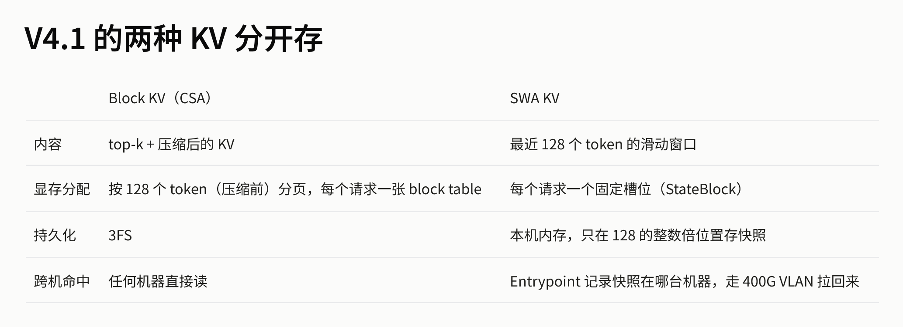
*Figure: Four-dimensional comparison of Block KV and SWA KV. Source: presentation slides, page 11*

Expanding on each dimension from the diagram:

| Dimension | Block KV (CSA) | SWA KV (Sliding Window Attention) |
|---|---|---|
| **Content** | KV after top-k selection and compression | Full window of the most recent 128 tokens |
| **GPU memory allocation** | Paged in 128-token (pre-compression) blocks; each request maintains a block table | One fixed slot (StateBlock) per request |
| **Persistence** | Written to 3FS, distributed across 12 storage nodes via 10+2 EC | Saved only in **local host memory**; snapshots taken only at integer multiples of 128 |
| **Cross-machine hit** | Any compute node can read directly | The Entrypoint must record which machine holds the snapshot; retrieved via the internal high-speed network |

The design logic of the two tiers follows a causal chain: Block KV is large in volume but has a high compression ratio and relatively low write frequency, making it suitable for persistence in 3FS to enable global sharing; SWA KV is small in volume but updated extremely frequently (sliding with every token), and writing it to 3FS would amplify write traffic and accelerate SSD wear—keeping it in local host memory is more economical.

Take a long-document conversation as an example: the Block KV generated by CSA compression of historical context is written to 3FS, and any compute node subsequently processing a continuation request for the same session can retrieve that Block KV via 11-way parallel reads. Meanwhile, the SWA KV corresponding to the most recent 128 tokens remains in the memory of whichever compute node last processed the request.

### Summary

Tiered storage effectively alleviates network write bandwidth pressure—SWA KV never leaves the local machine, while Block KV achieves low tail-latency reads via EC fan-out. However, this also introduces a new fragility: when the load balancer routes a request to a machine that does not hold the corresponding SWA snapshot, the local cache is missing. How does the system recover at constant cost?

---

## 3. State Recovery: SWA Slot Management and Constant-Cost Recomputation

### The state gap in cross-machine scheduling

Block KV is persisted in 3FS at a granularity of 128 tokens and can be reused across machines; however, **SWA (Sliding Window Attention)** snapshots are local state on each GPU and are very likely missing after a cross-machine transfer. If the system were to recompute the entire context from scratch to address this, the cost would grow linearly with sequence length—directly contradicting the original intent of EPD disaggregation's free scheduling.

The system must answer two sub-questions: **how to ensure SWA slots are always available**, and **how to rebuild them at constant cost when missing**.

### Resource isolation: statically reserved slots

GPU memory management for SWA snapshots follows a hard rule: **statically reserved at startup, never borrowed from or lent to Block KV**.

| Parameter | Meaning | Notes |
|------|------|------|
| `max_num_seqs` | Maximum concurrent sequences for the system | Determined by deployment configuration |
| Reserved slot count | `max_num_seqs × 1.2` | Approximately 20% headroom |
| 6 extra positions | MTP speculation failure rollback | Dedicated to DSpark variable-length speculative decoding |

The key guarantee of static isolation is: the scheduler must simultaneously acquire both an SWA slot and Block KV space when assigning a request—both are required. If either resource is insufficient, the request is queued rather than degraded, preventing the unpredictable latency that would result from runtime contention between the two cache types.

### Recovery flow: bounded replay

After a request is scheduled to a remote node, the system determines whether recomputation is needed via the following flow. The diagram below shows the complete decision and recovery path—pay attention to the branch conditions and fallback steps:

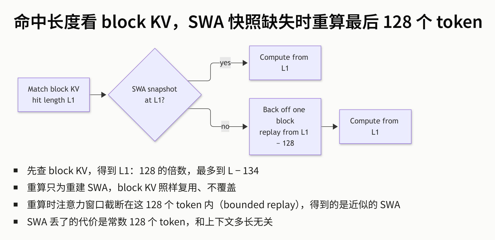
*Figure: Recovery decision and recomputation path when an SWA snapshot is missing. Source: presentation slides, page 13*

Walking through the flow step by step:

1. **Match Block KV → hit length L1**: The system first looks up the prefix cache on the target node, obtaining a hit length L1 at 128-token granularity.
2. **Branch decision—does an SWA snapshot exist at L1?** If yes, computation continues directly from position L1 with no additional overhead.
3. **No branch → Back off one block**: Fall back exactly one block (128 tokens) and replay the forward computation for those 128 tokens starting from L1 − 128, solely to rebuild the SWA snapshot. During this process, Block KV is reused as usual and is not overwritten.
4. **Compute from L1**: After SWA reconstruction is complete, normal computation resumes from L1.

The core causal logic: the SWA window width is itself 128 tokens, so replaying only the content within the window range is sufficient to obtain the necessary local attention state. **The recomputation volume is strictly bounded at 128 tokens, completely independent of the total context length.**

As an example, for a request with total length L = 100,000 tokens, the hit length must satisfy L1 ≤ L − 134 and be a multiple of 128. We can take L1 = 99,840 (780 × 128). If the SWA snapshot is missing at that position, the system falls back to 99,712 (99,840 − 128) and replays 128 tokens to restore an approximate local state; there is no need to reprocess the entire context.

### Boundary: approximation

Bounded replay has a known precision boundary: during recomputation, the attention window is truncated to within these 128 tokens. During normal inference, the SWA snapshot at position L1 is the result of progressive accumulation through continuously sliding windows; the recomputation path can only see information from the last 128 tokens, yielding an **approximate SWA state**. The presentation materials did not quantify the impact of this approximation on output quality, but from the architectural design it is clear that the team judged this truncation to be acceptable for practical generation quality.

**Summary**: Static reservation ensures that slots are always available, and bounded replay guarantees that the recovery cost when missing is a constant O(128). Together, they ensure that cross-machine scheduling is no longer constrained by SWA state gaps. With storage and state recovery mechanisms in place, the next barrier is physical: how to efficiently transfer matched Block KV data from host memory or the network into GPU memory.

---

## 4. Data Movement: GDR Direct-to-GPU-Memory Writes That Bypass CUDA

### Swap-in and forward computation compete for the same compute resources

Before the inference engine can begin forward computation, it must move the matched KV cache from host shared memory (host shm) into GPU memory (HBM). The intuitive approach is to overlap movement and computation in time so they do not block each other. In practice, however, most movement methods either invoke CUDA APIs that incur fixed overhead, or directly consume **SMs (Streaming Multiprocessors, the compute units on the GPU that actually execute kernels)**, slowing down concurrent forward kernels.

The core question: **how can swap-in operations overlap with forward computation without eroding compute capacity?**

### Where pipeline overlap occurs

First, consider the complete pipeline from request entry to execution. The following diagram marks two key overlaps: Fetch overlapping with queuing, and Swap-in overlapping with forward computation—the latter's SM consumption determines how effective the overlap actually is:

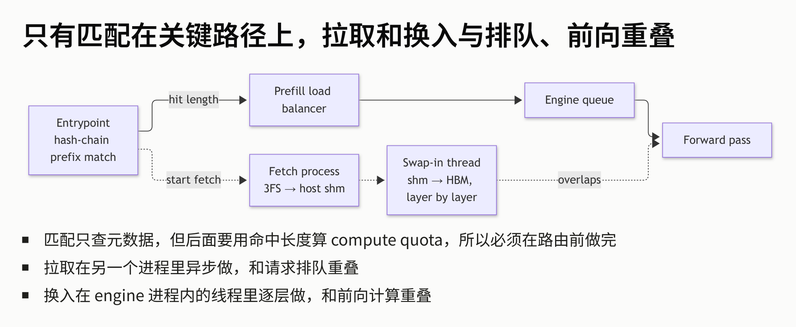
*Figure: Pipeline from request entry to forward computation. Dashed regions mark two overlaps: Fetch overlapping with Engine queue wait time, and Swap-in overlapping with Forward pass. Source: presentation slides, page 14*

The prefix matching at the entry point outputs the hit length, which is handed to the load balancer for routing decisions. The pipeline then splits into two parallel channels:

| Channel | Data path | Overlaps with |
|------|---------|-----------|
| **Fetch process** | 3FS → host shm (separate process) | Request queuing in Engine queue |
| **Swap-in thread** | shm → HBM (thread within the engine process, layer-by-layer transfer) | Forward pass |

The swap-in thread and forward kernels execute concurrently on the same GPU. **If the swap-in operation itself consumes SMs or blocks CUDA scheduling, the overlap is effectively nullified.** This is the criterion for choosing a data movement mechanism.

### Comparison of four data movement mechanisms

Each KV block is relatively small and scattered in memory. The presentation materials listed four approaches:

| Approach | Consumes SMs? | Goes through CUDA? | Primary cost |
|------|----------|--------------|---------|
| Copy engine, one-by-one | No | Yes, one `cudaMemcpyAsync` call per block | Independent DMA per block, high fixed overhead |
| Copy engine, batched | No | Yes, `cudaMemcpyBatchAsync` (CUDA 12.8+) | Submits a batch at once, but large batches can block scheduling |
| SM gather | **Yes** | Yes, kernel shares queue with forward pass | Directly preempts compute resources |
| **GDR** | No | **No** | NIC initiates RDMA write, completely bypasses CUDA |

**GDR (GPU Direct RDMA, a technology where the NIC initiates a remote memory write directly to GPU memory)** is the only approach that does not go through the CUDA stack. The swap-in thread needs no CUDA API calls whatsoever; the data movement is carried out independently by the NIC hardware.

### Measured data: the gap between 0.05 μs and 36% slowdown

The following diagram directly compares the per-operation overhead and impact on concurrent computation for all four approaches—the red bars in the right chart reveal the severity of the problem:

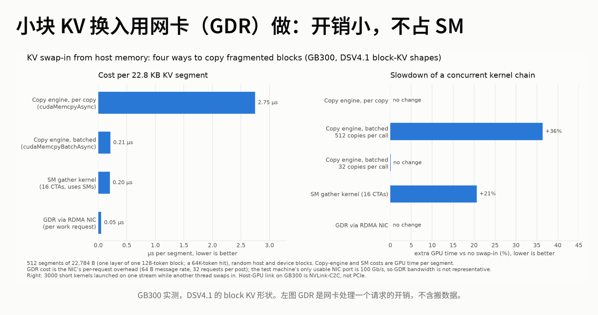
*Figure: Left chart shows per-KV-segment processing overhead (μs); right chart shows the slowdown percentage of concurrent kernel chains. Available NIC port bandwidth is 100 Gb/s. Source: presentation slides, page 16*

**Left chart—per-operation overhead.** Copy engine one-by-one tops the list at 2.75 μs; batched copy and SM gather drop to approximately 0.21 μs and 0.20 μs respectively, while GDR is only **0.05 μs**. Note: the 0.05 μs here is solely the NIC's control-plane overhead for processing a single request and does not include actual data transfer time.

**Right chart—impact on concurrent kernel chains (the critical metric).** Batched copy engine causes a **+36%** slowdown on concurrent kernel chains (red bar); SM gather causes a **+21%** slowdown; GDR causes **0%** slowdown on concurrent kernels.

The causal relationship is clear: the first three approaches all go through the CUDA scheduling path—batched copy does not consume SMs, but the copy engine shares GPU-internal scheduling resources with compute kernels; SM gather is even more direct, as it is itself a kernel competing with forward kernels for the same set of SMs. GDR's data movement is entirely executed by the NIC hardware; on the GPU side, there are no API calls and no DMA engine occupation, allowing the compute engine to run at full capacity.

### Boundary conditions

- The performance figures above are from a specific test environment described in the presentation materials, with available NIC port bandwidth of 100 Gb/s.
- The presentation materials did not provide throughput ceilings under full bandwidth conditions.
- GDR's advantage is particularly pronounced in small, scattered copy scenarios (extremely low control-plane overhead); for large contiguous copies, the copy engine's throughput is not necessarily inferior.

**Summary**: GDR initiates RDMA writes directly from the NIC to GPU memory, completely removing the swap-in operation from the CUDA scheduling chain and fully releasing SM resources to compute kernels. With data movement no longer a bottleneck, whether compute capacity can be fully utilized depends on the parallelism strategy of the compute layer itself—and Prefill and Decode have diametrically opposed parallelism granularity requirements.

---

## 5. Parallelism Divergence: EP Strategies Under Compute vs. Memory Bandwidth Bottlenecks

### Same model, two different bottlenecks

Prefill processes all of the user's input tokens in one pass, with dense matrix multiplications, making it **compute bound**; Decode produces only one token per step, with light computation but repeated reads of model weights and KV Cache, making it **memory bound**. These two physical bottlenecks point to opposite resource requirements: the former needs to saturate every GPU's compute capacity, while the latter needs to exhaust every GPU's memory bandwidth. Applying the same parallelism strategy to both inevitably wastes one side severely.

### The logic behind EP dimension selection

**EP (Expert Parallelism)** distributes an MoE model's experts across multiple GPUs. The larger the EP degree, the fewer experts each GPU hosts, the more GPU memory is freed, but the higher the inter-GPU communication overhead.

| Phase | Bottleneck type | EP choice | Rationale |
|------|---------|---------|------|
| Prefill | Compute bound | Small EP (e.g., EP4/EP8) | On-card compute is already saturated; increasing EP only adds communication without improving total throughput |
| Decode | Bandwidth bound | Wide-EP (e.g., EP64) | Trades communication for bandwidth; each GPU frees memory to accommodate a larger batch and more redundant experts |

For Prefill: when a single GPU's compute units are already fully occupied, expanding EP from 4 to 8 does not improve total throughput—the additional GPUs simply receive fewer experts but cannot speed up data movement, which is not the bottleneck. The strategy is "use the smallest EP possible and dedicate the remaining GPUs to more DP replicas."

For Decode: the computation per step is minimal, leaving GPU compute largely idle, with the bottleneck on memory read speed. Wide-EP distributes experts across more GPUs, so each GPU hosts fewer weights and has more available memory, which in turn allows a larger batch to amortize memory access overhead. The freed memory can also host redundant experts to assist with load balancing.

### Measured throughput curves: Wide-EP's throughput advantage

The following diagram shows the performance difference between two EP configurations on identical hardware during the Decode phase, clearly illustrating the throughput improvement from Wide-EP:

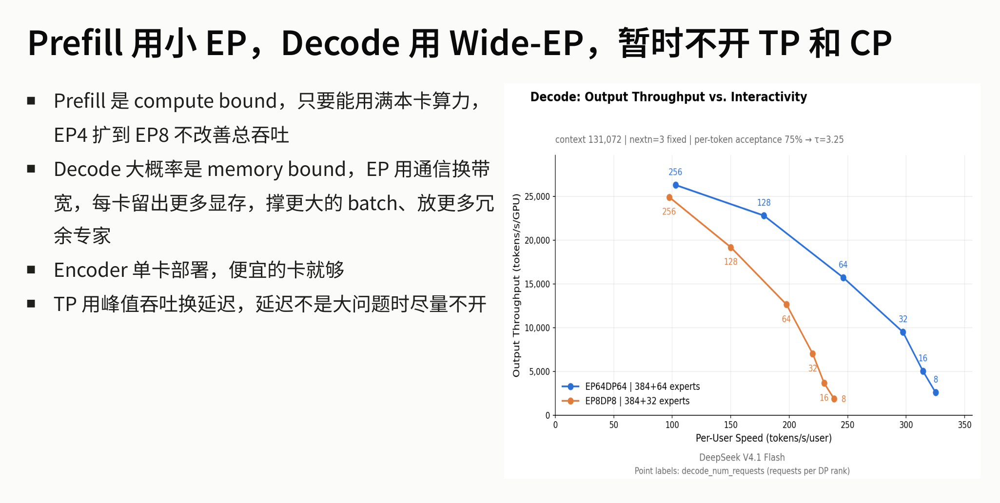
*Figure: Decode phase throughput curves. X-axis: Per-User Speed (tokens/s/user); Y-axis: Output Throughput (tokens/s/GPU). Blue curve: EP64DP64 | 384+64 experts; orange curve: EP8DP8 | 384+32 experts. Numbers next to data points indicate the number of concurrent requests per DP rank. Experimental conditions: context 131,072 | nextn=3 fixed | per-token acceptance 75% → τ=3.25. Source: presentation slides, page 4*

Three key takeaways:

1. **The blue curve (EP64) is consistently above the orange curve (EP8)**: At the same Per-User Speed, the Wide-EP configuration achieves higher per-GPU output throughput—precisely the payoff of "trading communication for bandwidth," as distributing experts frees more GPU memory per card, enabling more concurrent requests to be scheduled.
2. **Both curves decline as Per-User Speed increases**: Providing higher generation speed to a single user requires reducing the concurrent batch size, which lowers total throughput. The two curves decline at similar slopes, indicating that communication overhead does not increase dramatically with user speed requirements.
3. **The EP64 configuration mounts an additional 64 redundant experts (384+64 vs. 384+32)**: The GPU memory freed by Wide-EP is used not only to enlarge the batch but also to host more expert replicas, providing scheduling headroom for subsequent load balancing.

> **Data applicability**: The throughput advantage described above was established under strict experimental conditions including context length 131,072, nextn=3, and per-token acceptance 75%; the numbers may differ significantly under other scenarios.

### Why pipeline parallelism is not used

**PP (Pipeline Parallelism)** partitions the model by layers, with each stage flowing serially through different GPUs. However, V4.1 has two structural properties that make PP nearly infeasible (presenter's view, based on V4.1 architectural characteristics):

- **Cross-layer shared KV Cache**: Different layers' attention mechanisms share the same cache; if partitioned by layer across different nodes, this cache would need to be repeatedly synchronized between nodes, incurring prohibitive communication costs.
- **Non-uniform layer structures**: The training outcome results in differing parameter configurations across layers, precluding the uniform layer partitioning possible with standard Transformers.

Consequently, the system design ultimately chose EP as the core parallelism dimension.

### Summary

Prefill uses small EP to maximize compute utilization; Decode uses Wide-EP to trade for memory bandwidth—this is a direct mapping of the two phases' divergent physical resource demands. However, once Wide-EP distributes hundreds of experts across many GPUs, the request popularity of different experts is inherently uneven. The time for a single compute step is determined by the most heavily loaded GPU (the barrel effect), necessitating a dedicated load-balancing mechanism for peak shaving.

---

## 6. Expert Balancing: EPLB's Rearrangement and Redundancy-Based Peak Shaving

### The long-tail bottleneck: one GPU stalls the entire step

The MoE architecture splits the feed-forward layer into hundreds of experts distributed across multiple GPUs. At each inference step, the router selects a few experts for each token, but tokens do not land on all experts uniformly—a few "hot" experts may receive far more load than average. Since all GPUs in the same compute step must wait for the slowest one to finish before proceeding to the next stage, a single overloaded GPU leaves all others idling.

**EPLB (Expert-Parallel Load Balancer)** is designed to eliminate this long-tail spike. Its core objective is not to make all GPUs' loads "equal" but to **shave the peak**—bringing down the load on the slowest GPU in each step. Two complementary techniques are used:

| Technique | Principle | Cost |
|------|------|------|
| **Rearrangement** | Reassign experts to GPUs based on observed expert loads | No additional GPU memory; can be executed statically or dynamically |
| **Redundancy** | Replicate overloaded experts' weights onto multiple GPUs to spread tokens | Consumes extra GPU memory; requires additional weight reads during Decode |

### Bin-packing algorithm: Best Fit Decreasing

The rearrangement step uses the classic **Best Fit Decreasing** bin-packing strategy: sort experts by load in descending order and sequentially place each into the GPU bin that has the lowest peak load and still has an open slot. The following diagram shows the load change before and after rearrangement—note the reduction in the slowest GPU's load:

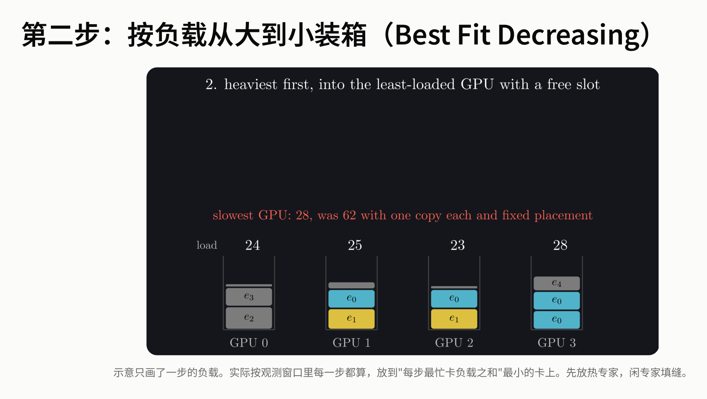
*Figure: Best Fit Decreasing bin-packing process—hot experts are assigned first, and the slowest GPU's load drops from 62 to 28. Source: presentation slides, page 23*

The four bins in the diagram represent GPUs 0–3, with colored blocks representing different experts. Under fixed placement, the slowest GPU's load reaches 62; after rearrangement, the four GPUs carry loads of 28, 25, 24, and 23 respectively, compressing the peak by more than half. The diagram shows only a single-step snapshot; the actual implementation performs this computation on statistics from an observation window to globally minimize the sum of peaks.

### Replica routing: prime-number shuffling with zero communication

When an expert has $c_e$ replicas, each GPU must independently decide which replica to send a token to—and this must be accomplished **without any inter-GPU communication**. EPLB provides the following formula:

$$k = (\text{rank} + i \times 23333) \bmod c_e$$

where `rank` is the current GPU's ID, `i` is the token's index within the current batch on this GPU, and 23333 is a prime number. The following diagram shows how this routing mechanism distributes tokens across different replicas:

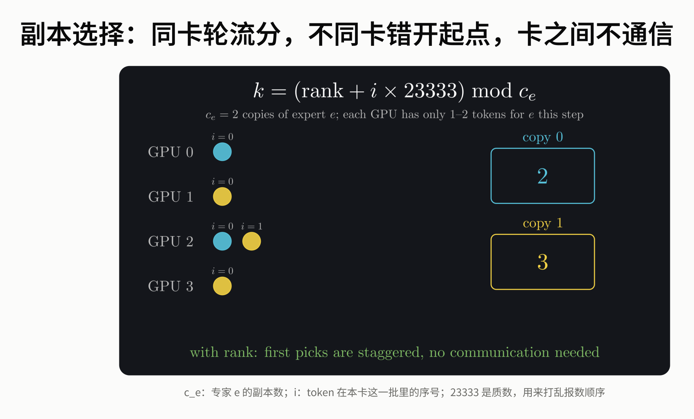
*Figure: Replica selection formula and four-GPU allocation illustration; colored circles represent tokens routed to copy 0 or copy 1. Source: presentation slides, page 19*

Why a prime number? The key is **staggering starting points**. If a composite number were used, multiple GPUs would easily land on the same replica sequence under the modulo operation, creating new load concentrations. The combination of a prime with any `rank` yields a more uniform hash distribution under modulo, causing different GPUs to naturally spread tokens across different replicas without any synchronization or negotiation. Within a single GPU, round-robin assignment further evens out the distribution.

### Measured ablation: nearly all gains come from rearrangement

End-to-end measurements were conducted at EP8/DP8 scale. The following diagram shows the throughput changes and load-balancing metrics under different configuration combinations:

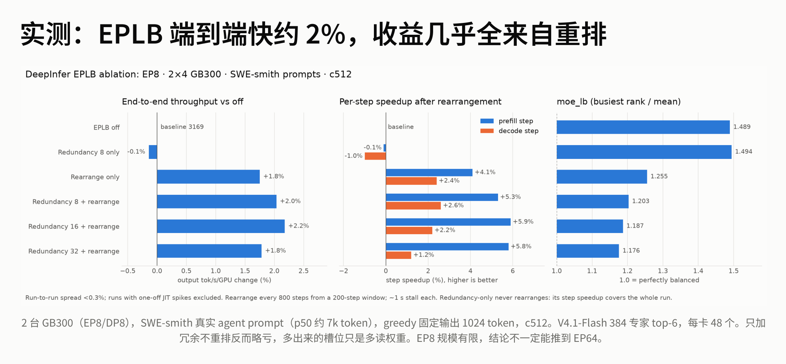
*Figure: Three sets of bar charts showing throughput change, per-step speedup, and the ratio of the busiest GPU to the average. Source: presentation slides, page 24*

Key comparisons from the bar charts:

| Configuration | End-to-end throughput change | moe_lb (busiest rank / mean) |
|------|:-:|:-:|
| EPLB off | Baseline | 1.489 |
| Redundancy 8 only | −0.1% | 1.494 |
| Rearrangement only | +1.8% | 1.255 |
| Redundancy 8 + Rearrangement | +2.0% | 1.203 |

Two conclusions are noteworthy:

- **Adding redundancy without rearrangement actually causes a slight throughput decrease.** The reason is that the additional replica slots only increase weight-reading overhead without improving the distribution of experts across GPUs.
- **Nearly all gains come from rearrangement**, and the incremental benefit of redundancy on top of rearrangement is limited (from +1.8% to +2.0%).

> **Boundary warning**: The presenter explicitly noted that the above data was obtained at EP8 scale and cannot be directly extrapolated to EP64 scenarios—at larger scales, both expert distribution characteristics and communication topology change, and the marginal benefit of redundancy may differ.

**Summary**: EPLB uses bin-packing rearrangement to dramatically reduce the peak load on the slowest GPU, supplemented by a small number of redundant replicas for further peak shaving. However, after eliminating MoE layer imbalance, Attention computation across GPUs within a DP group still varies before entering all-to-all communication—this introduces the balancing problem along the data-parallelism dimension.

---

## 7. Data Balancing: DPLB Eliminates the Barrel Effect Within DP Groups

### Hidden waits at every layer

EPLB addresses expert popularity skew, but system throughput still cannot approach the theoretical limit. The root cause lies in synchronization barriers within the DP group: before each Transformer layer enters MoE's all-to-all communication, all DP ranks must complete their respective Attention computations—the slowest GPU dictates the global pace. The following diagram reveals the specific manifestation of this waiting—pay attention to the area of the red regions:

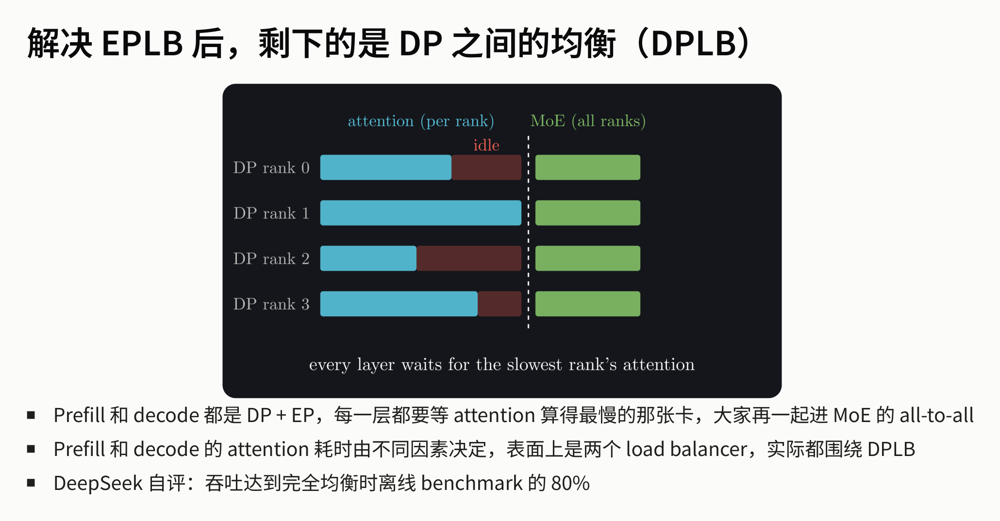
*Figure: Per-layer time breakdown for 4 DP ranks. Blue bars represent attention, green bars represent MoE, and red regions represent idle waiting. The dashed line marks the global synchronization point: all ranks must wait for the slowest DP rank to finish before entering all-to-all. Source: presentation slides, page 25*

The red idle regions are the critical signal: some DP ranks finish their Attention computation earlier but must idle-wait for the slowest rank to align. This barrel effect occurs at every layer; the more layers, the greater the cumulative waste.

**DPLB (Data-Parallel Load Balancer)** aims to shrink these red regions—making each rank's Attention computation time as closely aligned as possible. However, the factors dominating Attention computation time differ between Prefill and Decode, requiring two distinct scheduling strategies.

### Prefill: bucketing by context length + compute quota pull

**Bucketing.** The relationship between Attention and context length is non-linear: processing 1K tokens with a long context takes far longer than with a short context. To address this, Prefill divides requests into 4 buckets by context length, making the Attention computation time of requests within the same bucket more predictable and enabling more precise balancing by the scheduler. Since all nodes share the 3FS pooled storage, migrating requests between buckets does not reduce cache hit rates.

**Pulling.** Each inference engine maintains a cost estimator that computes a **compute quota**, which constrains Attention computation time rather than overall step time. Engines actively pull requests from the corresponding bucket's queue based on remaining quota (pull-based), without cache awareness. Within the DP group, requests are dispatched according to the principle of least consumed quota.

**Batch formation.** The scheduler forms batches by time budget—for example, targeting 300 ms—rather than a fixed chunk size. Once formed, an all-reduce min is performed within the DP group to tighten the allocation, ensuring no single rank is assigned computation far exceeding the average.

### Decode: dual-metric balancing

The Decode phase does not use bucketing but faces a different contradiction: **request count** determines GEMM operator time (the batch dimension), while **total KV length** determines Attention computation time. Looking at either metric alone cannot achieve true balance. The following diagram shows how DPLB balances both metrics simultaneously during the Decode phase:

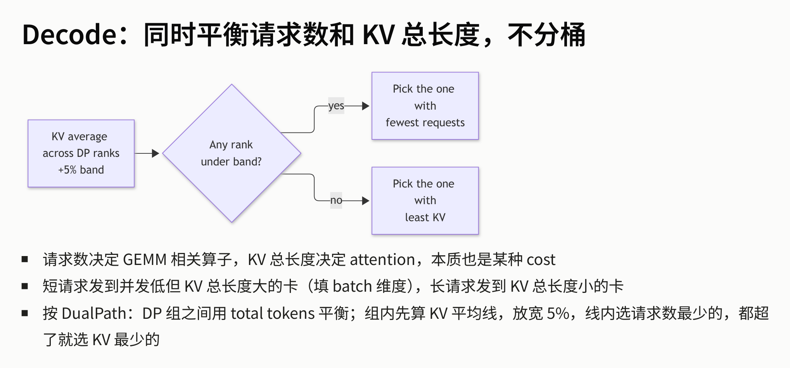
*Figure: Scheduling flow diagram. First, compute the KV average across all DP ranks and add a 5% tolerance band; within the band, select the rank with the fewest requests; if all ranks exceed the band, select the rank with the least KV. Source: presentation slides, page 29*

The flow breaks down into three steps:

1. **Compute baseline**: Take the average total KV length across all DP ranks and add 5% to form the tolerance band's upper bound.
2. **Prioritize request count within the band**: If there are ranks whose total KV length is below the tolerance band's upper bound, select the one with the fewest requests—at this point, the rank's Attention overhead is still manageable, and the bottleneck is on the GEMM side.
3. **If all exceed the band, select the lowest KV**: When all ranks exceed the band, Attention has become the global bottleneck, so select the rank with the least KV to compress the peak.

Intuitively: short requests go to GPUs with low concurrency but high total KV length (filling the batch dimension), while long requests go to GPUs with low total KV length (controlling the Attention dimension), with both resources alternately filled.

### Effectiveness and boundaries

The system self-assessment on slide 28 states: after two-tier balancing, throughput reaches approximately **80%** of the offline benchmark under perfectly balanced conditions. This is a specific system result from the presentation; the materials did not provide a complete breakdown of the remaining gap, and the entire loss cannot be attributed solely to request fluctuations or scheduling latency.

**Summary**: EPLB addresses the static allocation problem of "which experts go on which GPUs," while DPLB addresses the dynamic scheduling problem of "which requests go to which DP rank." Together, they extend from the MoE expert level to the Attention level, forming a complete scheduling closed loop. Once the underlying storage, data movement, parallelism, and load balancing are all pushed to their limits, the only remaining lever for squeezing throughput is to reduce the absolute number of generation steps at the algorithmic level.

---

## 8. Throughput Maximization: DSpark Dynamic Variable-Length Speculative Decoding

### The cost reversal of fixed verification length at full load

The basic idea of Speculative Decoding is: use an auxiliary head to quickly draft several candidate tokens, then have the large model verify them all in one pass, thereby reducing the number of autoregressive steps. A common approach is to draft a fixed 5 tokens per step. In low-concurrency scenarios where GPU compute is plentiful, the extra verification is nearly "free"; but when the system enters full-load operation with large batches, a contradiction emerges—every additional verification of a low-acceptance-rate token steals compute from other requests, actually decreasing throughput.

### DSpark's dynamic decision loop

**DSpark (DeepSeek's variable-length verification speculative decoding technique)** introduces two information channels to break the rigidity of fixed lengths:

1. **Online signal — Confidence Head**: A lightweight prediction head that outputs an acceptance-rate estimate for each draft token. Tokens with high acceptance rates are worth verifying; those with low rates are truncated early.
2. **Offline signal — throughput Profile curve**: The actual throughput under combinations of "different verification lengths × different concurrency levels" is pre-measured on the target hardware, forming a lookup table. At runtime, the system queries this table based on the current concurrency to obtain the optimal mapping between verification length and throughput.

When the two channels converge, the system dynamically decides, per request and per step, how many tokens to verify this time.

### Gain curve: higher concurrency yields greater benefit

The following diagram shows DSpark's throughput change relative to fixed 5-draft verification at different concurrency levels—note the upward trend of the curve in the high-concurrency region:

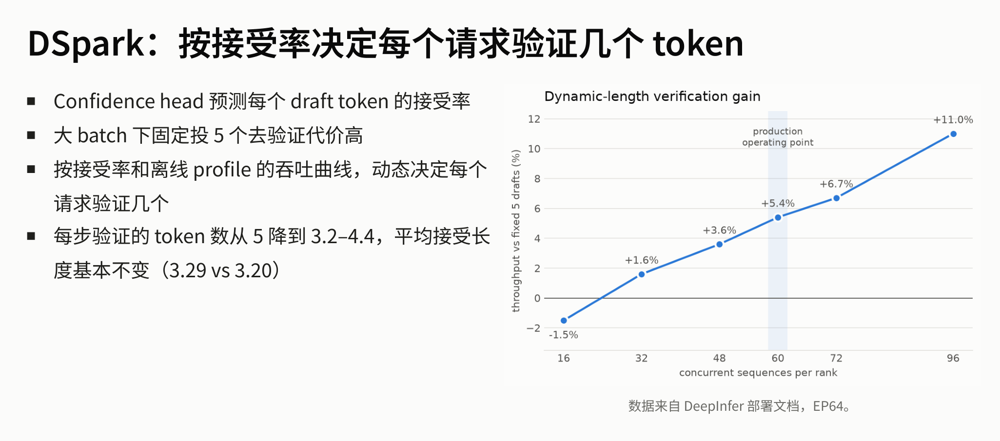
*Figure: DSpark's throughput gain at different concurrent sequence counts (baseline: fixed 5-draft verification), EP64 environment. Source: presentation slides, page 31*

Key elements in the diagram:

- **X-axis**: Number of concurrent sequences per rank, from 16 to 96.
- **Y-axis**: Throughput gain percentage relative to fixed 5-draft verification.
- **Trend**: At low concurrency (16), the gain is approximately −1.5%—GPU compute is ample, and reducing verification length actually forfeits hit opportunities; as concurrency increases, the gain climbs steadily to +11.0% (concurrency 96), where the compute freed by truncating low-probability drafts is immediately utilized by other requests.
- **Production operating point**: Slide 31 marks this at approximately 60 concurrent sequences, corresponding to a gain of **+5.4%**; the chart notes that data comes from DeepInfer deployment documentation, under EP64 test conditions.

The core causal chain:

> Confidence Head predicts acceptance rate → jointly decides with the offline Profile curve → verification length dynamically drops from a fixed 5 to **3.2–4.4** → wasteful verification of rejected tokens is cut → freed compute serves more concurrent requests → throughput increases

Key data comparison (EP64 environment, data from DeepInfer deployment documentation):

| Metric | Fixed 5-draft | DSpark dynamic |
|------|------------|------------|
| Tokens verified per step | 5 | 3.2–4.4 |
| Average acceptance length | 3.29 | 3.20 |

The average acceptance length drops only marginally from 3.29 to 3.20, essentially lossless—the tokens truncated are primarily the tail-end draft tokens "destined for rejection," while tokens that would actually be accepted are not lost.

### Boundaries and limitations

- **Generalizability of the offline curve**: The presenter inferred during the Q&A that DSpark's offline Profile is highly dependent on the specific model architecture and hardware configuration; re-measurement is required when switching models or GPU types.
- **Negative effect at low concurrency**: The curve shows a negative gain at concurrency 16; dynamic truncation should not be enabled in scenarios with substantial GPU idle time.
- The presentation materials did not provide details on the additional latency overhead of the Confidence Head or its training methodology.

**Summary**: From 3FS pooled storage to DSpark dynamic speculative decoding, a rigorous causal chain emerges—storage decoupling unlocks routing flexibility, GDR reclaims compute, EPLB and DPLB eliminate waiting, and DSpark compresses step counts. Each optimization layer creates headroom for the next.

---

## Conclusion

From the lowest storage layer to the highest algorithmic layer, the optimization of the DeepSeek V4.1 inference system exhibits a clear layer-by-layer causal structure. Below are the core conclusions that run throughout this article:

1. **Separating storage from compute is the physical prerequisite for breaking routing rigidity.** 3FS pooled storage ensures the KV Cache is no longer bound to specific compute nodes, allowing Prefill routing to completely abandon cache-aware strategies and degenerate into a pure load-balancing problem.

2. **Tiered persistence balances network bandwidth and SSD endurance.** Block KV is written to 3FS via 10+2 erasure coding for global sharing, while SWA KV remains in local host memory to avoid the wear caused by frequent writes. The two types' resources are statically isolated and never borrowed from each other.

3. **The cost of cross-machine state recovery can be constant.** When an SWA snapshot is missing, only the last 128 tokens need to be recomputed (bounded replay), independent of total context length, making free scheduling viable in practice.

4. **Maximum throughput stems from completely freeing SM compute capacity.** GDR bypasses the entire CUDA scheduling path, causing zero slowdown of concurrent kernels from swap-in operations, making pipeline overlap truly effective.

5. **Prefill and Decode must adopt differentiated parallelism dimensions.** The former is compute-bound and uses small EP; the latter is bandwidth-bound and uses Wide-EP; V4.1's cross-layer shared KV Cache makes pipeline parallelism inherently unfriendly.

6. **System-level load balancing requires layer-by-layer peak shaving from the expert dimension to the data-parallelism dimension.** EPLB uses bin-packing rearrangement to smooth out expert popularity differences (measured gains come primarily from rearrangement rather than redundancy), and DPLB further balances Attention computation time within DP groups.

7. **Speculative decoding under high concurrency requires dynamic adjustment of verification length.** DSpark combines online acceptance-rate prediction with offline throughput curves, reducing the per-step verification count from a fixed 5 to 3.2–4.4, achieving approximately 5.4% throughput gain at the production operating point shown in the slides (EP64 conditions).

### Limitations and applicability

- The above architecture is heavily dependent on high-specification, purpose-built hardware (e.g., 20 × 30.73 TB SSDs and 40 GB/s read throughput per storage node); ordinary shared-nothing clusters or small-to-medium-scale deployments cannot directly replicate it.
- EPLB's end-to-end gain of approximately 2% was obtained at EP8/DP8 scale; the presenter explicitly noted this cannot necessarily be extrapolated to EP64 scale.
- DSpark's offline Profile curve is tied to a specific model and hardware, limiting generalizability; enabling dynamic truncation under low concurrency actually reduces throughput.
- After two-tier balancing, system throughput reaches approximately 80% of the perfectly balanced offline benchmark; the specific composition of the remaining loss was not further broken down in the presentation materials.
