# DeepInfer 推理架构解析：EPD 分离、KV 池化与负载均衡

> **图解 EPD 架构、3FS 存储与双层负载均衡机制**

**原视频**：[拆解 DeepSeek 生产推理架构：从 DeepInfer 源码到技术报告](https://www.bilibili.com/video/BV1cgHP6BEp1) · **配套资料**：[DeepInfer 推理系统拆解课件](https://drive.google.com/file/d/1ZKrCY7Q_RAhPXJ1Qy0WGxWClWIEy-wua/view)

大模型推理系统的吞吐瓶颈从来不只卡在单个环节。当 KV 缓存被锁死在本地显存时，路由器失去调度自由度；当数据搬运侵占计算单元时，流水线重叠形同虚设；当专家负载参差不齐时，一张卡的过载足以拖慢全局。DeepSeek V4.1 的推理系统沿着这条因果链逐层击破——从池化存储解耦状态，到 GDR 直写释放算力，再到 EPLB 与 DPLB 双层削峰消除等待。本文依据本次直播与配套课件，按真实依赖顺序完整拆解这套系统的设计逻辑与工程取舍。

**适读人群**：大模型推理系统工程师、AI 基础设施架构师

**前置知识**：

- 大模型推理的 Prefill / Decode 两阶段划分
- MoE（Mixture of Experts，混合专家模型）的基本工作原理
- EP（Expert Parallelism，专家并行）、DP（Data Parallelism，数据并行）、TP（Tensor Parallelism，张量并行）等并行策略的含义

**阅读目标**：

1. 理解 EPD 分离架构与池化存储之间的必然联系
2. 掌握 GDR 显存直写在推理数据搬运中的性能优势
3. 深入解析 EPLB 与 DPLB 如何分层解决长尾效应

---

## 一、架构破局：从缓存感知路由到 EPD 分离

### 路由为什么被缓存"绑架"

在典型的大模型推理集群中，Router（路由器）需要决定每条用户请求发往哪个 GPU 节点。最直觉的做法是 **cache aware（缓存感知路由，将请求发送到已持有其前缀缓存的节点）**：检查哪个节点恰好持有该请求的历史 KV Cache，就把请求发到那里，省去重复计算。

这一策略在 **share nothing（无共享架构，各节点拥有独立存储）** 环境下几乎是唯一选择——KV Cache 只存在本地显存，换一台机器就意味着全部重算。由此产生一个工程矛盾：

| 维度 | cache aware 路由 | 理想的纯负载路由 |
|------|-----------------|----------------|
| 调度自由度 | 受缓存位置约束，可能把请求发往已繁忙节点 | 直接发往最闲节点 |
| 负载均衡 | 热点 key 导致局部过载 | 天然均匀 |
| 前提条件 | 无额外存储要求 | 需要全局可访问的 KV Cache 池 |

开源世界长期缺乏可直接部署的池化 KV 存储方案，Router 不得不在"命中缓存"和"均匀负载"之间反复取舍——这正是多数开源推理系统路由策略僵化的根源。

### EPD 分离架构如何破局

DeepSeek V4.1 给出的回答是 **EPD 分离架构**——将推理流水线拆分为三个独立阶段：

- **E — Vision Encoder**：处理多模态输入的编码
- **P — Prefill**：一次性计算所有输入 token 的 KV Cache
- **D — Decode**：逐 token 自回归生成

三者各自拥有独立的负载均衡器，底层通过一个外部池化存储 **3FS（DeepSeek 自研的池化 KV 存储系统）** 共享 KV Cache。下图展示了这一架构的全景，重点在于理解请求流向与底层存储如何将两个计算阶段串联起来：

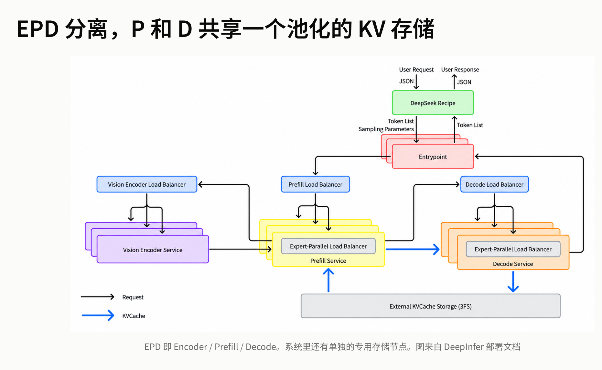
*图注：EPD 分离架构与池化 KV 存储。来源：演讲 PPT，第 3 页*

图中关键路径解读：

1. **Entrypoint**（图顶部入口）接收用户请求，随即将其拆分到三条并行通道。
2. **三个 Load Balancer** 分别面向 Vision Encoder Service、Prefill Service、Decode Service，各自独立做调度决策。
3. **Prefill Service 与 Decode Service 内部**各自包含 EPLB（Expert-Parallel Load Balancer，专家并行负载均衡），用于 MoE 专家层的二次均衡——其原理将在第六节详述。
4. **图底部 External KVCache Storage (3FS)** 同时连接 Prefill 和 Decode，双向箭头表明两阶段均可读写同一份 KV Cache。

第 4 点构成了整个架构的核心枢纽：Prefill 写入的 KV Cache 不再留在本地显存，而是落入 3FS 池；Decode 启动时直接从 3FS 拉取，无需关心 Prefill 在哪台机器上执行。

### 池化存储释放路由自由度

逻辑链条可以归纳为：

> **3FS 池化存储 → KV Cache 与计算节点解耦 → Prefill 路由无需 cache aware → 调度退化为纯负载均衡问题**

以一个三节点集群为例：假设 Prefill 节点 A、B、C，节点 A 恰好缓存了用户 X 的历史前缀。

| 步骤 | cache aware 路由（传统） | EPD + 3FS 路由（V4.1） |
|------|------------------------|-------------------------------|
| 1. 用户 X 新请求到达 | Router 查表 → 发往节点 A | Load Balancer 查负载 → A 繁忙，发往节点 C |
| 2. Prefill 执行 | A 利用本地缓存，跳过部分计算 | C 全量计算，KV Cache 写入 3FS |
| 3. Decode 阶段 | 仍在 A 本地完成 | 任一空闲 Decode 节点从 3FS 读取后执行 |

传统方案在步骤 1 看似高效，但当大量请求的前缀集中在少数节点时，热点过载将抵消缓存收益。EPD 方案则始终保持全局负载均匀。

### 边界与小结

此架构的成立有一项刚性前提：**3FS 必须提供足够高的带宽和足够低的延迟**，使远端缓存读取的代价在目标延迟和吞吐预算内可接受。对于普通 share nothing 集群，缺少等效的池化存储底座，直接复刻 EPD 分离会导致 KV Cache 搬运成为新瓶颈。

EPD 架构的灵活性完全建立在 3FS 池化存储之上——接下来需要拆解这个存储底座的硬件规格与分级机制。

---

## 二、存储底座：3FS 硬件规格与 KV 分级持久化

### 吞吐与寿命的拉锯

KV Cache 池化到共享存储后，所有用户的每一次写入都无法省略——缓存不能"挑着存"。底层 SSD 要持续承接高写入流量，读端则需支撑数十 GB/s 级带宽才能满足在线推理的延迟要求。在吞吐与设备寿命之间找到平衡，是 3FS 存储层面临的核心矛盾。

### 单台存储机的硬件规格

据演讲者基于公开信息的推断，3FS 存储机单台配备 **20 块 30.73 TB SSD**，裸容量接近 **600 TB**；系统对单台的吞吐要求为**读 40 GB/s、写 5 GB/s**。读写比约 8∶1 的不对称特征说明：写虽然绝对值较低，但因为全量用户 KV 无差别落盘，累积写入量极大，**SSD 寿命成为主要工程瓶颈**。演讲材料未给出具体的 DWPD（Drive Writes Per Day）估算或更换周期数据。

> **数据适用条件**：以上硬件规格为演讲者推断值，基于公开的 3FS 存储机配置信息估算，非官方确认的精确数字。

### 纠删码读扇出：一次请求打到 11 台机器

KV 缓存写入 3FS 时采用 **10+2 EC（Erasure Coding，纠删码）**：将数据切为 10 个数据分片和 2 个校验分片，任意丢失 2 片仍可恢复。12 个分片被放置到 12 台不同机器上。

读取时系统直接向其中 **11 台**发起并行请求——只需最快返回的 10 份即可解码。多发一份的策略借鉴了"尾延迟对冲"思想：单节点偶发的慢响应不会拖慢整体读延迟。3FS 本身主要负责 **placement（分片放置）**，确保每台机器承担的分片数量均衡。

### 分级持久化：Block KV 与 SWA KV

并非所有 KV 缓存都适合走网络写入 3FS。V4.1 将 KV 缓存按注意力机制类型拆分为两级。下图以表格形式对比了两种缓存在内容、显存分配、持久化方式和跨机命中四个维度的差异：

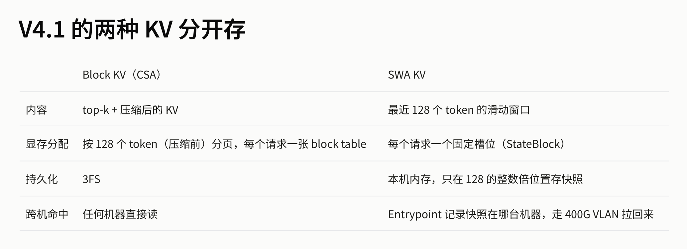
*图注：Block KV 与 SWA KV 四维对比。来源：演讲 PPT，第 11 页*

将图中各维度展开说明：

| 维度 | Block KV（CSA） | SWA KV（Sliding Window Attention，滑动窗口注意力） |
|---|---|---|
| **内容** | 经 top-k 筛选与压缩后的 KV | 最近 128 个 token 的完整窗口 |
| **显存分配** | 按 128 token（压缩前）分页，每请求维护一张 block table | 每请求一个固定槽位（StateBlock） |
| **持久化** | 写入 3FS，通过 10+2 EC 分布到 12 台存储机 | 仅保存在**本机内存**，且只在 128 的整数倍位置做快照 |
| **跨机命中** | 任何计算节点均可直接读取 | 需由 Entrypoint 记录快照所在机器，通过内部高速网络拉回 |

两级的设计逻辑遵循一条因果链：Block KV 体量大但压缩比高、写入频率相对低，适合持久化到 3FS 以实现全局共享；SWA KV 体量小但更新极其频繁（每个 token 都在滑动），写 3FS 会放大写流量并加剧 SSD 磨损，留在本机内存更经济。

以一段长文档对话为例：历史上下文经 CSA 压缩后生成的 Block KV 被写入 3FS，后续任何计算节点处理同一会话的续写请求时，均可通过 11 路并行读取获得该 Block KV。而最近 128 个 token 对应的 SWA KV 则留在最后一次处理该请求的那台计算节点的内存中。

### 小结

分级存储有效缓解了网络写带宽压力——SWA KV 不出本机，Block KV 借助 EC 扇出获得低尾延迟读。但这也引入一项新的脆弱性：当负载均衡器将请求路由到一台并不持有对应 SWA 快照的机器时，本地缓存即缺失。系统如何以常数代价完成恢复？

---

## 三、状态恢复：SWA 槽位管理与常数代价重算

### 跨机调度的状态断层

Block KV 以 128 token 为粒度持久化在 3FS 上，可跨机复用；但 **SWA（Sliding Window Attention，滑动窗口注意力）** 的快照是每张卡上的本地状态，跨机后大概率缺失。如果为此把整个上下文从头重算，代价会随序列长度线性增长——这与 EPD 分离自由调度的初衷直接矛盾。

系统需要回答两个子问题：**如何保证 SWA 槽位始终可用**，以及**缺失时如何以常数代价重建**。

### 资源隔离：静态预留槽位

SWA 快照的显存管理遵循一条硬性原则：**启动时静态预留，绝不与 Block KV 互相挪用**。

| 参数 | 含义 | 说明 |
|------|------|------|
| `max_num_seqs` | 系统最大并发序列数 | 由部署配置决定 |
| 预留槽位数 | `max_num_seqs × 1.2` | 多出约 20% 的余量 |
| 额外 6 个位置 | MTP 投机失败回退 | 专供 DSpark 变长投机解码使用 |

静态隔离带来的关键保证是：调度器在分配请求时，必须同时获得 SWA 槽位和 Block KV 空间，两者缺一不可。任何一侧资源不足，请求会被排队等待而非降级执行，避免了运行时两类缓存互相抢占导致的不可预测延迟。

### 恢复流程：bounded replay

当请求被调度到远端节点后，系统按以下流程判定是否需要重算。下图展示了完整的决策与恢复路径——关注图中的分支判断和回退步骤：

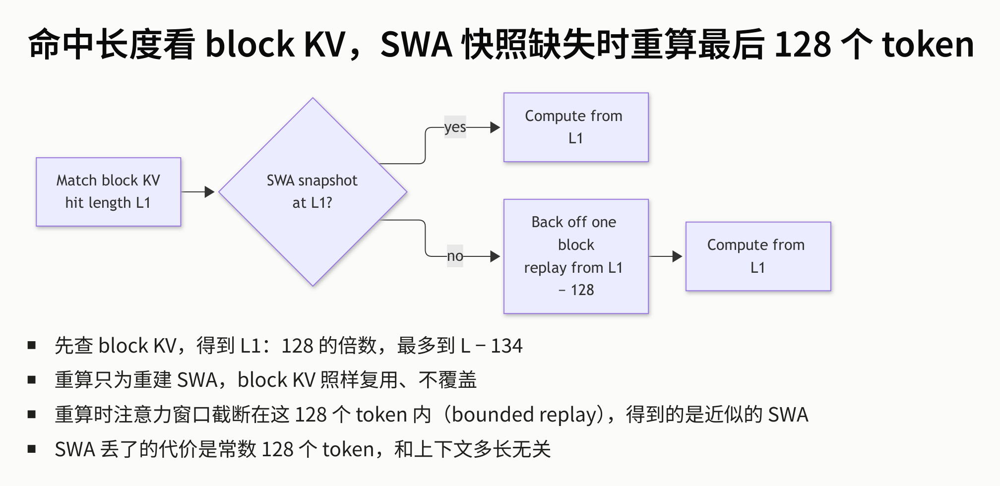
*图注：SWA 快照缺失时的恢复判断与重算路径。来源：演讲 PPT，第 13 页*

沿图中流程逐步展开：

1. **Match Block KV → 命中长度 L1**：系统首先在目标节点查找前缀缓存，得到以 128 token 为粒度的命中长度 L1。
2. **判断分支——L1 处是否存在 SWA 快照？** 若存在，直接从 L1 位置继续计算，无额外开销。
3. **No 分支 → Back off one block**：回退恰好一个 block（128 token），从 L1 − 128 位置开始重放这 128 个 token 的前向计算，仅用于重建 SWA 快照。此过程中 Block KV 照常复用、不被覆盖。
4. **Compute from L1**：SWA 重建完毕后，从 L1 继续正常计算。

核心因果：SWA 的窗口宽度本身就是 128 个 token，因此只需重放窗口范围内的内容即可获得足够的局部注意力状态。**重算量被严格限制在 128 个 token，与上下文总长度完全无关。**

以总长 L = 100,000 token 的请求为例，命中长度必须满足 L1 ≤ L − 134，且是 128 的整数倍。可取 L1 = 99,840（780 × 128）。若该处缺少 SWA 快照，则回退到 99,712（99,840 − 128）重放 128 个 token，以恢复近似的局部状态；无需重新处理全部上下文。

### 边界：近似性

bounded replay 存在一个已知的精度边界：重算时注意力窗口被截断在这 128 个 token 以内。正常推理中，SWA 在位置 L1 处的快照是基于之前连续滑动窗口逐步积累的结果；而重算路径只能看到最后 128 个 token 的信息，得到的是**近似的 SWA 状态**。演讲材料未给出该近似对输出质量的量化影响，但从架构设计看，团队判定此截断在实际生成质量上可接受。

**小结**：静态预留保证槽位始终可用，bounded replay 保证缺失时恢复代价为常数 O(128)。两者配合，使跨机调度不再受 SWA 状态断层的制约。存储和状态恢复机制已完备，下一道关卡是物理层面的：如何将命中的 Block KV 数据从内存或网络高效搬运到 GPU 显存。

---

## 四、数据搬运：绕开 CUDA 的 GDR 显存直写

### 换入与前向计算争抢同一块算力

推理引擎在开始前向计算之前，必须把命中的 KV 缓存从主机共享内存（host shm）搬进显存（HBM）。直觉方案是让搬运和计算在时间上重叠、互不阻塞。但现实中，大多数搬运手段要么调用 CUDA API 产生固定开销，要么直接占用 **SM（Streaming Multiprocessor，流式多处理器，GPU 上实际执行 kernel 的计算单元）**，导致并发的前向 kernel 被拖慢。

核心问题：**换入操作怎样才能既与前向计算重叠，又不侵蚀算力？**

### 流水线重叠的位置

先看请求从入口到执行的完整流水线。下图标明了两组关键重叠：拉取（Fetch）与排队重叠，换入（Swap-in）与前向计算重叠——后者对 SM 的占用决定了重叠的实际效果：

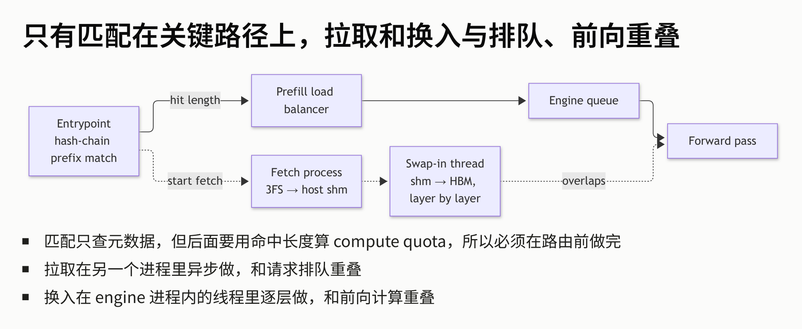
*图注：请求从入口到前向计算的流水线。虚线区域标明两组重叠：Fetch 与 Engine queue 排队重叠，Swap-in 与 Forward pass 重叠。来源：演讲 PPT，第 14 页*

入口处的前缀匹配输出命中长度（hit length），交由负载均衡器决定路由。此后流水线分为两条并行通道：

| 通道 | 数据路径 | 与什么重叠 |
|------|---------|-----------|
| **Fetch process**（拉取） | 3FS → host shm（独立进程） | 请求在 Engine queue 中排队 |
| **Swap-in thread**（换入） | shm → HBM（引擎进程内线程，逐层搬运） | 前向计算（Forward pass） |

换入线程与前向 kernel 在同一张卡上并发执行。**如果换入动作本身占用 SM 或阻塞 CUDA 调度，重叠就名存实亡。** 这正是选择搬运机制的判断标准。

### 四种搬运机制对比

每个 KV block 的数据量较小且在内存中离散分布。演讲材料列举了四种方案：

| 方案 | 是否占 SM | 是否经过 CUDA | 主要代价 |
|------|----------|--------------|---------|
| Copy engine 逐个拷 | 否 | 是，每块调一次 `cudaMemcpyAsync` | 每次独立 DMA，固定开销高 |
| Copy engine 批量拷 | 否 | 是，`cudaMemcpyBatchAsync`（CUDA 12.8+） | 一次提交一批，但 batch 过大时阻塞调度 |
| SM gather | **是** | 是，kernel 与前向共享队列 | 直接抢占计算资源 |
| **GDR** | 否 | **否** | 网卡发起 RDMA write，完全绕开 CUDA |

**GDR（GPU Direct RDMA，网卡向显存直接发起远程内存写入的技术）** 是唯一不经过 CUDA 栈的方案。换入线程无需调用任何 CUDA API，搬运动作由网卡硬件独立完成。

### 实测数据：0.05 μs 与 36% 减速的差距

下图直接对比了四种方案的单次开销与对并发计算的影响程度——右图中红色柱状图揭示了问题的严重性：

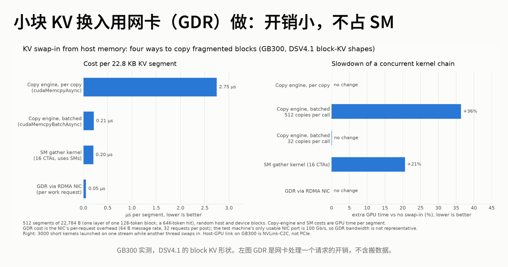
*图注：左图为单个 KV segment 的处理开销（μs）；右图为并发 kernel 链的减速百分比。可用 NIC 端口带宽为 100 Gb/s。来源：演讲 PPT，第 16 页*

**左图——单次处理开销。** Copy engine 逐个拷以 2.75 μs 居首，批量拷和 SM gather 分别降至约 0.21 μs 和 0.20 μs，而 GDR 仅 **0.05 μs**。需注意：此处 0.05 μs 仅为网卡处理一个请求的控制面开销，不含实际数据搬运时间。

**右图——对并发 kernel 链的影响（核心指标）。** Copy engine 批量拷导致并发 kernel 链减速 **+36%**（红色柱状图）；SM gather 减速 **+21%**；GDR 对并发 kernel 的减速为 **0%**。

因果关系清晰：前三种方案都经过 CUDA 调度路径——批量拷虽不占 SM，但 copy engine 与计算 kernel 共享 GPU 内部调度资源；SM gather 更直接，它本身就是一个 kernel，与前向 kernel 竞争同一组 SM。GDR 的搬运完全由网卡硬件执行，GPU 侧既无 API 调用、也无 DMA 引擎占用，计算引擎可满载运行。

### 边界条件

- 上述性能数字来自演讲材料中的特定测试环境，可用 NIC 端口带宽为 100 Gb/s。
- 演讲材料未给出满带宽条件下的吞吐上限。
- GDR 的优势在小块离散拷贝场景中尤为突出（控制面开销极低）；对于大块连续拷贝，copy engine 的吞吐未必逊色。

**小结**：GDR 通过网卡直接向显存发起 RDMA write，将换入操作从 CUDA 调度链中彻底摘除，SM 资源被完全释放给计算 kernel。数据搬运不再是瓶颈后，算力能否被充分利用就取决于计算层自身的并行策略——而 Prefill 与 Decode 对并行粒度的需求截然不同。

---

## 五、并行分化：计算与显存瓶颈下的 EP 策略

### 同一模型，两种瓶颈

Prefill 一次性处理用户输入的全部 token，矩阵乘法密集，属于 **compute bound（算力受限）**；Decode 每步只产出一个 token，运算量轻但需反复读取模型权重与 KV Cache，属于 **memory bound（显存带宽受限）**。两种物理瓶颈指向相反的资源需求：前者要把每块 GPU 的算力吃满，后者要把每块 GPU 的显存带宽用尽。对二者施加同一套并行策略，必然有一方被严重浪费。

### EP 维度的选择逻辑

**EP（Expert Parallelism，专家并行）** 把 MoE 模型的专家分散到多块 GPU 上。EP 数越大，每卡驻留的专家越少，空出的显存越多，但卡间通信开销也越高。

| 阶段 | 瓶颈类型 | EP 选择 | 理由 |
|------|---------|---------|------|
| Prefill | 算力受限 | 小 EP（如 EP4/EP8） | 本卡算力已饱和，扩大 EP 只增加通信而不提升总吞吐 |
| Decode | 带宽受限 | Wide-EP（如 EP64） | 以通信换带宽，每卡腾出显存容纳更大 batch 及更多冗余专家 |

对于 Prefill：当单卡计算单元已被完全占满时，将 EP 从 4 扩大到 8 并不能改善总吞吐——额外的卡只是分到了更少的专家，却无法加速已经不是瓶颈的数据搬运。策略是"尽量用小 EP，把卡省给更多 DP 副本"。

对于 Decode：每步计算量极小，GPU 算力大量空闲，瓶颈落在显存读取速度上。Wide-EP 把专家分散到更多卡上后，每卡承载的权重更少、可用显存更多，从而能装入更大的 batch 来摊薄访存开销，同时还能放置冗余专家以辅助负载均衡。

### 实测折线：Wide-EP 的吞吐优势

下图展示了 Decode 阶段两种 EP 配置在相同硬件上的表现差异，可以直观看到 Wide-EP 在吞吐维度的提升幅度：

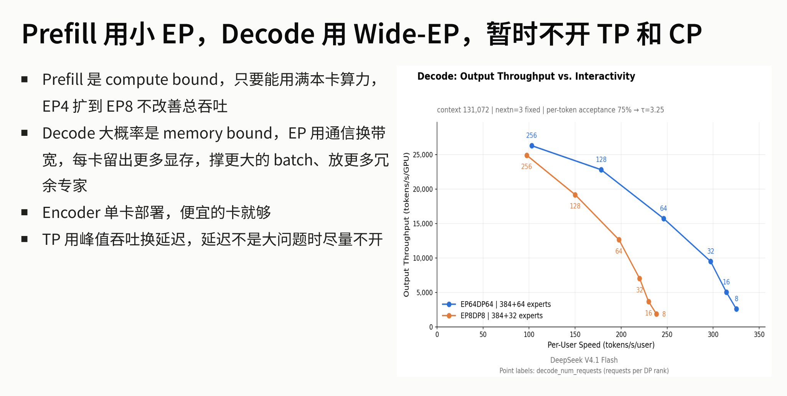
*图注：Decode 阶段吞吐折线图。横轴为 Per-User Speed（tokens/s/user），纵轴为 Output Throughput（tokens/s/GPU）。蓝色折线对应 EP64DP64 | 384+64 experts，橙色折线对应 EP8DP8 | 384+32 experts。数据点旁标注的数字为每个 DP rank 的并发请求数。实验条件：context 131,072 | nextn=3 fixed | per-token acceptance 75% → τ=3.25。来源：演讲 PPT，第 4 页*

三个关键信息：

1. **蓝色折线（EP64）整体高于橙色折线（EP8）**：在相同 Per-User Speed 下，Wide-EP 配置取得更高的每卡输出吞吐——正是"以通信换带宽"的收益，分散专家后每卡显存余量更大，可调度更多并发请求。
2. **两条折线均随 Per-User Speed 升高而下降**：要给单用户更高的生成速度就必须减少并发 batch 大小，总吞吐随之降低。两者下降斜率接近，说明通信开销并未随用户速度需求显著剧增。
3. **EP64 配置额外挂载了 64 个冗余专家（384+64 vs 384+32）**：Wide-EP 释放的显存不仅用于扩大 batch，还用于放置更多专家副本，为后续负载均衡提供调度余量。

> **数据适用条件**：上述吞吐优势建立在 context 长度 131,072、nextn=3、per-token acceptance 75% 等严格实验条件下，不同场景的数值可能有显著差异。

### 为何不用流水线并行

**PP（Pipeline Parallelism，流水线并行）** 按层切分模型，各阶段串行流过不同 GPU。但 V4.1 有两个结构特性使 PP 几乎不可行（演讲者观点，基于 V4.1 架构特征）：

- **跨层共用 KV Cache**：不同层的注意力共享同一份缓存，若按层切分到不同节点，该缓存必须在节点间反复同步，通信代价极高。
- **每层结构各不相同**：模型训练结果导致各层参数配置存在差异，无法像标准 Transformer 那样做均匀的层切分。

因此系统设计最终选择以 EP 为核心并行维度。

### 小结

Prefill 用小 EP 榨取算力，Decode 用 Wide-EP 换取显存带宽——这是两个阶段对物理资源需求差异的直接映射。但 Wide-EP 将数百个专家分散到多张卡后，不同专家的请求热度天然不均。单步计算的耗时取决于负载最重的那张卡（木桶效应），必须引入专门的负载均衡机制来削峰。

---

## 六、专家均衡：EPLB 的重排与冗余削峰机制

### 长尾瓶颈：一张卡拖慢整步计算

MoE 架构将前馈层拆分为数百个专家，分布在多张 GPU 上。每步推理中，路由器为每个 token 选出若干专家，但 token 并不会均匀地落到所有专家——少数"热门"专家可能接收远超平均的负载。由于同一步计算必须等最慢的 GPU 完成才能进入下一阶段，单卡过载使其余 GPU 全部空转等待。

**EPLB（Expert-Parallel Load Balancer，专家并行负载均衡）** 正是为消除这个长尾毛刺而设计的。其核心目标并非让所有卡负载"一样"，而是**削峰**——把每一步中最慢那张卡的负载压下来。两个互补手段：

| 手段 | 原理 | 代价 |
|------|------|------|
| **重排（Rearrangement）** | 根据观测到的专家负载，重新分配专家到各卡 | 不增加显存；可静态或动态执行 |
| **冗余（Redundancy）** | 将过热专家的权重复制到多张卡上，分摊 token | 多占显存，Decode 时需额外读取权重 |

### 装箱算法：Best Fit Decreasing

重排步骤采用经典的 **Best Fit Decreasing（最佳适配递减）** 装箱策略：将专家按负载从大到小排序，依次放入当前峰值负载最小且仍有空槽的 GPU 桶中。下图展示了重排前后的负载变化——注意最慢卡负载的下降幅度：

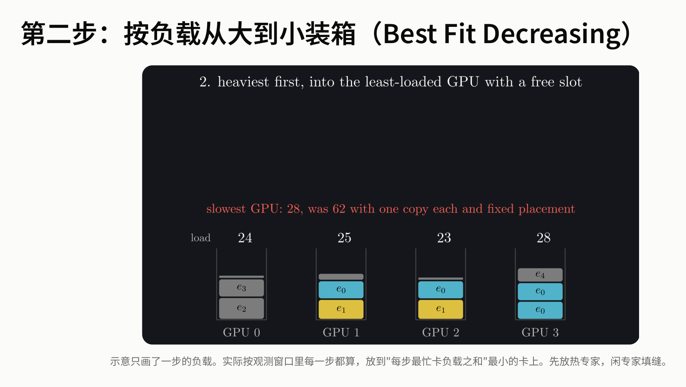
*图注：Best Fit Decreasing 装箱过程——热门专家优先分配，最慢卡负载从 62 降至 28。来源：演讲 PPT，第 23 页*

图中四个桶代表 GPU 0–3，桶内色块为不同专家。固定放置时最慢卡负载高达 62，经重排后四卡分别为 28、25、24、23，峰值被压缩超过一半。图中仅展示单步快照；实际实现会对观测窗口中的统计数据执行这一计算，以全局最小化峰值之和。

### 副本路由：质数打乱与零通信

当某个专家拥有 $c_e$ 份副本时，每张 GPU 需独立决定把 token 发给哪份副本——这必须在**不发生卡间通信**的前提下完成。EPLB 给出的公式为：

$$k = (\text{rank} + i \times 23333) \bmod c_e$$

其中 `rank` 是当前 GPU 编号，`i` 是 token 在本卡当前批次中的序号，23333 是一个质数。下图展示了这一路由机制如何将 token 分散到不同副本：

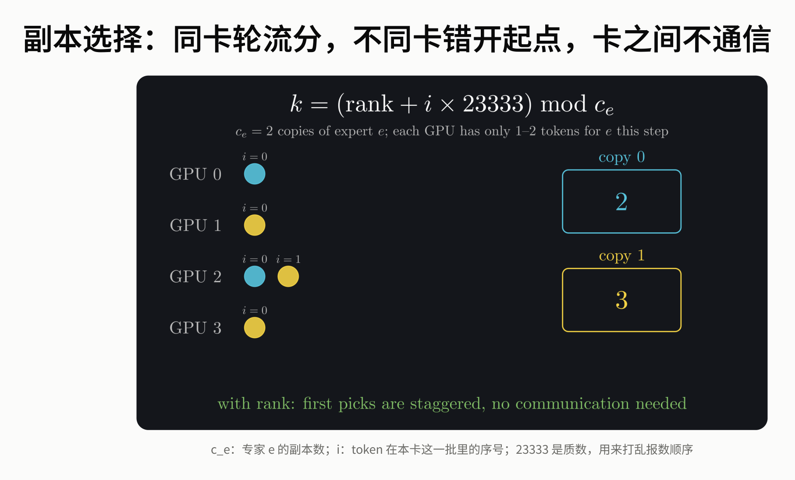
*图注：副本选择公式与四 GPU 分配示意，彩色圆圈代表 token 被路由到 copy 0 或 copy 1。来源：演讲 PPT，第 19 页*

为什么选质数？关键在于**错开起点**。若使用合数，多张卡在 `mod` 运算后容易落入相同的副本序列，造成新的负载聚集。质数与任意 `rank` 的组合在模运算下具有更均匀的散列效果，使不同卡自然地将 token 分散到不同副本，无需任何同步或协商。同一张卡内部则通过轮流分配进一步摊平。

### 实测消融：收益几乎全来自重排

在 EP8/DP8 规模下进行端到端实测。下图展示了不同配置组合下的吞吐变化和负载均衡指标：

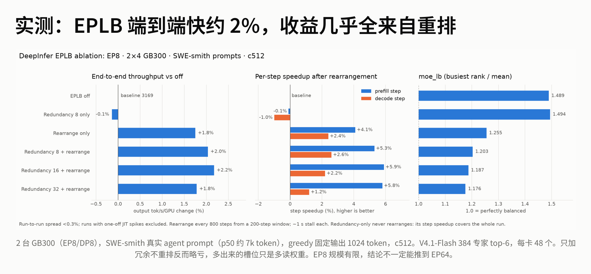
*图注：三组柱状图分别展示吞吐变化、单步加速比和最忙卡与平均值之比。来源：演讲 PPT，第 24 页*

从图中柱状图可读出关键对比：

| 配置 | 端到端吞吐变化 | moe_lb（最忙 rank / 均值） |
|------|:-:|:-:|
| EPLB 关闭 | 基线 | 1.489 |
| 仅冗余 8 | −0.1% | 1.494 |
| 仅重排 | +1.8% | 1.255 |
| 冗余 8 + 重排 | +2.0% | 1.203 |

两个结论值得注意：

- **仅加冗余而不做重排，吞吐反而微跌**。原因是多出的副本槽位只增加了权重读取开销，却未改善专家在卡间的分布。
- **收益几乎全部来自重排**，冗余在重排之上的增量有限（从 +1.8% 到 +2.0%）。

> **边界警告**：演讲者明确指出，上述数据在 EP8 规模下取得，不能直接推导至 EP64 场景——更大规模下专家分布特征和通信拓扑均会改变，冗余的边际收益可能不同。

**小结**：EPLB 通过装箱重排把最慢卡的峰值负载大幅压低，再辅以少量冗余副本做进一步削峰。但消除 MoE 层的不均衡后，在进入 all-to-all 通信之前，DP 组内各卡的 Attention 计算量仍然参差不齐——这就引出数据并行维度的均衡问题。

---

## 七、数据均衡：DPLB 消除 DP 组内的木桶效应

### 每一层的隐性等待

EPLB 解决了专家热度偏斜，但系统吞吐仍无法逼近理论极限。根源在于 DP 组内部的同步壁垒：每一层 Transformer 进入 MoE 的 all-to-all 通信之前，所有 DP rank 必须完成各自的 Attention 计算——最慢的那张卡决定全局节奏。下图揭示了这一等待的具体形态——关注红色区域的面积：

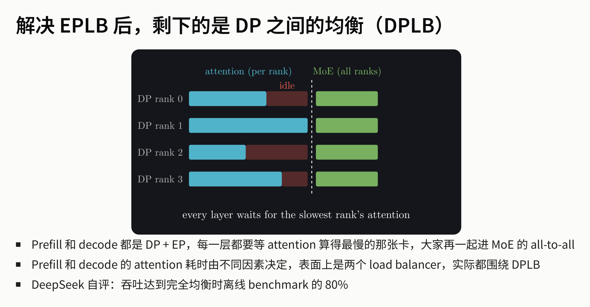
*图注：4 个 DP rank 的单层耗时拆解。蓝色条为 attention，绿色条为 MoE，红色区域为 idle 等待。虚线标出全局同步点：所有 rank 须等最慢的 DP rank 完成后才能进入 all-to-all。来源：演讲 PPT，第 25 页*

红色 idle 区域是关键信号：部分 DP rank 的 Attention 较快完成，却必须空等最慢的 rank 对齐。这种木桶效应在每一层都会发生，层数越多累积浪费越大。

**DPLB（Data-Parallel Load Balancer，数据并行负载均衡）** 的目标就是缩小这些红色区域——让各 rank 的 Attention 耗时尽可能对齐。但 Prefill 和 Decode 的 Attention 耗时由不同因素主导，需要两套调度策略。

### Prefill：按上下文长度分桶 + 算力配额拉取

**分桶。** Attention 与上下文长度并非线性关系：同样处理 1K token，长上下文的耗时远高于短上下文。为此 Prefill 将请求按上下文长度分为 4 个桶，使同一桶内请求的 Attention 耗时更可预测，调度器能更精确地实现均衡。由于所有节点共享 3FS 池化存储，请求在桶间迁移不会降低缓存命中率。

**拉取。** 每个推理引擎维护成本估算器，计算 **compute quota（算力配额）**，约束的是 Attention 耗时而非整个 step 耗时。引擎根据剩余配额从对应桶的队列中主动拉取请求（pull-based），不做 cache aware。DP 组内按最少已消耗配额原则派发。

**组 batch。** 调度器按时间预算组 batch——例如以 300 ms 为目标——而非固定 chunk size。组好后在 DP 组内做一次 all-reduce min 收紧，确保没有单个 rank 被分配到远超平均的计算量。

### Decode：双指标平衡

Decode 阶段不分桶，但面临另一个矛盾：**请求数**决定 GEMM 算子耗时（batch 维度），**KV 总长度**决定 Attention 耗时。单看任何一个指标都无法做到真正均衡。下图展示了 DPLB 在 Decode 阶段如何同时平衡这两个指标：

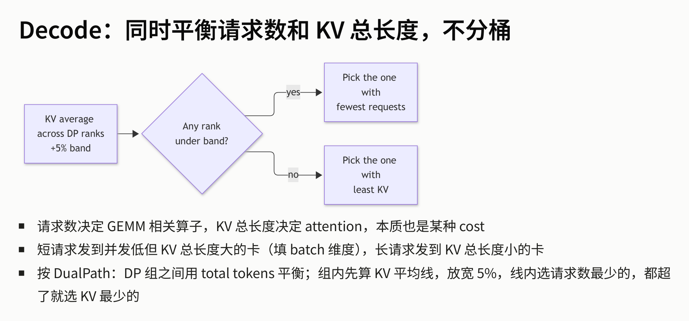
*图注：调度流程图。先计算所有 DP rank 的 KV 平均值并加 5% 容差带；带内选请求数最少的 rank，全部超带则选 KV 最少的 rank。来源：演讲 PPT，第 29 页*

流程拆解为三步：

1. **算基线**：取所有 DP rank 的 KV 总长度平均值，上浮 5% 构成容差带。
2. **带内优先请求数**：若存在 KV 总长度低于容差带上界的 rank，从中选请求数最少的——此时该 rank 的 Attention 开销尚可控，瓶颈在 GEMM 侧。
3. **全部超带选 KV 最小**：所有 rank 均超带时，Attention 已成全局瓶颈，转而选 KV 最少的 rank 压缩峰值。

直觉上：短请求发到并发低但 KV 总长度大的卡（补 batch 维度），长请求发到 KV 总长度小的卡（控 Attention 维度），两种资源交替填充。

### 效果与边界

课件第 28 页给出的系统自评是：经过双层均衡，吞吐约达到完全均衡时离线 benchmark 的 **80%**。这是分享中的特定系统结果；材料未提供剩余差距的完整归因，不能据此把全部损耗分配给请求波动或调度延迟。

**小结**：EPLB 解决的是"哪些专家放在哪张卡"的静态分配，DPLB 解决的是"哪些请求发给哪个 DP rank"的动态调度。两者叠加，从 MoE 专家层面延伸到 Attention 层面形成完整的调度闭环。当底层的存储、搬运、并行和负载均衡都做到极致后，唯一能继续压榨吞吐的手段，就是从算法层面减少单次生成的绝对步数。

---

## 八、吞吐压榨：DSpark 动态变长投机解码

### 满载时固定验证长度的代价反转

投机解码（Speculative Decoding）的基本思路是：用辅助头快速草拟若干候选 token，再由大模型一次性验证，以此减少自回归步数。常见做法是每步固定草拟 5 个 token。在低并发场景下 GPU 算力富余，额外验证几乎"免费"；但当系统进入大 batch 满载运行时，矛盾出现——每多验证一个低接受率的 token，都在挤占其他请求的计算资源，吞吐反而下降。

### DSpark 的动态决策回路

**DSpark（DeepSeek 的变长验证投机解码技术）** 引入两条信息通路来打破固定长度的僵局：

1. **在线信号——Confidence Head**：一个轻量预测头，对每个 draft token 输出接受率估计。接受率高的 token 值得验证，接受率低的提前截断。
2. **离线信号——吞吐 Profile 曲线**：预先在目标硬件上测量"不同验证长度 × 不同并发数"组合下的实际吞吐，形成查找表。运行时根据当前并发数查表，得到验证长度与吞吐的最优映射。

两条通路交汇后，系统逐请求、逐步动态决定本次验证几个 token。

### 增益曲线：并发越高收益越大

下图展示了 DSpark 在不同并发水平下相对于固定 5-draft 验证的吞吐变化——关注折线在高并发区域的爬升趋势：

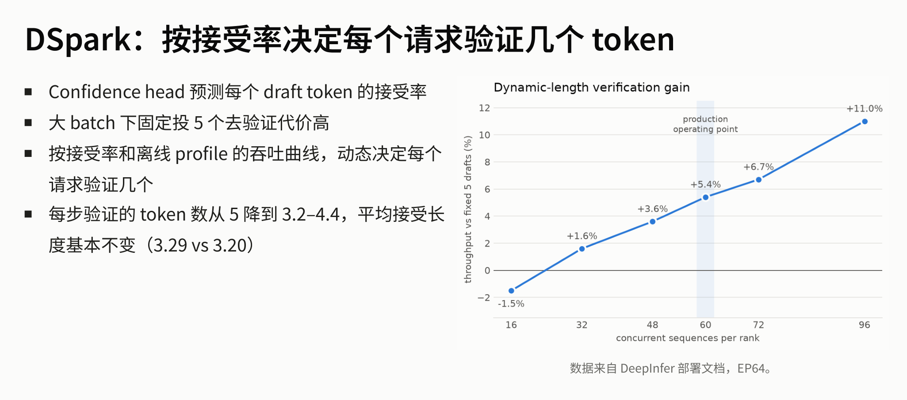
*图注：DSpark 在不同并发序列数下的吞吐量增益（基线为固定 5-draft 验证），EP64 环境。来源：演讲 PPT，第 31 页*

图中关键元素：

- **横轴**：每个 rank 的并发序列数，从 16 到 96。
- **纵轴**：相对于固定 5-draft 验证的吞吐量增益百分比。
- **趋势**：低并发（16）时增益约 −1.5%，GPU 算力宽裕，缩减验证长度反而损失命中机会；随并发数增大，增益持续爬升至 +11.0%（并发 96），截断低概率 draft 释放的算力立刻被其他请求利用。
- **生产运行点**：课件第 31 页图中标注位于并发约 60 处，对应增益 **+5.4%**；图表注明数据来自 DeepInfer 部署文档，测试条件为 EP64。

核心因果链：

> Confidence Head 预测接受率 → 与离线 Profile 曲线联合决策 → 验证长度从固定 5 动态降至 **3.2–4.4** → 被拒绝的无效验证计算被削减 → 释放的算力服务更多并发请求 → 吞吐提升

关键数据对照（EP64 环境，数据来自 DeepInfer 部署文档）：

| 指标 | 固定 5-draft | DSpark 动态 |
|------|------------|------------|
| 每步验证 token 数 | 5 | 3.2–4.4 |
| 平均接受长度 | 3.29 | 3.20 |

平均接受长度仅从 3.29 微降至 3.20，几乎无损——被截断的主要是"注定被拒"的尾部 draft token，真正能被接受的 token 并未丢失。

### 边界与局限

- **离线曲线的泛化性**：演讲者在问答环节推断，DSpark 的离线 Profile 高度依赖特定模型架构与硬件配置，更换模型或卡型后需重新测量。
- **低并发反效果**：折线图显示并发 16 时增益为负，GPU 空闲较多的场景下不宜启用动态截断。
- 演讲材料未给出 Confidence Head 的额外延迟开销及其训练方式的细节。

**小结**：从 3FS 池化存储到 DSpark 动态投机解码，形成了一条严密的因果链——存储解耦释放路由自由度，GDR 释放算力，EPLB 与 DPLB 消除等待，DSpark 压缩步数。每一层优化都在为下一层创造提升空间。

---

## 结论

从底层存储到上层算法，DeepSeek V4.1 推理系统的优化呈现清晰的逐层因果关系。以下是贯穿全文的核心结论：

1. **存储与计算分离是打破路由僵化的物理前提。** 3FS 池化存储使 KV Cache 不再绑定于特定计算节点，Prefill 路由得以彻底放弃 cache aware 策略，退化为纯负载均衡问题。

2. **分级持久化平衡了网络带宽与 SSD 寿命。** Block KV 经 10+2 纠删码写入 3FS 实现全局共享，SWA KV 留在本机内存避免频繁写入带来的磨损。两者资源静态隔离、互不挪用。

3. **跨机状态恢复的代价可以是常数。** SWA 快照缺失时仅需重算最后 128 个 token（bounded replay），与上下文总长度无关，使自由调度在实践中成立。

4. **极致吞吐来源于对 SM 算力的彻底释放。** GDR 绕开整条 CUDA 调度路径，换入操作对并发 kernel 的减速为零，使流水线重叠真正生效。

5. **Prefill 与 Decode 必须采用差异化的并行维度。** 前者受算力约束用小 EP，后者受带宽约束用 Wide-EP；V4.1 跨层共用 KV Cache 的特性使流水线并行天生不友好。

6. **系统级负载均衡需要从专家维度到数据并行维度的逐层削峰。** EPLB 通过装箱重排抹平专家热度差异（实测收益主要来自重排而非冗余），DPLB 进一步平衡 DP 组内的 Attention 耗时。

7. **投机解码在高并发下需要动态调整验证长度。** DSpark 结合在线接受率预测和离线吞吐曲线，将每步验证数从固定的 5 降至 3.2–4.4，在课件所示生产运行点获得约 5.4% 的吞吐增益（EP64 条件）。

### 局限与适用条件

- 上述架构强依赖高规格自建硬件（如单台 20 块 30.73 TB SSD、读 40 GB/s 的存储节点等），普通 share nothing 集群或中小规模部署无法直接复刻。
- EPLB 端到端快约 2% 的结论在 EP8/DP8 规模下取得，演讲者明确指出不一定能推导至 EP64 规模。
- DSpark 的离线 Profile 曲线与特定模型及硬件绑定，泛化性受限；低并发场景下启用动态截断反而损失吞吐。
- 双层均衡后系统吞吐达到完全均衡离线 benchmark 的约 80%，剩余损耗的具体构成未在演讲材料中进一步拆解。
