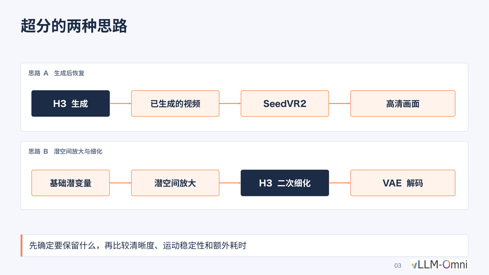
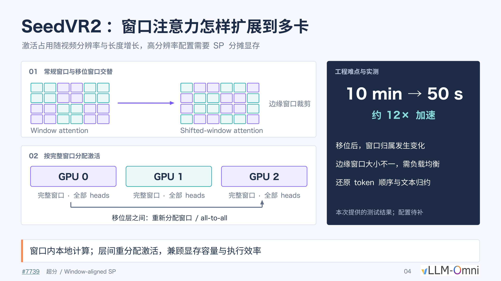
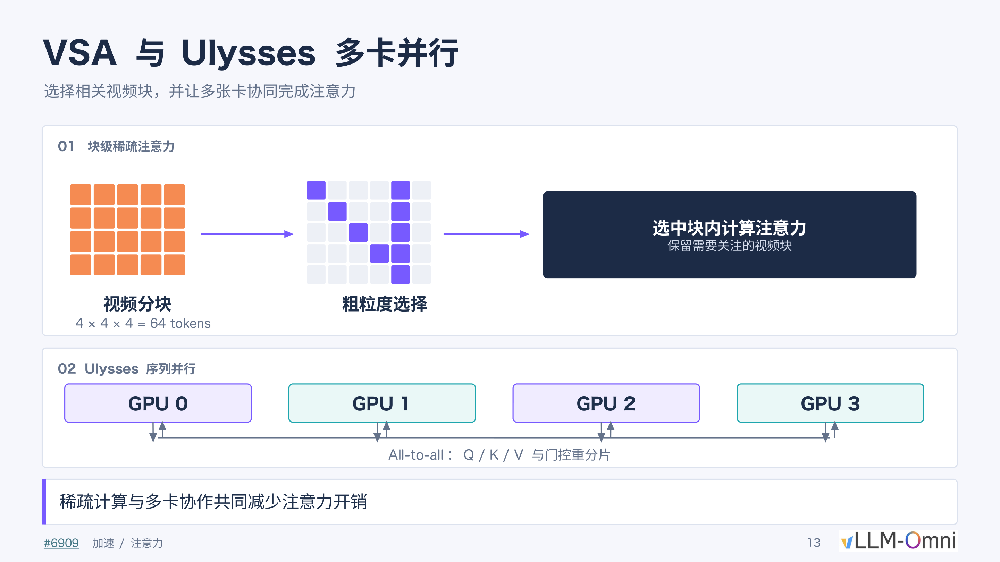
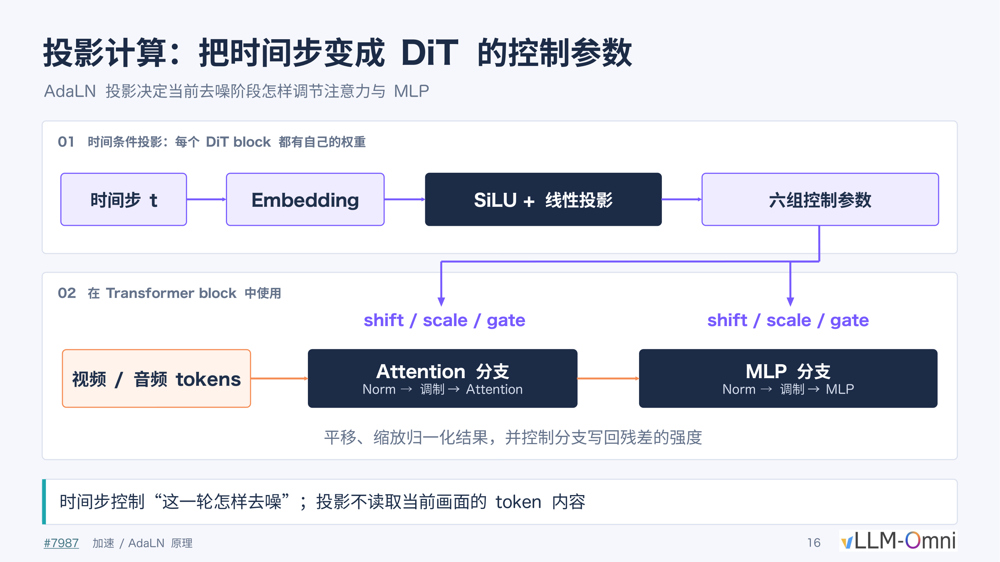
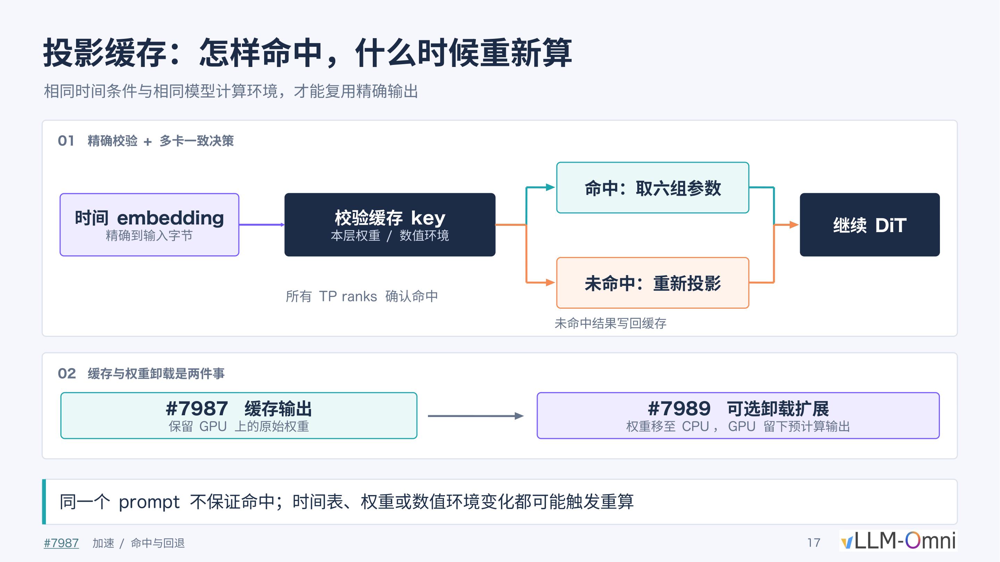
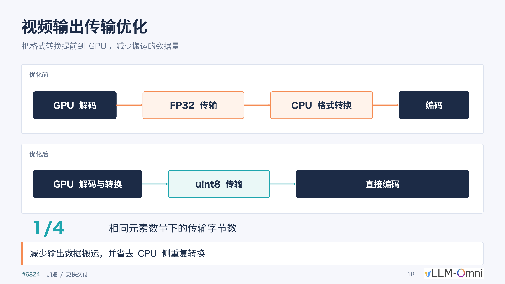
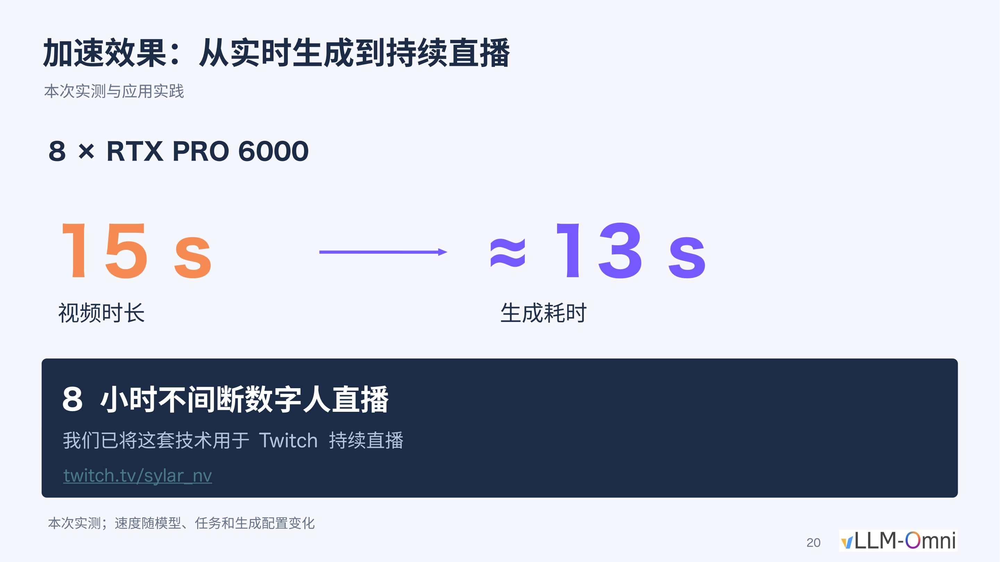

# Breaking the Engineering Bottlenecks of Video Generation Foundation Models: Full-Pipeline Inference Acceleration and Automation in Practice

**Source video**: [Bilibili BV115HY6tEmQ](https://www.bilibili.com/video/BV115HY6tEmQ) · **Slides**: [Making MiniMax-H3 Faster and Stronger slides](https://drive.google.com/file/d/1P5PjY07maTLr2JqNuGFokC7vTpvflMqt/view)

**From the Memory Wall to Real-Time Streaming: Dissecting the Architectural Evolution Behind High-Resolution Long-Video Generation**

Video generation foundation models can already produce stunningly impressive short clips, but transforming a native 15-second, 768P output into a commercially viable high-definition long video confronts engineering teams with a tightly coupled chain of bottlenecks: insufficient resolution demands super-resolution; super-resolution blows up GPU memory, requiring multi-GPU distribution; limited duration demands continuation; continuation drives up computation, requiring acceleration; and after acceleration, the pipeline stalls on data transfer… Solving any one problem exposes the next layer of contradiction.

This article traces the full-pipeline optimization of the MiniMax H3 video model by vLLM-Omni (an open-source framework for model inference acceleration supporting multi-GPU and cross-node interconnects), following the real engineering causal chain—image quality, GPU memory, duration, speed, delivery, usability—layer by layer. It dissects the technical choices, key mechanisms, and quantitative results at each step. All data in this article come from the presentation materials and PPT annotations; specific conditions are noted at the corresponding locations.

**Target Audience**: AI engineering developers, model inference optimization engineers, and technical architects with a working knowledge of deep learning.

**Prerequisites**:

- Familiarity with the basic denoising process of Diffusion models
- Understanding of the Transformer attention mechanism and the fundamentals of multi-GPU parallelism
- A basic grasp of GPU memory consumption and end-to-end latency

**Reading Objectives**:

1. Understand GPU memory optimization strategies for high-resolution video super-resolution in multi-GPU environments
2. Master the latent-variable condition extraction and temporal alignment mechanisms used in long-video continuation
3. Gain insight into the causal relationships among inference acceleration techniques such as attention sparsification and projection caching
4. Learn how to encapsulate low-level inference capabilities into automated workflows

---

## The Engineering Compromise Behind Commercial-Grade Image Quality: Choosing a Super-Resolution Route and Its Trade-Offs

### What Exactly Is Wrong with 768P

MiniMax H3 (a video generation foundation model released by MiniMax) has a native output ceiling of 1344 × 768 pixels at 15 seconds in duration. This resolution is commonly classified as "768P" on the consumer side, while the minimum commercially acceptable threshold today is 1080P—whether for short-video platforms or pre-visualization in film and television, a 768P image displayed full-screen exhibits perceptible sharpness deficiency. Without a reliable super-resolution stage, any speedup inside the model's generation process contributes limited value to the final commercial product.

The core engineering contradiction thus emerges: **How should the super-resolution route be chosen to balance fidelity and inference speed?**

### Side-by-Side Comparison of Two Approaches

The figure below directly compares two technical routes from 768P to 1080P, helping illustrate the fundamental differences in their data flows and operating spaces:

*Figure: Two super-resolution approaches—Approach A (top) performs pixel-level restoration on the already-generated video via SeedVR2; Approach B (bottom) upscales in latent space, then runs a second denoising pass through H3 before VAE decoding. Source: Presentation PPT, page 3.*

The figure shows two complete data flows:

| Route | Key Stages | Operating Space | Output Method |
|-------|-----------|----------------|---------------|
| **Approach A** Post-generation restoration | H3 generation → Generated video → SeedVR2 → HD output | Pixel space | Direct HD video output |
| **Approach B** Latent-space upscaling and refinement | Base latent → Latent-space upscaling → H3 second-pass refinement → VAE decoding | Latent space | Decoded to pixels via VAE |

Here, **latent space** refers to the low-dimensional space the model uses internally to represent compressed data; its tensor dimensions are far smaller than the corresponding pixel frames. The two routes diverge at the space in which super-resolution is performed, yielding fundamentally different quality–speed trade-offs.

### Mechanism Breakdown

**Approach A: SeedVR2 pixel-level restoration.** SeedVR2 (a high-definition super-resolution model for post-generation video restoration) receives complete video frames that have already been decoded to pixels and performs frame-by-frame restoration in pixel space. Because it operates on the final pixels, it can supplement high-frequency detail while preserving the original motion trajectories and color distributions. The cost is obvious: the pixel-space matrix is far larger than the latent-space matrix, causing computation and GPU memory consumption to spike dramatically.

**Approach B: Latent-space upscaling + H3 second-pass refinement.** This approach upscales the base latent along spatial dimensions within latent space, then injects noise into the upscaled latent and feeds it back into H3's DiT (Diffusion Transformer—the Transformer-based backbone of the diffusion model) for a second round of denoising. Because latent-space tensors are far smaller than the corresponding pixel frames, overall latency is markedly lower.

The key causal chain: latent-space upscaling → noise injection → H3 second-pass denoising → the model "hallucinates" detail from its own training priors → the output's visual style is overwritten by the model's preferences. It is precisely this pathway that causes the output to inevitably carry H3's own generative style.

### Visual Evidence: Real Differences in Facial Detail

To visually demonstrate the fidelity gap between the two routes, the figure below presents a cropped close-up of the eye region of the same source material under three conditions:

*Figure: Side-by-side cropped close-up of the eye region of the same source material under three conditions (left: original frame; center: H3 latent-space refinement 2×; right: SeedVR2 2×). Source: Presentation PPT, page 7.*

Two levels of difference can be observed across the three columns:

1. **Detail preservation.** The center column (latent-space refinement) yields smoother skin texture, with eyeliner and eyelid edges exhibiting a smeared look and an overall "2.5D" aesthetic; the right column (SeedVR2) better preserves skin texture and specular highlight positions.
2. **Color shift.** The latent-space refinement alters the entire frame's color distribution during the second denoising pass; SeedVR2 enhances only along the sharpness dimension without systematically shifting the color tone.

Note: The presentation materials explicitly caution that "static screenshots cannot substitute for continuous playback." At the video level, motion consistency and temporal stability are equally important evaluation dimensions; the materials do not provide a quantitative comparison of consecutive frames.

### The Engineering Trade-Off Between Speed and Fidelity

| Dimension | Approach A (SeedVR2) | Approach B (Latent-space refinement) |
|-----------|---------------------|--------------------------------------|
| Operating space | Pixel space | Latent space |
| Visual fidelity | High: pixel-level detail and color preserved | Medium: second-pass denoising introduces model style bias |
| Inference speed | Slow: requires running a separate super-resolution model | Fast: reuses the original model with smaller tensor sizes |
| Style risk | Low | High: prone to shifting toward a "short drama" / 2.5D look |
| Deployment complexity | Requires additionally loading SeedVR2 weights | Can be completed within the same pipeline |

For scenarios that demand rapid iteration (e.g., batch short-video production), the community generally opts for Approach B due to its faster speed and no need for an additional model. However, for scenarios demanding strict fidelity (e.g., brand advertising, film post-production), Approach A's pixel-level restoration is virtually the only choice.

### Boundaries and Summary

- The style drift of Approach B is not a bug but a structural limitation: as long as a second denoising pass is performed, the model fills in detail using priors from its training distribution—an inherent behavior of Diffusion models.
- The bottleneck of Approach A lies not in the algorithm but in the compute: SeedVR2 processes complete video frames in pixel space, resulting in extremely large activation tensors.
- The presentation materials do not provide absolute runtime or FLOPs comparison data for the two routes; the specific speedup ratio must be benchmarked on the target deployment hardware.

In summary, the 768P-to-1080P super-resolution stage is the critical juncture that determines whether the entire generation pipeline can be commercially deployed. When fidelity requirements point to SeedVR2, the enormous computational burden it brings becomes the next engineering problem that must be overcome.

## Smashing the Memory Wall: Reorganizing Window Attention Across Multiple GPUs

### Activations Blow Up the GPU

SeedVR2 has only 3B parameters, yet processing a 15-second video produces approximately **180 GB of activations** (i.e., the intermediate tensors that must be retained across layers during forward computation). This figure far exceeds the memory capacity of any single GPU. Even when run naively across 8 NVIDIA B300 GPUs, super-resolving a single 15-second video still takes roughly 10 minutes.

The bottleneck breaks down into two layers:

1. **Capacity problem**: 180 GB of activations cannot fit on a single GPU and must be distributed across cards.
2. **Efficiency problem**: Even after distribution enables execution, the communication overhead from naive partitioning keeps end-to-end latency unacceptably high.

### Why Naive Sequence Parallelism Doesn't Work

The general idea of Sequence Parallelism (SP) is to evenly partition the input sequence along the token dimension across multiple GPUs, with each card computing only a portion of the attention. However, SeedVR2's attention is not computed globally; instead, two operations alternate:

- **Window Attention**: The 3D token grid is divided into equally sized local windows, with self-attention computed independently within each window.
- **Shifted-window Attention**: The window grid is offset by half a window step before re-partitioning, allowing boundary tokens of adjacent windows to interact.

When naively splitting along the token dimension, tokens belonging to the same window are very likely to end up on different GPUs, making it impossible to complete intra-window attention locally and requiring heavy cross-card communication at every layer. Worse still: even if the first layer successfully aligns complete windows to the same card, the offset operation in the shifted-window layer re-scatters window memberships, nullifying the previous alignment.

### Mechanism Analysis: Window-Aligned SP

To address this contradiction, a **Window-aligned SP** strategy is adopted—using complete windows as the minimum allocation unit. The figure below illustrates this scheme's allocation and communication logic between regular-window and shifted-window layers:

*Figure: Overview of the Window-aligned SP scheme. The left region (labeled 01) shows the alternation between regular windows and shifted windows along with edge cropping; the right region (labeled 02) shows GPUs 0–2 each holding complete windows with all attention heads, with inter-layer redistribution via all-to-all. Source: Presentation PPT, page 4.*

Causal relationships among the key elements in the figure:

| Element in Figure | Meaning | Role |
|-------------------|---------|------|
| Region 01: two sets of grids | Regular window partition vs. shifted window partition | The two attention types alternate; window boundaries change between layers |
| Edge window cropping annotation | Shifted grids produce incomplete windows at the edges | Fragment windows of unequal size are a load-balancing challenge |
| Region 02: GPU 0/1/2 color blocks | Each card receives several complete windows while retaining all heads | Intra-window computation is fully local, with zero cross-card communication |
| Inter-layer all-to-all arrows | Activations are redistributed between shifted layers | Tokens are sent to the corresponding GPU according to new window membership |

**The execution flow** is a three-step cycle:

1. **Regular-window layer**—Each GPU holds several complete windows and independently completes intra-window self-attention locally, with no cross-card communication.
2. **All-to-all redistribution**—Before entering the shifted-window layer, tokens are transferred to their newly assigned GPUs via all-to-all, based on the post-shift window partitioning.
3. **Shifted-window layer**—After redistribution, each card again completes shifted-window attention locally.

Within every layer, computation is purely local; communication occurs only at window-switching points.

### Three Engineering Challenges

The right panel of the PPT identifies the specific issues that must be handled during deployment:

1. **Dynamically changing window membership**: After each shift, the entire token → GPU mapping changes, requiring dynamic computation of the all-to-all communication plan.
2. **Unequal-length edge windows**: The fragment windows produced by cropping create uneven token counts across cards; naively distributing by window count leads to load imbalance.
3. **Token order restoration and text reduction**: After attention computation, the scattered tokens must be restored to their original order and reduced with text conditioning information.

### Performance Anchor Point

In the presenter's test environment (8 × NVIDIA B300), Window-aligned SP reduced the super-resolution time for a 15-second video from **10 minutes to approximately 50 seconds**, a speedup of roughly **12×**. It should be noted that the presentation materials mark the detailed hardware configuration for this test as "to be supplemented"; the above figures come from the presenter's oral account of a single-run experiment, and results on different GPU types or resolutions have not been published.

The presenter also pointed out that at the 180 GB activation scale, this operation remains compute-bound rather than memory-bound on the B300, so the multi-GPU parallel speedup ratio is expected to be roughly consistent across different devices. Implementation details can be found in PR #7739 as mentioned in the presentation.

### Boundaries and Summary

Window-aligned SP simultaneously overcomes SeedVR2's GPU memory capacity and computational efficiency bottlenecks—through "allocating by complete windows + inter-layer all-to-all reorganization"—without altering model precision. Its applicability boundary is that the scheme relies heavily on window-attention architecture and is not directly applicable to global-attention models; load balancing of edge windows may require additional tuning under certain combinations of window size and GPU count.

At this point, a viable solution exists for image quality and resolution. But the next commercial pain point immediately surfaces: the 15-second duration limit falls far short of the needs of short-drama or livestreaming scenarios, necessitating a mechanism for continuous continuation without breaking context.

## Crossing the Temporal Boundary: Condition Injection and Alignment for Long-Video Continuation

### Splicing Artifacts—The Engineering Pain Point of the 15-Second Window

MiniMax H3 natively supports a maximum of 15 seconds per generation pass. When creators need longer narratives, the most intuitive approach is to concatenate multiple clips end to end, but this runs into two types of discontinuity in practice:

- **Abrupt camera-language changes**: The dolly direction and camera-movement rhythm of the preceding segment are not consistent with the following segment, producing jump cuts at the splice point.
- **Audio style conflicts**: The model generates background music independently for each segment, causing sudden changes in tempo and style between segments.

The engineering objective thus shifts to: coherent cross-window continuation without retraining, theoretically supporting unlimited duration.

### Three-Step Closed Loop

The entire continuation scheme unfolds along a causal chain—**extract tail conditions → attention interaction → global temporal alignment**—detailed step by step below.

### Step 1: Tail Condition Extraction

After the previous window finishes generation, the system extracts two sets of reference signals directly in latent space, rather than decoding to pixels and re-encoding:

| Signal Type | Extraction Rule | Post-Processing | Output |
|-------------|----------------|-----------------|--------|
| Video latent | Take the last **7 temporal grid cells** | Patchify | Video reference row |
| Audio latent | Crop the tail at the **40 Hz** global boundary | Pack | Audio reference row |

Why 7 frames? According to the presenter, 7 is the number of frames from the previous window introduced under a 5-second generation window; this value is adjustable via parameters. The frame count is essentially a balancing parameter between "context sufficiency" and "effective new duration"—too few and the continuation lacks motion reference; too many and the proportion of new content decreases.

Operating directly in latent space has two advantages: it avoids the information loss of an encode–decode round trip and maintains format consistency with the subsequent DiT input sequence.

### Step 2: Attention Interaction Between Reference Rows and the New Window

After extraction, the system concatenates five categories of tokens into a single DiT input sequence in the following order:

1. Text / original reference (user prompt or reference image)
2. Tail audio reference row
3. Tail video reference row
4. New window audio noise (denoising target)
5. New window video noise (denoising target)

During self-attention computation, the Query of the target rows simultaneously reads the Key / Value of both the reference tail and itself, enabling the new window's generation to perceive the tail content of the preceding segment and thereby continue the camera motion trajectory and audio progression.

Key constraint: Only items 4 and 5 (the target rows) are updated at each denoising step; items 2 and 3 (the reference rows) remain frozen throughout. This ensures that already-generated content is never retroactively altered by the continuation process.

### Step 3: Global Temporal Alignment via RoPE

RoPE (Rotary Position Embedding—a positional encoding method that injects position information into attention computation via rotation matrices) encodes from zero by default. Without correction, the model would treat every continuation window as "seconds 0–15." The alignment method applies a global temporal shift to the time coordinates before RoPE encoding:

$$t_{\text{global}} = t_{\text{local}} + s \times \frac{40}{24}$$

- $s$: Starting frame number of the current window
- 40 and 24 correspond to the 40 Hz audio sampling rate and 24 FPS video rate, respectively
- Only the temporal dimension is shifted; spatial coordinates remain unchanged

**Minimal example:** Suppose the second continuation window starts at frame 238. Then the temporal position encoding of all tokens must be offset by $238 \times 40/24 \approx 396.67$, retaining the decimal for precision.

### Overlap Discard Logic

The actual sampling length of the new window includes a region that temporally overlaps with the reference rows. After generation is complete, the system discards the portion of the new sample that overlaps with the reference rows and appends only the non-overlapping suffix to the existing footage. The reason for discarding rather than replacing is that the overlapping region already contains high-quality results from the previous window; overwriting with the new sample could actually introduce inconsistency at the splice point.

### Boundaries and Summary

- **The model's extrapolation capability is a prerequisite.** The presenter noted that the key reason this scheme works is that MiniMax H3 already possesses strong long-range temporal extrapolation ability from its training phase. To the presenter's knowledge, some open-source video models do not have this property and would require additional post-training to support continuation.
- The number of overlap frames and the window duration are both adjustable; digital-human livestreaming and short-drama production may adopt different settings.
- The presentation materials do not provide a quantitative assessment of quality degradation or cumulative error under extremely long durations (e.g., tens of minutes).

The core of long-video continuation is transforming the "splicing" problem into a "conditional generation" problem—extracting tail conditions in latent space to provide visual and audio context, fusing reference signals with new noise via the attention mechanism, and maintaining global temporal consistency through RoPE time shifting. However, as both resolution and duration increase simultaneously, the system's computational load surges, and end-to-end latency becomes the central obstacle to real-time interaction.

## Squeezing Every Last Drop of Compute: The Combination of Sparse Attention and Multi-GPU Coordination

### The Quadratic Complexity of Attention Devours Compute

The computational hotspot during inference in video generation models is concentrated in the attention layers. Taking MiniMax H3 as an example, when generating a 1344 × 768, 24 FPS, 30-second video, the sequence length can reach the order of hundreds of thousands of tokens. The computational cost of attention scales quadratically with sequence length, $O(n^2)$; doubling the resolution or duration can result in a fourfold increase in computation, quickly exhausting single-card resources.

The core question thus emerges: can the vast majority of redundant attention computations be skipped, while distributing the remaining workload across multiple cards? The combined scheme shown in the figure below breaks the problem into two steps—VSA is responsible for "cutting what doesn't need to be computed," and Ulysses is responsible for "distributing what's left across multiple cards."

*Figure: The left side (labeled 01) shows the VSA block partitioning, scoring, and selection workflow; the right side (labeled 02) shows how Ulysses coordinates computation across 4 GPUs by re-sharding Q/K/V via all-to-all communication. Source: Presentation PPT, page 13.*

### 01 VSA: Block-Level Sparse Attention—Score First, Compute Later

**VSA** (Video Sparse Attention, block-level sparse attention) is a sparse attention mechanism designed for video sequences; its design philosophy shares similarities with DSA's gated scoring approach. As shown on the left side of the figure, the workflow consists of three steps:

**Block partitioning.** VSA partitions the video tensor along the time, height, and width dimensions into fixed-size blocks, each containing **4 × 4 × 4 = 64 tokens**.

**Gated scoring and coarse-grained selection.** The model performs a gated assessment on each video block, outputting a relevance score between that block and the current Query. Only the top-k highest-scoring blocks proceed to attention computation; the rest are skipped entirely.

**Fine-grained attention within selected blocks.** Standard attention is computed only among the retained blocks, effectively compressing the $n \times n$ attention matrix into a sparse sub-matrix much smaller than $n$.

| Step | Operation | Granularity | Purpose |
|------|-----------|-------------|---------|
| Partitioning | 4 × 4 × 4 split | 64 tokens/block | Raise scheduling granularity |
| Scoring | Gated relevance assessment | Block-level | Identify high-information regions |
| Selection | Retain top-k blocks | Block-level | Skip redundant regions |
| Computation | Attention among selected blocks | Token-level | Preserve generation accuracy |

The presentation materials do not provide the specific ratio of top-k blocks to total blocks.

### 02 Ulysses: Sequence Parallelism—Distributing the Remaining Computation Across Cards

Even after sparsification, the sequence may still exceed the capacity of a single card. **Ulysses** is a sequence parallelism technique that achieves multi-GPU cooperative attention through all-to-all exchanges of Q/K/V. As shown on the right side of the figure, 4 GPUs coordinate as follows:

1. **Sequence sharding**—Each card holds 1/4 of the sequence and locally computes the corresponding Q / K / V.
2. **All-to-all communication**—The cards re-shard their fragments; after communication, each card obtains the full sequence but covers only a subset of attention heads.
3. **Parallel attention**—Each card independently performs sparse attention computation on the attention heads it is responsible for.
4. **Reverse all-to-all**—Results are exchanged back to the original sequence-shard layout for subsequent layers to continue processing.

The strategy of "first sharding by sequence, then sharding by head after communication" ensures that no single card needs to hold the complete K/V matrices, evenly distributing both memory and computation.

### Combined Effect and Boundary Warnings

VSA and Ulysses are complementary rather than mutually exclusive: VSA performs subtraction—shortening the effective sequence; Ulysses performs division—evenly distributing the shortened computation across N cards. Stacked together, both the total computation of the attention layers and the peak per-card GPU memory decrease simultaneously.

However, even if the attention kernel is dramatically accelerated, overall inference time does not necessarily shrink proportionally. Under the following test conditions—8 × SM120 GPUs, FastH3 VSA, 30-second generation, 1344 × 768, 24 FPS—replacing the attention backend with the FlashInfer BF16 kernel yielded these measured results:

| Measurement Level | Speedup Factor |
|-------------------|----------------|
| Sparse attention kernel | **3.43×** |
| HTTP end-to-end request latency | **1.14×** |

The kernel speedup is approximately 3.4×, yet end-to-end latency decreased by only about 14%. The root cause of the gap lies in components outside of attention—data transfer, non-attention layer computation, scheduling waits—which still account for the dominant share of total runtime. This is a textbook illustration of Amdahl's Law: when the optimized component accounts for a limited fraction of the total, local speedup yields greatly diluted global gains.

### Summary

VSA performs gated scoring and top-k selection at a granularity of 64 tokens/block, compressing full attention into a sparse subset; Ulysses re-shards Q/K/V across multiple cards via all-to-all communication to achieve sequence-level parallelism. Yet the 3.43× kernel speedup ultimately translates into only a 1.14× end-to-end improvement, indicating that computational stages outside of attention have become the new bottleneck—for example, the timestep projection modules that generate control parameters for Attention and MLP, whose redundant computation requires dedicated caching mechanisms to eliminate.

## Refusing to Reinvent the Wheel: Precise Caching of Timestep Projections

### The Problem: Every Denoising Step Re-Computes the Same Projections

During inference, a video generation model must execute dozens of denoising iterations. In each iteration, every block of the DiT must compute a set of control parameters based on the current timestep $t$ to modulate the behavior of the Attention and MLP branches. The key contradiction is that these projection operations do not depend on the current frame's token content—they depend only on the timestep condition itself. If two requests happen to use the same timestep and model environment, the projection outputs are identical, and re-computation is pure waste.

### AdaLN Projection: From Timestep to Six Sets of Control Parameters

**AdaLN** (Adaptive Layer Normalization) is the core mechanism in DiT that injects temporal conditions into each Transformer block. The figure below shows how AdaLN maps a single timestep to six sets of parameters that modulate network behavior:

*Figure: The AdaLN projection workflow and its role within a Transformer block. Source: Presentation PPT, page 16.*

The figure is divided into two stages:

| Stage | Input | Operation | Output |
|-------|-------|-----------|--------|
| ① Temporal condition projection | Timestep $t$ | Embedding → SiLU activation → Linear projection | Six sets of control parameters |
| ② Intra-block modulation | Video/audio tokens | Norm → Modulation → Attention / MLP | Modulated residual output |

The six sets of parameters are functionally split into two groups of three: **shift, scale, and gate**. The first three act on the Attention branch; the latter three act on the MLP branch. Shift and scale alter the distribution of the LayerNorm output, while gate controls the strength at which the branch writes back to the residual stream. Each DiT block holds its own independent projection weights, so the same timestep produces different parameters in different blocks.

Key point: The projection process does not read the current frame's token content at all; its output is determined solely by the timestep $t$ and the layer's weights—this is precisely the precondition that makes caching viable.

### Precise Validation: Hit Conditions and Multi-Card Consensus

The core difficulty of caching lies not in "storing" but in "knowing when retrieval is safe." Any minute change in the numerical environment would cause reusing old results to introduce cumulative error. The figure below presents the complete hit-determination workflow:

*Figure: Precise validation and fallback mechanism for projection caching. Source: Presentation PPT, page 17.*

The workflow follows the arrows in the figure:

1. **Construct validation key**—Combine the time embedding (byte-exact), the layer's weights, and the current numerical environment (e.g., precision mode) into a cache key.
2. **Multi-card consensus decision**—Under Tensor Parallelism (TP), all TP ranks must simultaneously confirm a hit before the cached six sets of parameters can be retrieved; if any single card determines a miss, all ranks fall back to re-computation.
3. **Write-back on miss**—The freshly computed result is written into the cache for subsequent queries.

The three dimensions of precise validation:

- **Time embedding**: Byte-level comparison, with no approximate matching.
- **Layer weights**: If the model has been fine-tuned, undergone LoRA merging, or any other operation that changes weights, the cache is automatically invalidated.
- **Numerical environment**: Includes runtime states such as floating-point precision settings; any change triggers re-computation.

The second section of the figure (labeled 02) also distinguishes between **cached output** and **optional weight offloading extension**: the former retains the original weights on the GPU and only additionally stores the projection results; the latter migrates weights to CPU, leaving only the pre-computed outputs on the GPU side. The two can be configured independently.

### Boundaries and Summary

| Boundary Condition | Explanation |
|--------------------|-------------|
| Same prompt does not guarantee a hit | Different sampling schedulers may produce different timestep sequences |
| Schedule changes | Switching the number of denoising steps or the noise schedule strategy changes the time embedding |
| Weight or precision changes | Model hot-updates or quantization scheme switches all trigger cache invalidation |

The presentation materials do not provide specific speedup ratio data for this caching mechanism, but from a mechanistic standpoint, each cache hit saves a complete forward pass of Embedding + SiLU + linear projection for each DiT block—a saving that is considerable in deep models with a large number of blocks.

The essence of projection caching is lazy evaluation under a constraint of "absolute correctness." It is orthogonal to optimizations of the attention or MLP layers and can be stacked with them. GPU-side computation has now been compressed along multiple dimensions, but if data gets stuck in the last mile of transfer to the CPU, real-time delivery remains out of reach.

## Racing to the Finish Line: Data Transfer and Format Conversion Hoisting

### The Overlooked Tail-End Bottleneck

After a series of optimizations—attention sparsification, projection caching, multi-GPU parallelism—the diffusion model's denoising stage is already quite fast. However, in an early version, the engineering team discovered a counterintuitive phenomenon: **end-to-end delivery time was still anomalously slow.** The bottleneck was not in GPU computation, but in the data transfer and format conversion process that occurs after inference completes and before the video file is written out. According to the presenter, this issue was identified and localized within roughly the first week of the project, and its severity was such that it was effectively treated as a bug.

### The Original Data Flow: A Fourfold Transfer Redundancy

The problem lay in the processing pipeline for video frame output. Before optimization, the data flow was as follows:

1. **GPU decoding**: The model completes denoising and VAE decoding on the GPU, outputting pixel-level results in FP32 format (single-precision floating point, 4 bytes per element).
2. **FP32 transfer**: The entire batch of FP32 data is transferred from GPU memory to CPU main memory via the PCIe bus.
3. **CPU format conversion**: On the CPU side, each FP32 element is converted to uint8 (unsigned 8-bit integer, 1 byte per element, value range 0–255, corresponding to pixel intensity).
4. **Encoding**: The converted uint8 data is fed into the MP4 encoder.

The critical contradiction lies in the combination of steps 2 and 3: Under FP32 representation, the video pixel data can reach several GB in size; transferring it to the CPU via the PCIe bus and then performing per-frame floating-point-to-integer truncation and scaling—both wastes bandwidth and consumes CPU cycles.

### The Fix: Hoisting the Conversion to the GPU

The figure below compares the data transfer paths before and after the fix, visually illustrating the change in transfer volume:

*Figure: Comparison of data transfer paths before and after optimization. The left side shows the original flow (GPU decoding → FP32 transfer → CPU format conversion → encoding); the right side shows the optimized flow (GPU decoding and conversion → uint8 transfer → direct encoding). Source: Presentation PPT, page 18.*

The fix is straightforward: perform the FP32→uint8 format conversion on the GPU first, then transfer.

| Comparison Item | Before Optimization | After Optimization |
|-----------------|--------------------|--------------------|
| Conversion location | CPU | GPU |
| Transfer data type | FP32 (4 bytes/element) | uint8 (1 byte/element) |
| Transfer volume for the same number of elements | Baseline | **1/4** |
| CPU-side conversion overhead | Required | Eliminated |

The FP32→uint8 conversion is essentially a value-range mapping (linearly scaling floating-point [0.0, 1.0] to integer [0, 255]); it is computationally trivial—a single simple GPU kernel completes it with virtually no additional load on the graphics card. In contrast, the latency from transferring 4× the data volume and the serial CPU-side conversion overhead were the real end-to-end bottlenecks.

### Final Performance Anchor Point

After eliminating the transfer bottleneck and combining all full-pipeline optimizations, the system achieved the following measured performance:

*Figure: Final measured performance data. Hardware: 8 × RTX PRO 6000; generating a 15-second video takes approximately 13 seconds; this configuration supported an 8-hour uninterrupted digital-human livestream on Twitch. Source: Presentation PPT, page 20.*

Key metrics:

- **Hardware configuration**: 8 × NVIDIA RTX PRO 6000
- **Generation speed**: 15-second video ≈ 13 seconds of generation time—generation speed exceeds playback speed, achieving real time
- **Stability verification**: This configuration completed an 8-hour uninterrupted digital-human livestream on Twitch

The following caveats should be noted: the SeedVR2 super-resolution module was not yet integrated during this livestream; speed varies with model version, task, and sampling parameters; the presenter estimated that integrating super-resolution would make it difficult to maintain the current real-time generation speed.

### Boundaries and Summary

This case reveals a pattern common in engineering but easily overlooked: once core computation has been sufficiently accelerated, "glue" stages such as data transfer and format conversion become the new dominant bottleneck. The fix itself is not complex—merely moving one lightweight conversion step to the device where the data already resides—but discovering it requires per-segment timing and profiling of the entire end-to-end pipeline.

At this point, the speed and quality of the underlying inference engine are ready. But for ordinary users and business systems to actually utilize these capabilities, upper-layer encapsulation and orchestration are still required.

## Encapsulating Complexity: From Node-Based Workflows to Multi-Agent Orchestration

### The Optimization Is Done—How Do Users Actually Use It?

All the inference acceleration techniques discussed in previous sections occur inside the framework. From the creator's perspective, the real pain points are:

1. **Hard to reproduce**: The impressive results shared by the community often depend on specific parameter combinations and ad hoc scripts, lacking a reusable operational pipeline.
2. **Repetitive labor**: Advanced capabilities such as localized editing, video extension, and storyboard assembly require repeated manual configuration.
3. **Fragmented end-to-end workflow**: Even if a single generation pass is fast enough, going from a creative brief to a finished video still requires a human to switch back and forth between multiple tools.

To address these issues, vLLM-Omni provides encapsulation at two levels: **the node level** exposes visual operational units via ComfyUI (a node-based workflow GUI widely used for image and video generation with Diffusion models); **the orchestration level** uses JiuwenSwarm (a multi-agent framework for task analysis and orchestration that can invoke ComfyUI workflows to achieve automated video generation) to let AI replace humans in performing repetitive configuration.

### Node Level: ComfyUI Mask-Editing Workflow

vLLM-Omni provides native ComfyUI nodes (core code located at `apps/ComfyUI-vLLM-Omni/comfyui_vllm_omni/nodes.py`) that can directly replace corresponding modules in existing community workflows while inheriting the framework's multi-GPU deployment and inference optimization capabilities.

Presentation PPT page 22 shows a screenshot of a localized editing workflow interface (PR #7898), whose data flow can be summarized as the following closed loop:

| Stage | Node Function | Output |
|-------|--------------|--------|
| ① Source video input | Load the video frame sequence to be edited | Raw frame tensor |
| ② Mask generation | User draws or algorithm generates a mask region | Binary mask tensor (masking—used to specify the video region to be modified) |
| ③ Preview | Overlay the mask on the original frames for confirmation | Visual preview |
| ④ Diffusion sampling | Perform conditional generation within the masked region | Edited frame sequence |
| ⑤ Video output | Composite the edited region with unmodified regions | Final video file |

Key causal relationship: The mask determines the editing scope. The binary mask produced in stage ② is passed both to stage ③ for visual verification and to stage ④ to constrain the diffusion model to sample only within the masked region, thereby ensuring spatiotemporal consistency in unmasked areas.

According to the presenter's demonstration, this workflow covers four scenarios: object removal, object replacement, localized inpainting, and video extension. The generation speed of the editing workflow is identical to standard inference—all previously discussed optimizations (sparse attention, projection caching, etc.) stack and take effect.

**Limitation of the node level:** ComfyUI solves the "visual operation" problem but does not eliminate the manual cost of prompt tuning and repeated sampling. When the task objective scales from "edit a single clip" to "produce a complete short film," the number of manual steps grows linearly.

### Orchestration Level: JiuwenSwarm Multi-Agent Framework

PPT page 23 shows the design interface of JiuwenSwarm Harness (open-source at: `github.com/openJiuwen-ai/jiuwenswarm`), which contains three types of Agent nodes and their task-routing relationships:

| Agent Role | Responsibility | Input → Output |
|-----------|---------------|----------------|
| Main Agent | Receives the user's one-sentence description and decomposes it into a creative brief and video script | Natural language → Structured storyboard script |
| Sub-agent (characters and scenes) | Invokes image generation models based on the storyboard script to produce reference images for each segment | Storyboard script → Reference image set |
| Sub-agent (storyboard generation) | Invokes the vLLM-Omni video model service for each storyboard segment, generating video segment by segment | Reference image + prompt → Video clip |
| Composition node | Concatenates multiple video segments along a timeline for output | List of video clips → Complete finished video |

The main Agent's core function is to translate creative intent into executable workflow parameters—it connects to a large language model to automatically perform copywriting and storyboard design, then distributes each segment's description to downstream sub-agents. An important engineering detail is that JiuwenSwarm can directly import existing ComfyUI workflow files without building the Agent pipeline from scratch.

The presenter showed a working example: the user inputs a one-sentence description themed around *"The Peach Blossom Spring"* (a classical Chinese prose piece), and the system automatically completes storyboard design, asset generation, and video assembly, outputting a complete music video. However, the presenter also explicitly stated that JiuwenSwarm is currently in an early preliminary stage. The presentation materials provide no data on end-to-end finished-video production time, Agent decision success rate, or quantitative evaluation of storyboard quality.

### Summary

The two layers of encapsulation form a progressive relationship: ComfyUI nodes package the inference framework's low-level capabilities into drag-and-drop, composable visual modules, lowering the barrier for individual editing operations; JiuwenSwarm builds on this foundation by introducing multi-agent collaboration, compressing "multiple edits + manual stitching" into a single natural-language interaction. Both point toward the same engineering objective—ensuring that optimizations do not remain confined to throughput numbers but are translated into tangible creative efficiency gains perceptible to the user.

---

## Conclusion and Known Limitations

### Core Conclusions

1. **Engineering optimization is a system-level chain reaction.** From image quality (super-resolution) to GPU memory (distribution) to duration (continuation) to speed (sparse attention, projection caching) to delivery (data transfer), solving each bottleneck exposes the next. No single-point improvement can deliver value in isolation; a global balance must be found among multiple mutually constraining metrics.

2. **Eliminating the "weakest link" is often more effective than further optimizing the fastest operator.** A 3.43× attention kernel speedup (test conditions: 8 × SM120, FastH3 VSA, 30 seconds, 1344 × 768, 24 FPS) ultimately translated into only a 1.14× end-to-end acceleration, whereas the lightweight change of hoisting the format conversion from CPU to GPU directly compressed the transfer volume to 1/4. Identifying and eliminating non-computational bottlenecks throughout the full pipeline typically yields the most direct returns.

3. **Distributed solutions must be aligned with the specific architectural details of the model.** The reason Window-aligned SP compressed SeedVR2 super-resolution from 10 minutes to 50 seconds (8 × B300) is precisely that it was custom-designed around the window-attention structure—using complete windows as the minimum allocation unit and executing all-to-all communication only at window-switching points—rather than applying a generic sequence parallelism scheme.

4. **The ultimate value of technical capabilities depends on whether users can reach them.** ComfyUI nodes and the JiuwenSwarm Agent framework encapsulate hardcore low-level optimizations into operable interfaces and orchestratable services, a necessary step from lab-bench metrics to real-world business scenarios.

### Known Limitations

5. **Performance data is highly dependent on hardware and configuration.** Both the 12× speedup (8 × B300) and the 13-second generation of a 15-second video (8 × RTX PRO 6000) are measured values under specific conditions. Results may differ significantly under different GPU types, resolutions, sampling step counts, or model versions; re-evaluation is necessary before deployment.

6. **Latent-space second-pass refinement systematically alters the visual style of the output.** Although this route is faster, the model priors introduced during the second denoising pass change the color distribution and detail texture. Static screenshot comparisons cannot fully reflect the actual perceptual differences during continuous playback.

7. **Local operator speedup ratios are heavily diluted in end-to-end scenarios.** HTTP communication, data transfer, scheduling waits, and other non-computational stages account for a significant share of total runtime. Optimization should always use complete request latency as the baseline metric to avoid being misled by kernel-level speedup ratios.

8. **The automation framework is still in its early stages.** The JiuwenSwarm multi-agent orchestration is currently a preliminary version; the presentation materials provide no quantitative data on end-to-end finished-video production time, Agent decision success rate, or storyboard quality. Real-world effectiveness remains to be validated.
