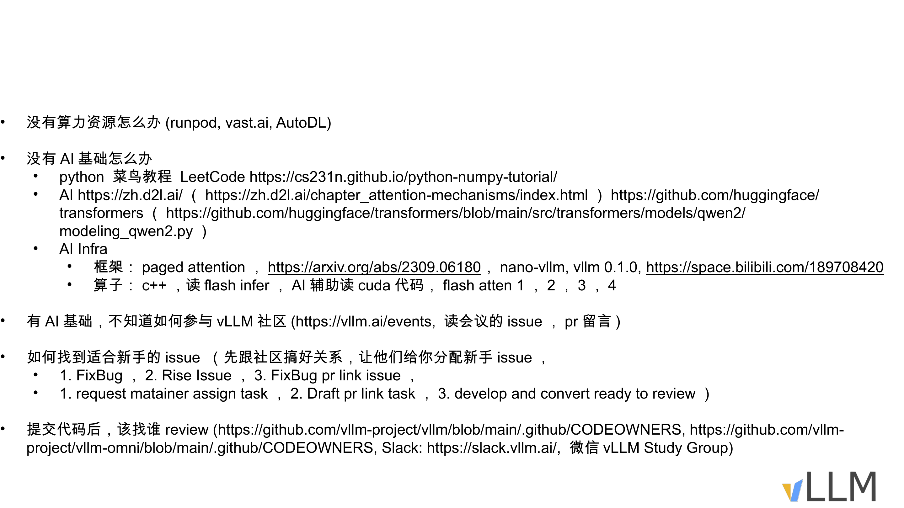

# Getting Started with AI Infra and Contributing to vLLM: Compute Resources, Source Code Reading, and Collaboration Workflows

> Start from a runnable experimental environment, progressively understand inference systems, and participate in reviewable open-source contributions

**Source video**: [Bilibili BV1nEYv6XE15](https://www.bilibili.com/video/BV1nEYv6XE15) · **Slides**: [AI Infra beginner Q&A materials](https://drive.google.com/drive/folders/1IgC1258EOrsSughkngg_iNLiqs_d0AvR)


Contributing to vLLM can begin with a reproducible issue or a piece of code you can explain clearly. This newcomer Q&A session covered three interrelated questions: how to obtain experimental resources without a local GPU, how to progress from model fundamentals to inference frameworks and operators, and how to communicate tasks with maintainers, submit PRs, and follow up on reviews. This article organizes the livestream content along that path, separating the speaker's community observations from verifiable operational steps.

The rental prices and PyTorch versions mentioned are historical examples from this particular session and do not represent current quotes or installation combinations applicable to all hardware. Source code reading, documentation improvements, and some testing can begin on an existing computer; matching hardware should be prepared only when GPU execution behavior needs to be verified.

**Target audience**: Developers with basic programming skills who want to enter the field of large-model inference infrastructure and participate in the vLLM open-source community.

**Prerequisites**:

- Basic Python programming experience
- Fundamental Git and GitHub knowledge

**Reading objectives**:

1. Master strategies and parameter anchors for building a low-cost large-model development environment
2. Clarify the progressive learning path from model architecture to low-level operators
3. Understand the collaborative relationships among task claiming, Draft PRs, testing, and code review

---

## 1. Breaking the Compute Barrier: Cloud GPU Selection and Cost Control

### The Starting Conflict: No Local GPU—How Do You Begin Large-Model Infra Development?

The livestream first addressed developers who need GPU experimentation but lack local hardware. Runpod, vast.ai, and AutoDL were the compute rental options the speaker listed. The value of renting is short-term, task-driven hardware access; whether it is cost-effective depends on the model, test scale, instance pricing, and usage duration—not GPU model alone.

The following slide, the first page of the presentation, places the compute problem at the top of all newcomer obstacles. Subsequent items also cover foundational AI learning and community participation paths—topics we will expand on in later sections.


*Figure: Presentation slide 1. The first line reads "What if I have no compute resources?" and lists three platform options: Runpod, vast.ai, and AutoDL.*

### Selection Decision Tree: From Task Scale to GPU Model

Cloud development scenarios can be split into two paths by model scale, each annotated with recommended GPUs, reference costs, and typical use cases:

| Decision Dimension | Path A: Small-Parameter Models | Path B: High-VRAM Models |
|---|---|---|
| **Typical tasks** | TTS speech models (1B–2B parameters) | Video generation models (HunyuanVideo, MiniMax H3, etc.) |
| **VRAM pressure** | Must be estimated based on precision, context length, and concurrency | Generally requires larger VRAM capacity; specifics depend on task configuration |
| **Recommended GPUs** | RTX 4090 / RTX 5090 | H-series (H100/H200), B-series, or Pro6000 |
| **Reference rental cost** | Approx. \$0.3–\$0.4/hour | No specific unit price given in the presentation materials |
| **Selection rationale** | Cost-first; sufficient for compilation and single-GPU inference | VRAM-first; verify actual footprint of model weights and intermediate activations |

**Branching logic**: Determine what you need to verify before choosing hardware. The speaker contrasted small-parameter TTS models with video generation models to show that VRAM pressure between the two task types can differ dramatically. Even at the same parameter count, precision, sequence length, batch size, and intermediate activations all affect memory usage. The GPU models in the table illustrate the selection thought process and cannot substitute for a minimum-run test on the target model.

Source code reading does not require renting high-end GPUs first. When preparing to run GPU-related tests, list the paths that need verification, confirm whether a single GPU suffices, whether a specific architecture is required, and whether multi-GPU communication is involved. This ensures that rental time is spent primarily on executing experiments.

### Billing Causality and Lifecycle Management

The speaker emphasized that after development concludes, you must check the instance state to prevent idle GPU charges. In practice, this breaks down into three checks: whether code and experimental results have been saved, whether compute resources have been released, and whether any retained storage continues to incur charges.

Taking Runpod as an example, stopping a Pod releases the GPU, but a retained volume disk may still incur charges; before terminating a Pod, confirm the storage type where your data resides. "Paused" should not be naively interpreted as "all charges are zero." For exact behavior, refer to the [Runpod Pod Management documentation](https://docs.runpod.io/pods/manage-pods).

### Environment Preparation: Verify Versions First, Then Validate Devices

The speaker used PyTorch 2.9.0 as an example, recommending that official release version combinations be preferred. This version number was illustrative at the time of the session and should not be directly applied to the current vLLM main branch, RTX 5090, or other hardware. vLLM build artifacts have compatibility constraints with PyTorch, CUDA, and build configurations; the source development workflow using an existing PyTorch installation also has dedicated steps—see the [vLLM GPU Installation documentation](https://docs.vllm.ai/en/latest/getting_started/installation/gpu/).

After preparing the environment required by your chosen versions, start with read-only checks:

```bash
#In an NVIDIA environment, check driver and devices
nvidia-smi

#After installation, check whether PyTorch can detect CUDA
python -c "import torch; print(torch.__version__, torch.cuda.is_available())"
```

Device visibility is only the first step; you should also run small-scale tests corresponding to the scope of your changes. Recording the repository commit, PyTorch version, CUDA environment, and hardware model helps maintainers reproduce your results. When reading older code for learning purposes, keep that environment separate from the dependency environment of the current development branch.

### Summary

| Dimension | Applicable Scope | Inapplicable or Requires Caution |
|---|---|---|
| Task type | Source code reading, compilation, unit tests, small-scale inference | Large-scale training, prolonged continuous experiments |
| Cost controllability | Controllable when stop/terminate is strictly enforced | Uncontrollable with shared accounts or forgotten shutdowns |
| Version stability | Pinned official PyTorch release + matching CUDA | Error-prone with nightly or unreleased versions |

Cloud rental provides a way to experiment without purchasing hardware upfront. First confirm the scope of your experiments, then control instance uptime, and retain reproducible environment records—only then can you map compute costs to actual output.

---


## 2. Architecture Deconstruction: From Transformer to Qwen2 Source Code Analysis

### The Starting Conflict: Every Symbol Is Familiar, but Strung Together It Reads Like Gibberish

The cloud environment is ready and `nvidia-smi` runs in the terminal, but opening a large-model inference framework repository—hundreds of files, massive tensor operations, deeply nested class hierarchies—leaves you with no idea which line to start from. The root cause: readability of large-model code simultaneously depends on two layers of prerequisite knowledge—**programming syntax** and **model theory**. Missing either layer makes the source code impossible to follow. The real question is therefore not "which file to read" but "in what order to fill which prerequisites, and then which file to read."

### Three-Stage Knowledge Dependency Graph

The shortest knowledge chain required to "understand large-model source code" is broken into three stages, where the output of each stage is exactly the input prerequisite for the next:

```text
Python basics (syntax and classes)
    ↓
Transformer theory (Q/K/V and attention)
    ↓
Qwen2 source (forward pass and position encoding)
```

**Causal relationships between nodes**:

- **① → ②**: Stage ① solves "can read Python." The goal of practice is to be able to read control flow, tensor operations, and class organization—mastery need not be measured by a fixed problem count. The syntax reading ability from this stage is the prerequisite for understanding code examples when studying Transformer theory (a neural network architecture built entirely on the attention mechanism) in Stage ②.
- **② → ③**: The key anchor of Stage ② is the Attention Mechanism—a computational method that allows the model to dynamically focus on relevant positions when processing sequences. The attention mechanism chapter on d2l.ai provides a complete explanation. Once you understand the meaning of the three matrix operations Q (Query), K (Key), and V (Value), the linear projection layers in Stage ③ are no longer abstract symbols.

### Causal Rationale: Why Anchor on Qwen2

The HuggingFace transformers repository contains dozens of model implementations. The reasons for recommending Qwen2 (the second-generation Tongyi Qianwen large language model) code as the priority reading target are threefold:

1. **Most basic implementation**: Qwen2 is a standard dense model (as opposed to sparse architectures such as Mixture of Experts). `modeling_qwen2.py` contains the most basic and simplest implementation of mainstream large language models—core components including attention computation and RoPE (Rotary Position Embedding) are all present, making it an ideal starting point for tracing the forward pass.
2. **Widely referenced**: Many subsequent models in the repository directly import Qwen2 modules to build their own architectures; understanding it effectively gives you a universal key.
3. **Minimal engineering wrapping**: In HuggingFace, each model's inference code is self-contained; you can locate the forward-pass path without tracing complex scheduling logic.

### Minimal Example: Five Steps to Locate the Attention Computation Block

```text
Step 1 → Open the GitHub repository huggingface/transformers
Step 2 → Navigate to src/transformers/models/qwen2/
Step 3 → Open modeling_qwen2.py (the model backbone file)
Step 4 → Search for "Attention" within the file to locate the attention class definition
         → Inside that class, find Q/K/V linear projections and the RoPE call
Step 5 → Trace callers upward from the attention class
         → Upper-level classes chain the embedding layer, multiple attention blocks,
           and the output head, forming the
           "input token → embedding → attention → output probability" pipeline
```

After completing these five steps, you can see a complete forward-pass code path. When you later encounter MoE architectures or multimodal models, you only need to locate the differences relative to this baseline.

### Summary and Boundaries

- **Focus on the current objective**: If starting with the Qwen2 text model, understanding the Transformer is sufficient; supplement with corresponding structures only when vision or audio models are involved.
- **No need to master complex architecture variants**: Advanced directions such as Mixture of Experts and linear attention should be explored on demand after understanding Qwen2.
- **No need to learn AI Infra knowledge in advance**: HuggingFace's framework is designed to lower the barrier; model architecture can be understood without low-level infrastructure knowledge.


---


## 3. Infra Deep Dive: Paged Attention and Low-Level Operator Analysis

### The Starting Conflict: The Mechanisms You Want to Understand Are Hidden Behind Mature Engineering Abstractions

After understanding Embedding, Transformer Blocks, and vocabulary mapping, you can further trace how vLLM organizes inference. A mature framework must support multiple models, hardware targets, and attention backends, so core mechanisms are spread across many modules. The speaker recommended first building a conceptual understanding of PagedAttention using a smaller code implementation, then returning to the production development version to find corresponding paths.

The approach is to split the learning objective into two independent levels—**framework level** and **operator level**—and select the highest-information-density materials for each.

### Layered Structure and Learning Entry Points

| Level | Focus | Recommended Entry Point | Core Outcome |
|-------|-------|------------------------|--------------|
| **Framework level** | VRAM paging, KV cache allocation and reclamation, scheduler coordination | vLLM 0.1.0 source code; nano-vllm project | Understand the data flow and control flow of Paged Attention |
| **Operator level** | GPU implementation of blocked attention computation, memory access patterns | Flash Attention (generations 1 through 4); FlashInfer operator library | Understand the computational principles of hardware-level acceleration |

The dependency between the two levels is **top-down invocation, bottom-up constraint**: the framework level determines "when to compute and where data resides"; the operator level determines "how to compute fastest." It is recommended to start from the framework level to build a global understanding, then go deeper into the operator level to understand performance bottlenecks.

### Framework Level: Finding Unobscured Logic in Early Versions

**Why 0.1.0?** In vLLM's original 0.1.0 release, the core developers implemented a basic but complete Paged Attention prototype. Compared to the current main branch, the early version has two key advantages: ① The codebase is small, free of multi-backend adaptation and complex scheduling branches, so the core path is immediately clear; ② The Paged Attention CUDA (NVIDIA's parallel computing platform and programming model) operators had not yet been extracted into external libraries, allowing you to see the full call chain from Python scheduling to GPU kernels within a single repository.

**nano-vllm** is a community-maintained minimalist reimplementation project that aims to demonstrate the core ideas of Paged Attention with the least code. It is suitable as warm-up material before reading the 0.1.0 source—grasp the paging concept in a few hundred lines, then see the engineering realization in the early version.

**Closure criterion for framework-level learning**: You are ready to move to the operator level once you can answer the following three questions—After an inference request arrives, how are KV cache physical blocks allocated? When multiple requests share the same prefix tokens, what happens to the logical-to-physical block mapping? After a request completes, how are its occupied physical blocks reclaimed?

### Operator Level: The Flash Attention Family and FlashInfer

The operator level refers to low-level code that executes matrix operations directly on the GPU, typically written in CUDA.

- **Flash Attention** (a fast and memory-efficient attention algorithm): Continuously evolved from generation 1 through generation 4. The core idea is to tile the attention matrix into blocks that are computed in SRAM, avoiding storage of the full $N \times N$ attention matrix in HBM.
- **FlashInfer** (an operator library for large-model inference): The attention operators in vLLM's current version are primarily based on the FlashInfer backend. New attention support and custom operators contributed by hardware vendors for vLLM are also prioritized for inclusion in this repository.

Whether it is Flash Attention's tiling or the blocked loops in the inference stage, the underlying philosophy is highly consistent: partition large matrices into sub-blocks that fit GPU shared memory, compute block by block with online reduction, and trade this for a substantial decrease in VRAM usage.

### Minimal Example: Using AI Assistants to Read CUDA Operator Code

Community engineers mentioned during the session that AI code assistants have reached practical utility for reading CUDA code. The following prompt template can be used directly:

```text
I am reading a CUDA kernel in the FlashInfer repository.
The file path is [fill in file path].

Please help me with the following tasks:
1. Explain the meaning of each parameter of the __global__ function line by line;
2. Annotate which variables are stored in shared memory and which in registers;
3. Draw the thread-to-data mapping of this kernel;
4. Indicate which step of the attention formula corresponds to the reduction operation inside the loop.
```

> **Usage boundaries**: AI assistants excel at explaining the local logic of a single kernel but may err on cross-kernel data-flow dependencies and host–device interaction timing. Critical conclusions should still be cross-verified against source code comments.

### Summary

| Dimension | Framework Level | Operator Level |
|-----------|----------------|----------------|
| Core question | How is VRAM managed; how are requests scheduled | How to compute matrices fastest |
| Language | Primarily Python | Primarily CUDA / C++ |
| Learning entry point | vLLM 0.1.0, nano-vllm | Flash Attention papers and code, FlashInfer |
| Closure criterion | Can describe the KV cache paging allocation and reclamation flow | Can explain the tiling and reduction of an attention kernel |


---


## 4. Community Participation: Helping Maintainers Understand Your Problem and Plan

### Observations and Suggestions from the Livestream

The speaker observed that some newcomer-friendly issues quickly attract auto-generated PRs, and maintainers also face heavy notification and review pressure. This is a community observation from this particular session; it does not mean good first issues have become ineffective, nor that all AI-assisted contributions lack value. Contributors still need to understand the code, verify behavior, and take responsibility for their submissions.

The speaker recommended leveraging two types of entry points simultaneously: one is public Issue and PR discussions; the other is module meetings and community events. The former leaves searchable problems and solutions; the latter helps in understanding what maintainers currently care about most. The two are complementary.

| Entry Point | Information You Can Obtain | Suitable Follow-Up Actions |
|---|---|---|
| good first issue or existing bug reports | Reproduction steps, requirement boundaries, existing discussion | Verify whether the issue still needs attention; state your plan and request feedback |
| Module meetings | Roadmap, current pain points, PRs in progress | Choose a well-scoped problem; follow up with a written discussion after the meeting |
| PR discussions | Design trade-offs, testing requirements, review standards | After reading the context, provide reproduction results or specific suggestions |
| CODEOWNERS | Code owners mapped to file paths | Identify the right person to discuss approaches and request reviews |

### Making Communication Contain Actionable Information

What maintainers typically need to know is: what problem you observed, how to reproduce it, where you plan to make changes, and what uncertainties remain. Expressing this information is more likely to elicit concrete feedback than simply asking "are there any tasks?" The purpose of building connections is also to reduce redundant explanations and duplicated work—not to bypass code quality requirements.

Suppose you heard at a module weekly meeting that a certain interface lacks boundary checking. After the meeting, you can leave a comment on the corresponding Issue. The names and branch names below are purely illustrative:

```text
Hi @Alice,

I reproduced the boundary-checking issue after today's weekly meeting.
Reproduction steps and logs are below. My initial assessment is that
it involves [file:line number].

I plan to add validation for [parameter] along with a corresponding
regression test. Is anyone else already working on this? If the
direction looks right, I'm happy to continue.
```

This comment combines reproduction, scope, and collaboration intent. If the maintainer points out an existing related PR, read or join that work first; if the problem definition is unclear, refine the reproduction rather than rushing to submit a large-scale change.

### How to Prepare for Meetings

The session mentioned vLLM-Omni weekly meetings, AMD-related meetings, and module bi-weekly meetings. Actual times and participation methods should be checked on the community events page and meeting announcements; times mentioned in a single livestream should not be treated as a fixed schedule.

Reading relevant Issues before the meeting and preparing a specific question, then writing the conclusions back to the public discussion afterward, allows people who did not attend to continue following up. Listening in can also help newcomers learn terminology and project context; whether or not you speak should not be the sole criterion for judging effective participation.

Understanding project priorities, creating searchable discussion records, and demonstrating the ability to follow through consistently are usually more beneficial to collaboration than racing to be the first to submit. Meetings, asynchronous comments, and code contributions are all forms of participation; individuals can choose based on time zone and experience.

---

## 5. Submission Workflow: Using Draft PRs to Express Progress and Work Boundaries

### Self-Discovered Issues vs. Claiming Existing Issues

The session discussed two paths. When you discover a bug yourself, you can complete reproduction and an initial fix, then publish the problem description and PR together. For existing Issues, you should first read the discussion, confirm whether someone is already working on it, and state your plan. For design changes or larger-scope modifications, discussing the approach first can reduce rework.

| Stage | Content to Provide | Completion Criteria |
|---|---|---|
| Reproduction | Input, environment, actual behavior vs. expected behavior | Others can reproduce the problem |
| Scope communication | Modules you plan to modify, existing related work | Goal and division of labor are generally clear |
| Draft PR | Initial implementation, linked Issue, to-do items | Readers know which parts are not yet reviewable |
| Refinement | Regression tests, CI results, and design notes | Core behavior is verified |
| Ready for Review | Reviewable changes and test records | Proactively request review from the corresponding owner |
| Iteration and merge | Respond to feedback, revise code | Meets the project's review requirements |

### What Draft PRs Solve

A Draft PR makes work-in-progress visible, allowing other contributors to see the existing implementation and outstanding items. The speaker used the term "claiming a spot" to describe this practice and also suggested submitting drafts early. A more robust practice is to ensure the draft contains meaningful reproduction, an initial implementation, or a clear plan—rather than creating a change with no informational value.

A linked PR can reduce the chance of duplicated work but is not a task lock: it cannot guarantee that no one else will submit, nor can it block all automated tools. Whether a task is assigned and whether an approach is accepted still depend on repository rules and maintainer communication. GitHub's feature mechanics and the speaker's observations about tool behavior should be distinguished.

### Linking an Issue in the Description

Assuming the issue number is `#5021`, you can state the linkage and current status in the PR description:

```markdown
## Summary
Draft fix for the encoding issue described in #5021.

Fixes #5021

## Status
- [x] Reproduced locally
- [ ] Regression tests added
- [ ] CI passed
```

The number is for illustration only. The conditions under which closing keywords take effect depend on GitHub's branch and linkage rules; during the draft stage, you should verify that the linkage displayed in the UI matches your expectations. When ready for review, change the status to Ready for Review and complete the reproduction results and test descriptions.

### Avoid Turning Drafts into a New Communication Burden

Continuously update progress and clearly state blockers; if you are temporarily unable to continue, inform maintainers and other contributors. Do not interpret a request for assignment as a merge commitment, and do not treat a Draft PR as a right to hold a task indefinitely. The goal of collaboration is to have the problem reliably resolved and to enable reviewers to evaluate your changes.

---

## 6. Closing the Review Loop: Code Review Strategies That Cut Through Information Noise

### The Conflict: PR Submitted, Then Silence

A common frustrating scenario: you spend days completing the code, submit a PR, and see auto-assigned Reviewers on the GitHub page—then nothing happens. The comment section is flooded with CI bots and code-scanning bot output, but the actual maintainer never appears.

The speaker noted that the sheer volume of automated notifications may cause maintainers to miss review requests. While waiting, you can first check whether the PR is still in Draft, whether tests have passed, whether the description is complete, and whether you have identified the appropriate owner—rather than concluding solely from the absence of a reply that the notification mechanism is broken.

### Precision Routing: Three Review Paths Compared

| Path | Information Channel | Effectiveness | Reason |
|------|-------------------|:------------:|--------|
| GitHub review request and comments | GitHub Notification | Baseline channel | Preserves public review context |
| Check CODEOWNERS → Slack discussion | Slack instant messaging | Supplementary channel | State the blocker and PR link in the project's customary channel |
| Communication in existing community groups | Community group messages | Use as needed | Follow group conventions; bring final conclusions back to the PR |

These channels are complementary and do not guarantee response speed. When sending a reminder, include the PR link, scope of changes, completed tests, and the specific feedback you are looking for—this reduces the cost for the other party to re-locate context.

### Key Node: The CODEOWNERS File

CODEOWNERS is located at the `.github/CODEOWNERS` path in the repository and declares the owner of each directory via path-matching rules. In the vLLM main repository, this file is organized by module—CPU-related, Intel GPU-related, frontend-related, speculative decoding-related, etc., each with clearly designated owners. Sub-projects such as vllm-omni also have their own independent CODEOWNERS files.

### Minimal Example: From File to Person

**Step 1**: Read CODEOWNERS from the repository root:

```text
#.github/CODEOWNERS (illustrative, not complete)
/vllm/spec_decode/       @maintainer-alice
/vllm/attention/         @maintainer-bob
/vllm/entrypoints/       @maintainer-carol
```

Suppose your PR modifies files under `/vllm/spec_decode/`; the target owner is `@maintainer-alice`.

**Step 2**: Choose an effective channel. In the corresponding Slack channel or a direct message, include the PR link and describe the changes and the review scope you are requesting. If you confirm that the owner is a member of the Chinese-language community, you may also post the PR link in the WeChat developer group and @ the appropriate person.

**Step 3**: If there is still no response, raise the matter directly at a community weekly meeting.

### Edge Cases

| Scenario | Recommended Action |
|----------|-------------------|
| CODEOWNERS does not cover the path you modified | Check the recent git log for that directory and contact the active committer directly |
| The designated owner has been inactive for an extended period | Describe the situation in a public Slack channel and request assistance from another maintainer |
| The PR spans multiple modules | Contact multiple owners; describe the changes for each module in separate sections of the PR description |

> **Note**: The usernames in the examples above are placeholders. In practice, always refer to the latest CODEOWNERS file in the repository.

### Summary

From experimental environment to review follow-up, every step requires leaving verifiable information. The speaker recommended finding the responsible owner through CODEOWNERS and, when necessary, requesting feedback in the community's customary channels. Public PR discussions should still preserve design conclusions and verification results so that future participants can understand the changes.

---

## Conclusion

1. **Determine the experiment first, then choose compute**: Source code reading can proceed first; GPU experiments are configured according to model, precision, context, and concurrency requirements.
2. **Manage resource lifecycles**: Save data, release compute resources, and check whether any retained storage continues to incur charges.
3. **Build model understanding incrementally**: Python, the attention mechanism, and Qwen2 source code form a reference learning path that can be adjusted based on your existing background.
4. **Learn the framework and operators separately**: Early vLLM or nano-vllm helps establish paging and scheduling concepts; FlashInfer and Flash Attention are suited for further study of execution efficiency.
5. **State your collaboration intent clearly**: Reproduction, plans, and scope descriptions help maintainers assign tasks and reduce duplicated work.
6. **Let Draft PRs carry real progress**: They are meant to express an incomplete implementation—they cannot guarantee exclusive claiming or block automated submissions.
7. **Close with reviewable results**: Prepare tests and documentation, convert to Ready for Review, contact the corresponding owner, and continuously respond to feedback.
