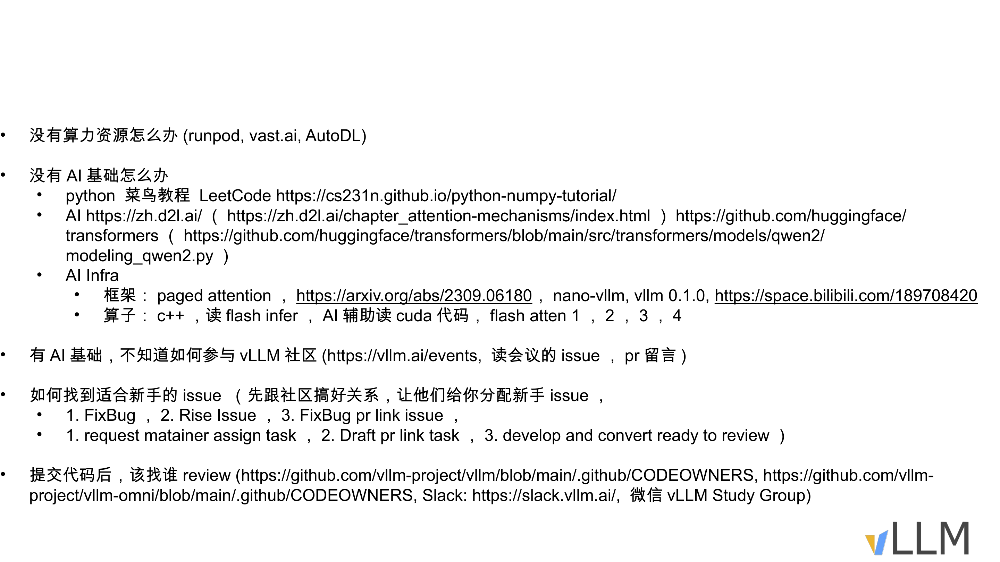

# AI Infra 入门与 vLLM 开源贡献：算力、源码阅读与协作流程

> 从可运行的实验环境开始，逐步理解推理系统并参与可审查的开源贡献

**原视频**：[AI Infra 新手答疑：vLLM 从入门到精通](https://www.bilibili.com/video/BV1nEYv6XE15) · **配套资料**：[AI Infra 新手答疑资料目录](https://drive.google.com/drive/folders/1IgC1258EOrsSughkngg_iNLiqs_d0AvR)


参与 vLLM 开源贡献，可以从一个能复现的问题或一段能解释清楚的代码开始。本次新手答疑讨论了三个相互关联的问题：没有本地 GPU 时如何获得实验资源，如何从模型基础走到推理框架与算子，以及如何与维护者沟通任务、提交 PR 并跟进审查。本文沿这条路径整理直播内容，并把讲者的社区观察与可验证的操作步骤分开说明。

文中的租赁价格和 PyTorch 版本是本次分享中的历史示例，不代表当前报价或适用于所有硬件的安装组合。源码阅读、文档改进和部分测试可以先在已有电脑上开展；需要验证 GPU 执行行为时，再准备匹配的硬件环境。

**适读人群**：具备基础编程能力，希望进入大模型推理基础设施领域并参与 vLLM 开源社区的开发者。

**前置知识**：

- 基础 Python 编程经验
- 基本的 Git 与 GitHub 操作知识

**阅读目标**：

1. 掌握低成本搭建大模型开发环境的策略与参数锚点
2. 明确从模型架构到底层算子的递进式学习路径
3. 理解任务认领、Draft PR、测试与代码审查之间的协作关系

---

## 一、算力破局：云端 GPU 选型与成本控制机制

### 矛盾起点：本地无卡，如何启动大模型 Infra 开发？

直播先讨论了需要 GPU 实验、但缺少本地设备的开发者。Runpod、vast.ai 和 AutoDL 是讲者列举的算力租赁选项。租赁的价值是按任务短期使用硬件；是否划算取决于模型、测试规模、实例价格和使用时长，不能只看显卡型号。

下面这张 PPT 首页将算力问题列在所有新手障碍之首，后续条目还覆盖了 AI 基础学习、社区参与路径等内容——我们会在后续章节逐一展开。


*图注：演讲 PPT 第 1 页。首行列出"没有算力资源怎么办"并给出 runpod、vast.ai、AutoDL 三个平台选项。*

### 选型决策树：从任务规模到显卡型号

云端开发场景可按模型规模拆成两条路径，每条路径标注了推荐显卡、参考成本与典型用例：

| 决策维度 | 路径 A：小参数量模型 | 路径 B：大显存需求模型 |
|---|---|---|
| **典型任务** | TTS 语音模型（1B–2B 参数） | 视频生成模型（HunyuanVideo、MiniMax H3 等） |
| **显存压力** | 需要按精度、上下文长度与并发量测算 | 通常需要更大的显存容量，具体取决于任务配置 |
| **推荐显卡** | RTX 4090 / RTX 5090 | H 系列（H100/H200）、B 系列或 Pro6000 |
| **参考租赁成本** | 约 $0.3–$0.4 / 小时 | 演讲材料未给出具体单价 |
| **选型依据** | 成本优先，满足编译与单卡推理即可 | 显存优先，核对模型权重与中间激活的实际占用 |

**分支逻辑**：先确认要验证什么，再选择硬件。讲者以小参数量 TTS 模型和视频生成模型作对比，说明两类任务的显存压力可能相差很大。即使参数量相同，精度、序列长度、批量大小和中间激活也会影响占用。表中的型号用于理解选型思路，不能替代目标模型的最小运行测试。

源码阅读不需要先租高端显卡。准备运行 GPU 相关测试时，应先列出需要验证的路径，再确认单卡是否足够、是否依赖特定架构，以及是否涉及多卡通信。这样才能让租赁时间主要用于执行实验。

### 计费因果与生命周期管理

讲者强调，开发结束后要检查实例状态，避免 GPU 持续空转。实际操作应分成三个检查：代码和实验结果是否已保存、计算资源是否已释放、仍保留的存储是否继续计费。

以 Runpod 为例，停止 Pod 会释放 GPU，但保留的 volume disk 仍可能计费；终止 Pod 前需要确认数据所在的存储类型。不能把“暂停”简单理解成“所有费用归零”。具体行为以 [Runpod Pod 管理文档](https://docs.runpod.io/pods/manage-pods) 为准。

### 环境准备：先核对版本，再验证设备

讲者以 PyTorch 2.9.0 为例，建议优先使用明确的正式版本组合。这个版本号是分享时的示例，不应直接套用到当前 vLLM 主线、RTX 5090 或其他硬件上。vLLM 的编译产物与 PyTorch、CUDA 及构建配置存在兼容约束；使用已有 PyTorch 的源码开发流程也有专门步骤，参见 [vLLM GPU 安装文档](https://docs.vllm.ai/en/latest/getting_started/installation/gpu/)。

准备好所选版本要求的环境后，可以先做只读检查：

```bash
#NVIDIA 环境中检查驱动与设备
nvidia-smi

#安装完成后检查 PyTorch 能否识别 CUDA
python -c "import torch; print(torch.__version__, torch.cuda.is_available())"
```

设备可见只是第一步，还应运行与修改范围对应的小规模测试。记录仓库提交、PyTorch 版本、CUDA 环境和硬件型号，有助于维护者复现结果。阅读旧版代码用于学习时，也应与当前开发分支的依赖环境分开。

### 小结

| 维度 | 适用范围 | 不适用或需谨慎 |
|---|---|---|
| 任务类型 | 源码阅读、编译、单元测试、小规模推理 | 大规模训练、长时间连续实验 |
| 成本可控性 | 严格执行 stop/terminate 时可控 | 多人共享账户、忘记关机时失控 |
| 版本稳定性 | 锁定 PyTorch 正式版 + 对应 CUDA | 使用 nightly 或未发布版本易出错 |

云端租赁提供了无需先购买设备的实验方式。先确认实验范围，再控制实例运行时长，并保留可复现的环境记录，才能把算力费用与实际产出对应起来。

---


## 二、架构解构：从 Transformer 到 Qwen2 源码剖析

### 矛盾起点：每个符号都认识，串在一起就是天书

云端环境就绪，终端能跑通 `nvidia-smi`，但打开一个大模型推理框架的仓库——数百个文件、大量张量运算、层层嵌套的类继承——完全不知从哪一行读起。根源在于：大模型代码的可读性同时依赖**编程语法**和**模型理论**两层前置知识，缺少任何一层，源码就无法串联。因此问题的本质不是"该读哪个文件"，而是"该按什么顺序补齐哪些前置知识，然后读哪个文件"。

### 知识依赖三阶图谱

将"读懂大模型源码"所需的最短知识链拆为三个阶段，每阶段的输出恰好构成下一阶段的输入前提：

```text
Python 基础（语法与类）
    ↓
Transformer 理论（Q/K/V 与注意力）
    ↓
Qwen2 源码（前向传播与位置编码）
```

**节点之间的因果关系**：

- **① → ②**：阶段 ① 解决"看得懂 Python"。练习的目标是能够阅读控制流、张量操作和类的组织方式，无需用固定题量衡量掌握程度。此阶段的语法阅读能力是阶段 ② 学习 Transformer（一种完全基于注意力机制构建的神经网络架构）理论时理解代码示例的前提。
- **② → ③**：阶段 ② 的关键锚点是注意力机制（Attention Mechanism，一种让模型在处理序列时动态聚焦于相关位置的计算方法）。d2l.ai 的注意力机制章节提供完整的中文讲解。掌握 Q（Query）、K（Key）、V（Value）三组矩阵运算的含义后，阶段 ③ 中的线性投影层才不再是抽象符号。

### 因果机制：为什么锚定 Qwen2

HuggingFace 的 transformers 仓库包含数十个模型实现，建议优先阅读 Qwen2（通义千问第二代大语言模型）代码的原因有三条：

1. **实现最基础**：Qwen2 是标准的稠密模型（Dense Model，区别于混合专家等稀疏架构），`modeling_qwen2.py` 包含了主流大语言模型最基础、最简单的实现——注意力计算、RoPE（Rotary Position Embedding，旋转位置编码）等核心组件俱全，适合作为追踪前向传播的起点。
2. **被广泛引用**：仓库中许多后续模型直接引用 Qwen2 的模块构建自身架构，读懂它等于拿到通用钥匙。
3. **工程封装最少**：HuggingFace 中每个模型的推理代码各自独立，无需追溯复杂调度逻辑就能找到前向传播路径。

### 最小例子：五步定位注意力计算代码块

```text
步骤 1 → 打开 GitHub 仓库 huggingface/transformers
步骤 2 → 导航至 src/transformers/models/qwen2/
步骤 3 → 打开 modeling_qwen2.py（模型主干文件）
步骤 4 → 文件内搜索 "Attention"，定位注意力类定义
         → 该类内部可找到 Q/K/V 线性投影和 RoPE 调用
步骤 5 → 从注意力类向上追溯调用方
         → 上层类串联嵌入层、多层注意力块和输出头，
           构成 "输入 token → 嵌入 → 注意力 → 输出概率" 链路
```

完成这五步后即可看到一条完整的前向传播代码路径。后续遇到 MoE 架构或多模态模型，只需在此基础上定位差异部分。

### 小结与边界

- **先聚焦当前目标**：若从 Qwen2 文本模型入手，可先理解 Transformer；涉及视觉或音频模型时，再补充对应结构。
- **不需掌握复杂架构变体**：混合专家模型、线性注意力等进阶方向应在读懂 Qwen2 之后按需扩展。
- **不需提前学习 AI Infra 知识**：HuggingFace 框架的设计目标就是降低门槛，不依赖底层基础设施知识也能理解模型架构。


---


## 三、Infra 进阶：Paged Attention 与底层算子解析

### 矛盾起点：你想理解的机制，被成熟工程的抽象层掩盖了

理解 Embedding、Transformer Block 和词表映射之后，可以进一步追踪 vLLM 如何组织推理。成熟框架需要兼容多种模型、硬件和注意力后端，因此核心机制分散在多个模块中。讲者建议先用较小的代码实现建立 PagedAttention（页式注意力）的概念，再回到实际开发版本寻找对应路径。

解决思路是：把学习目标拆成**框架层**和**算子层**两个独立层次，分别选择信息密度最高的材料。

### 分层结构与学习入口

| 层次 | 关注点 | 推荐入口 | 核心产出 |
|------|--------|----------|----------|
| **框架层** | 显存分页管理、KV Cache 分配与回收、调度器协调 | vLLM 0.1.0 版本源码；nano-vllm 项目 | 理解 Paged Attention 的数据流与控制流 |
| **算子层** | 注意力分块计算的 GPU 实现、内存访问模式 | Flash Attention（1 至 4 代）；FlashInfer 算子库 | 理解硬件级加速的计算原理 |

两层之间的依赖关系是**自上而下调用、自下而上约束**：框架层决定"何时计算、数据在哪"，算子层决定"怎样算最快"。建议先从框架层建立全局认知，再深入算子层理解性能瓶颈。

### 框架层：从早期版本找到未被遮蔽的逻辑

**为什么选 0.1.0？** vLLM 最初的 0.1.0 版本中，核心开发者实现了基础但完整的 Paged Attention 原型。相比当前主线代码，早期版本有两个关键优势：① 代码量小，无多后端适配与复杂调度分支，核心链路一目了然；② Paged Attention 的 CUDA（NVIDIA 推出的并行计算平台和编程模型）算子尚未抽离到外部库，可在同一仓库中看到从 Python 调度到 GPU kernel 的完整调用链。

**nano-vllm** 是社区维护的极简复现项目，目标是用最少代码展示 Paged Attention 的核心思想。适合作为阅读 0.1.0 源码前的预热材料——先在几百行代码中抓住分页思想，再到早期版本中看工程落地。

**框架层学习的闭环判断**：你能回答以下三个问题即可进入算子层——一个推理请求到达后，KV Cache 的物理块如何分配？多个请求共享相同前缀 token 时，逻辑块到物理块的映射发生了什么变化？请求结束后其占用的物理块如何回收？

### 算子层：Flash Attention 系列与 FlashInfer

算子层指直接在 GPU 上执行矩阵运算的底层代码，通常用 CUDA 编写。

- **Flash Attention**（快速且节省显存的注意力机制算法）：从第 1 代到第 4 代持续演进，核心思想是将注意力矩阵按分块（tiling）送入 SRAM 计算，避免在 HBM 中存储完整的 $N \times N$ 注意力矩阵。
- **FlashInfer**（面向大模型推理的算子库）：vLLM 当前版本的注意力算子主要基于 FlashInfer 后端。硬件厂商为 vLLM 贡献的新型注意力支持和定制算子也优先放入该仓库。

无论 Flash Attention 的 tiling 还是推理阶段的分块循环，底层思路高度一致：将大矩阵切分为适配 GPU 共享内存的子块，逐块计算并在线归约（online reduction），换取显存占用的大幅下降。

### 最小例子：用 AI 辅助阅读 CUDA 算子代码

社区工程师在分享中提到，AI 代码助手在辅助阅读 CUDA 代码方面已具备实用价值。以下提示词模板可直接使用：

```text
我正在阅读 FlashInfer 仓库中的一个 CUDA kernel，
文件路径为 [填入文件路径]。

请帮我完成以下任务：
1. 逐行解释 __global__ 函数的参数含义；
2. 标注哪些变量存储在 shared memory，哪些在 register；
3. 画出该 kernel 的线程到数据的映射关系；
4. 指出循环中的 reduction 操作对应注意力公式的哪一步。
```

> **使用边界**：AI 助手擅长解释单个 kernel 的局部逻辑，但对跨 kernel 的数据流依赖和 host-device 交互时序判断可能出错。关键结论仍需对照源码注释交叉验证。

### 小结

| 维度 | 框架层 | 算子层 |
|------|--------|--------|
| 核心问题 | 显存怎么管、请求怎么调度 | 矩阵怎么算最快 |
| 语言 | Python 为主 | CUDA / C++ 为主 |
| 学习入口 | vLLM 0.1.0、nano-vllm | Flash Attention 论文与代码、FlashInfer |
| 闭环标志 | 能描述 KV Cache 分页的分配与回收流程 | 能解释一个注意力 kernel 的 tiling 与 reduction |


---


## 四、社区参与：让维护者理解你的问题与计划

### 直播中的观察与建议

讲者观察到，一些适合新手的问题会很快出现自动生成的 PR，维护者也承受着大量通知与审查压力。这是本次分享中的社区观察，不意味着 good first issue 已经失效，也不意味着所有 AI 辅助贡献都缺乏价值。贡献者仍需要理解代码、验证行为并对提交负责。

讲者建议同时利用两类入口：一类是公开的 Issue 和 PR 讨论，另一类是模块例会与社区活动。前者留下可检索的问题与方案，后者有助于了解维护者当前最关心的工作。两者可以互相补充。

| 入口 | 可以获得的信息 | 适合的后续动作 |
|---|---|---|
| good first issue 或已有 Bug 报告 | 复现步骤、需求边界、已有讨论 | 核实是否仍需处理，说明计划并请求反馈 |
| 模块例会 | 路线图、近期难题、正在推进的 PR | 选择一个范围清楚的问题，会后补充书面讨论 |
| PR 讨论 | 设计取舍、测试要求、审查标准 | 阅读上下文后提供复现结果或具体建议 |
| CODEOWNERS | 文件路径对应的代码负责人 | 找到适合讨论方案与请求审查的人 |

### 让沟通包含可判断的信息

维护者需要知道的通常是：你看到了什么问题、如何复现、准备改动哪里，以及还存在什么不确定性。表达这些信息，比只问“有没有任务”更容易获得具体反馈。建立联系的目的也是减少重复解释和重复工作，不是绕过代码质量要求。

假设你在模块周会上听到某接口缺少边界检查，会后可以在对应 Issue 下留言。下面的人名与分支名仅作示意：

```text
Hi @Alice,

我在今天的周会后复现了这个边界检查问题。
复现步骤与日志见下方，初步判断涉及 [文件:行号]。

我计划补充 [参数] 的校验及对应回归测试。
是否已有其他人处理？如果方向合适，我愿意继续。
```

这条留言把复现、范围和协作意图放在一起。若维护者指出已有相关 PR，就先阅读或参与现有工作；若问题定义尚不清楚，就先完善复现，而不是急于提交大规模修改。

### 参加例会时如何准备

分享中提到了 vLLM-Omni 周会、AMD 相关会议和模块双周会。实际时间和参与方式需要查看社区活动页面与会议公告，不应把一次直播中提到的时间当作固定日程。

会前读相关 Issue、准备一个具体问题，会后把结论写回公开讨论，能让没有参会的人继续跟进。旁听也可以帮助新手了解术语和项目背景；不必把是否发言当作参与是否有效的唯一标准。

理解项目优先级、形成可检索的讨论记录、展示持续跟进的能力，通常比争抢最先提交更有利于协作。会议、异步评论和代码贡献都是参与方式，个人可以根据时区与经验选择。

---

## 五、提交流程：用 Draft PR 表达进展与工作边界

### 自行发现问题与认领已有问题

本次分享讨论了两条路径。自行发现 Bug 时，可以先完成复现与初步修复，再把问题说明和 PR 一起公开。对于已有 Issue，则应先阅读讨论、确认是否有人在处理，并说明自己的计划。涉及设计变更或较大范围修改时，先讨论方案可以减少返工。

| 阶段 | 应提供的内容 | 完成标准 |
|---|---|---|
| 复现 | 输入、环境、实际行为与预期行为 | 其他人能够重现问题 |
| 沟通范围 | 准备修改的模块、已有相关工作 | 目标与分工基本明确 |
| Draft PR | 初步实现、关联 Issue、待完成项 | 读者知道哪些内容尚不可审查 |
| 完善 | 回归测试、CI 结果与设计说明 | 核心行为已验证 |
| Ready for Review | 可审查的改动和测试记录 | 主动请求对应负责人审查 |
| 迭代与合入 | 回应反馈、修订代码 | 满足项目的审查要求 |

### Draft PR 能解决什么

Draft PR 将工作进展公开出来，使其他贡献者看到已有实现和待完成事项。讲者用“占坑”描述这个做法，也给出了很早提交草稿的建议。更稳妥的实践是让草稿包含有意义的复现、初步实现或明确计划，而不是只制造一个没有信息量的改动。

关联 PR 可以减少重复工作的机会，但不是任务锁：它不能保证其他人不再提交，也不能阻止所有自动化工具。任务是否分配、方案是否接受，仍取决于仓库规则和维护者沟通。GitHub 的功能机制与讲者对工具行为的观察需要区分。

### 在描述中关联 Issue

假设问题编号为 `#5021`，可以在 PR 描述中说明关联关系和当前状态：

```markdown
## Summary
Draft fix for the encoding issue described in #5021.

Fixes #5021

## Status
- [x] Reproduced locally
- [ ] Regression tests added
- [ ] CI passed
```

编号仅为示例。关闭关键词的生效条件取决于 GitHub 的分支与关联规则；在草稿阶段应检查界面上的关联是否符合预期。准备好审查后，将状态改为 Ready for Review，并补全复现结果与测试说明。

### 避免让草稿变成新的沟通负担

持续更新进展，明确阻塞项；如果暂时无法继续，就告知维护者与其他贡献者。不要把请求分配理解为合入承诺，也不要把 Draft PR 当作无限期保留任务的权利。协作的目标是让问题被可靠解决，并让审查者能够判断你的改动。

---

## 六、审查闭环：绕过信息噪音的 Code Review 策略

### 矛盾：PR 提交后石沉大海

一个常见的挫败场景：你花了数天完成代码，提交 PR 后在 GitHub 页面看到了自动分配的 Reviewer——然后就没有然后了。评论区不断有 CI 机器人、代码扫描 bot 输出信息，真正的维护者始终未出现。

讲者提醒，大量自动通知可能使维护者漏看审查请求。等待期间可以先检查 PR 是否仍为 Draft、测试是否通过、描述是否完整，以及是否已经找到对应负责人；不能仅凭没有回复判断通知机制失效。

### 精准路由：三条 Review 路径对比

| 路径 | 信息通道 | 有效性 | 原因 |
|------|---------|:------:|------|
| GitHub 审查请求与评论 | GitHub Notification | 基础通道 | 保留公开的审查上下文 |
| 查阅 CODEOWNERS → Slack 讨论 | Slack 即时消息 | 补充通道 | 在项目惯用频道说明阻塞与 PR 链接 |
| 已有社区群中的沟通 | 社区群消息 | 按需使用 | 遵循群内习惯，最终结论回到 PR |

这些渠道是补充关系，不保证回复速度。提醒时附上 PR 链接、改动范围、已完成的测试和希望得到的具体反馈，有助于减少对方重新查找上下文的成本。

### 关键节点：CODEOWNERS 文件

CODEOWNERS 位于仓库 `.github/CODEOWNERS` 路径下，以路径匹配规则声明每个目录的负责人。在 vLLM 主仓中，该文件按模块分类——CPU 相关、Intel GPU 相关、前端相关、推测解码相关等各有明确负责人。子项目 vllm-omni 同样有独立的 CODEOWNERS 文件。

### 最小例子：从文件到人

**第一步**：在仓库根目录读取 CODEOWNERS：

```text
#.github/CODEOWNERS（示意，非完整内容）
/vllm/spec_decode/       @maintainer-alice
/vllm/attention/         @maintainer-bob
/vllm/entrypoints/       @maintainer-carol
```

假设你的 PR 修改了 `/vllm/spec_decode/` 下的文件，目标负责人为 `@maintainer-alice`。

**第二步**：选择有效通道。在 Slack 对应频道或私信中附上 PR 链接，说明修改内容和期望审查范围；若确认负责人是中文社区成员，也可在微信开发者群中贴出 PR 链接并 @ 对应人员。

**第三步**：若仍无回应，可在社区周会中直接提出。

### 边界情形

| 情形 | 应对策略 |
|------|---------|
| CODEOWNERS 未覆盖你修改的路径 | 查看该目录最近的 git log，找到活跃 Committer 直接联系 |
| 负责人长期不活跃 | 在 Slack 公共频道说明情况，请求其他维护者协助 |
| PR 跨越多个模块 | 联系多位负责人，在 PR 描述中分段说明各模块改动 |

> **说明**：上文示例中的用户名均为占位符，实际操作请以仓库最新 CODEOWNERS 文件为准。

### 小结

从实验环境到审查跟进，每一步都需要留下可验证的信息。讲者建议通过 CODEOWNERS 找到负责人，必要时在社区惯用渠道请求反馈。公开的 PR 讨论仍应保存设计结论与验证结果，让后来参与的人能够理解改动。

---

## 结论

1. **先确定实验，再选择算力**：源码阅读可以先行；GPU 实验按模型、精度、上下文与并发需求配置。
2. **管理资源生命周期**：保存数据、释放计算资源，并检查仍保留的存储是否继续计费。
3. **逐步建立模型理解**：Python、注意力机制与 Qwen2 源码是一条可参考的学习路径，可按已有基础调整。
4. **分开学习框架与算子**：早期 vLLM 或 nano-vllm 帮助建立分页与调度概念，FlashInfer 与 FlashAttention 则适合继续研究执行效率。
5. **把协作意图写清楚**：复现、计划和范围说明有助于维护者分配任务，也能减少重复工作。
6. **让 Draft PR 承载真实进展**：它用于表达尚未完成的实现，不能保证排他认领或阻断自动提交。
7. **以可审查结果收尾**：准备好测试与说明，转为 Ready for Review，联系对应负责人，并持续回应反馈。
