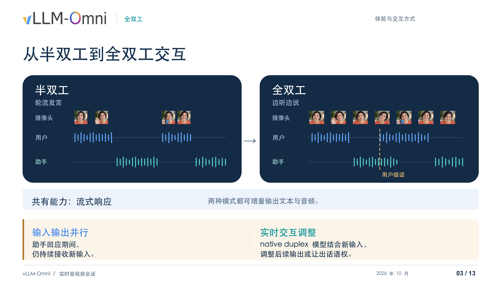
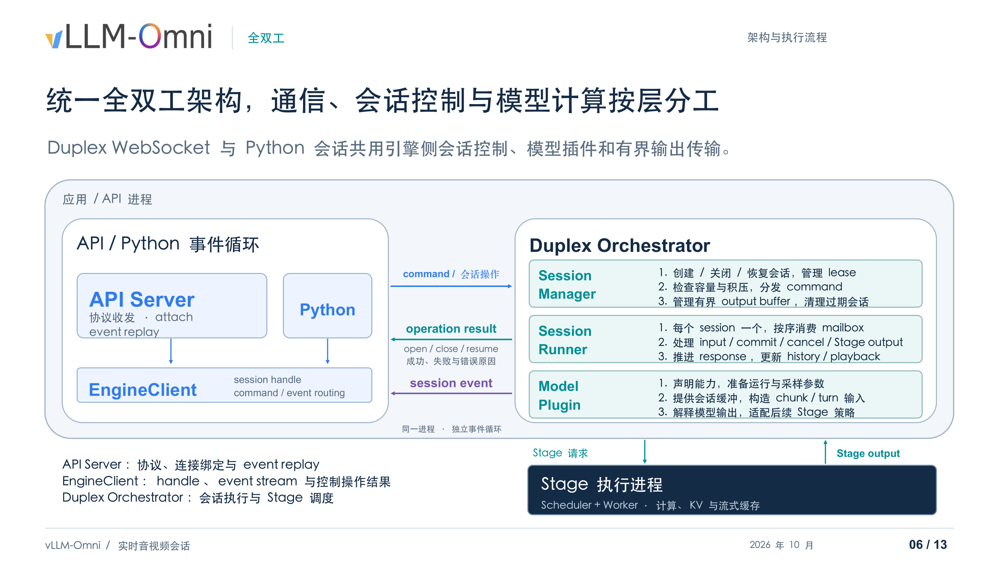
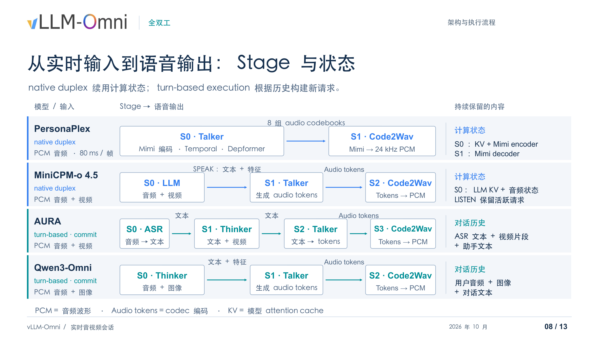
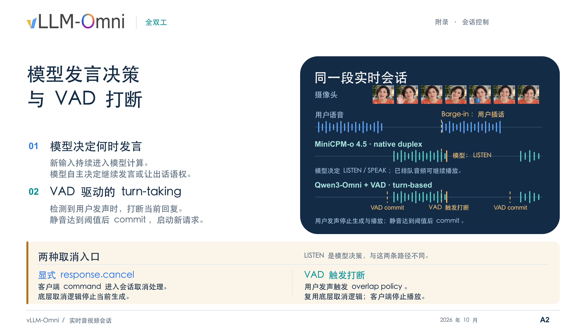
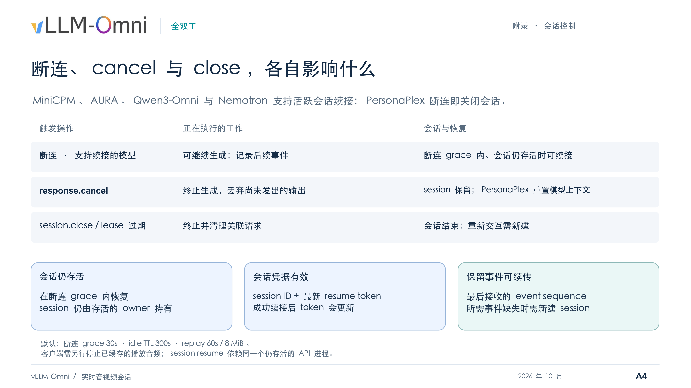
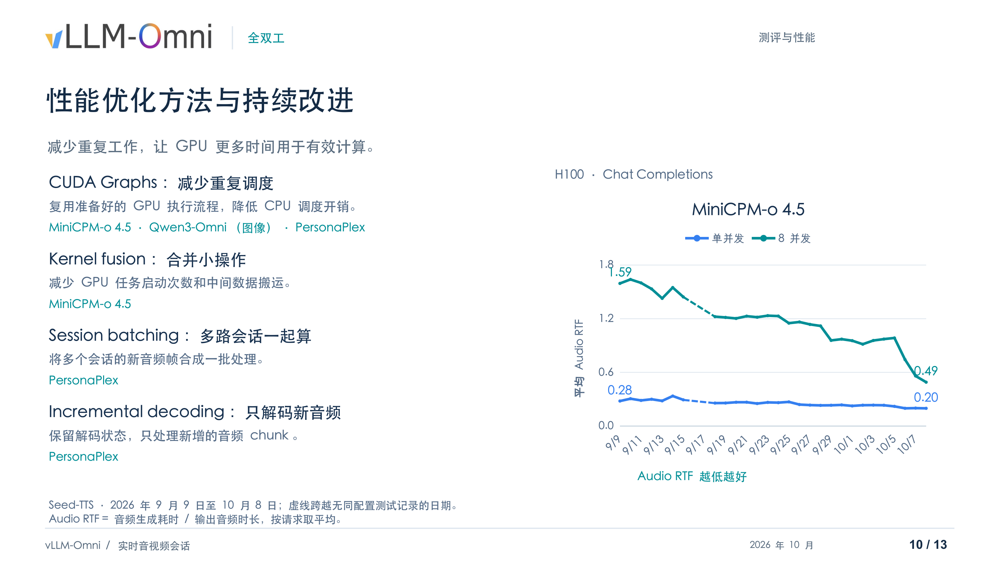
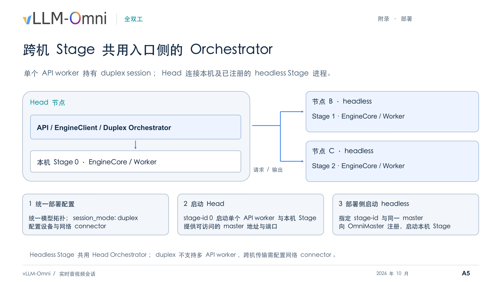
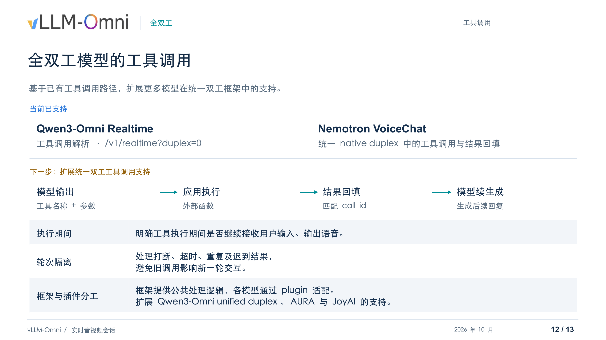

# Full-Duplex Sessions in vLLM-Omni: Model Execution, Interruption Control, and Performance

> As large models evolve from "you ask, I answer" to "listen and speak simultaneously," inference engines must handle bidirectional audio/video streams, millisecond-level interruption responses, and cross-node distributed scheduling all at once. vLLM-Omni is a full-duplex large-model inference framework supporting real-time audio/video conversations. As of 2026-10-07, over 60 contributors have participated, with more than 160 related PRs merged. This article traces the data flow and causal relationships to dissect, layer by layer, its architecture stratification, model adaptation, session control, performance optimization, and cross-node deployment mechanisms.

**Source video**: [Bilibili BV1zRpg6REeh](https://www.bilibili.com/video/BV1zRpg6REeh) · **Slides**: [vLLM-Omni full-duplex slides](https://drive.google.com/file/d/1Dh7w6MxO5QQ2HKgsNo8djFoKWIuBBrNw/view)

**Target Audience** · AI Infrastructure Engineers · Large-Model Inference Optimization Researchers · Real-Time Audio/Video Application Developers

**Prerequisites**

- Familiarity with basic concepts in large-model inference, such as KV Cache and Batching
- Knowledge of fundamental audio/video streaming protocols, such as WebSocket and PCM audio streams
- Basic understanding of concurrent programming and distributed systems architecture

**Reading Objectives**

1. Understand the core differences between half-duplex and full-duplex interaction at the system level
2. Master the layered design and event-loop mechanism of vLLM-Omni's unified full-duplex architecture
3. Clarify the execution flows and state retention strategies for different models (native full-duplex vs. turn-based)
4. Gain insight into session control, interruption mechanisms, and exception recovery logic in full-duplex scenarios
5. Acquire performance optimization methods for high-frequency real-time interaction and cross-node deployment strategies

---

## 1. From Taking Turns to Listening While Speaking

### The interaction requirement: handling input during output

The livestream contrasts half-duplex and full-duplex interaction to introduce a central question for real-time speech systems: how does the system keep receiving input while the assistant responds, and can that input change subsequent output? Interaction patterns, transport channels, and model execution need to be distinguished.

A turn-based system can keep recording. It can also use VAD (Voice Activity Detection) to detect an interruption, cancel the current response, and submit a new request. Interruption support or a bidirectional WebSocket therefore does not, by itself, establish native full-duplex model capability. Native duplex concerns a model receiving new input as execution continues and adjusting its subsequent behavior accordingly.

### The difference on a timeline

The following conceptual diagram from the livestream illustrates overlapping user and assistant speech. It does not impose a restriction on every half-duplex product implementation.

*Caption: Half-duplex interaction on the left and full-duplex interaction on the right; the right-hand diagram shows the user speaking during assistant output. Source: presentation slide 4.*

| Diagram element | Turn-taking illustration on the left | Simultaneous interaction on the right |
|---|---|---|
| User and assistant waveforms | Alternate by turn | Have overlapping intervals |
| User interruption | Handling is not expanded in the diagram | Occurs during assistant output |
| Camera input | Continuous capture depends on the implementation | Can be received continuously alongside audio |

Both approaches can stream text and audio. Streaming output reduces the wait for a complete response, but incremental output alone does not explain how new input enters inference.

### System requirements for concurrent input and output

vLLM-Omni organizes real-time interaction around a persistent session, rather than just one request and one response. This introduces three direct requirements:

1. **Coordinate input and output**: incoming data and control events must still be received while audio is emitted, without network operations blocking computation scheduling for long periods.
2. **Adapt execution to the model**: a native-duplex model can continue advancing its state; a turn-based model may rely on external detection to decide when to construct, cancel, or resubmit a request.
3. **Handle playback feedback at the client**: when speakers and microphones operate together, echo can enter the input. This depends on audio capture and playback behavior and can also occur in turn-based systems that support interruptions. Model category alone does not determine it.

### An interruption example: two possible paths

Suppose a user asks about Beijing's weather, then asks, “What about Shanghai?” while the assistant is answering. This example illustrates control flow; it does not guarantee a particular response from any specific model.

- **Turn-based execution with Server VAD**: after detecting speech, the system may cancel the current response, collect a new turn, and construct a new request. Framework and client policies determine whether to interrupt and when to submit.
- **Native-duplex execution**: the model receives new audio as the session advances and, according to its training and runtime design, decides whether to keep speaking, adjust output, or yield the floor.

The distinction is how new input participates in execution, not simply whether recording or playback cancellation is possible. Later sections distinguish model-driven decisions, Server VAD, and client cancellation events.

### Capability boundaries and the architecture that follows

Native-duplex capability depends on training, input/output representations, and runtime support together. It is not equivalent to a particular “attention direction.” The same real-time interface can host native-duplex and turn-based execution: the Qwen3-Omni path discussed in this livestream uses Server VAD to drive turns.

A session also has to handle audio chunks, text events, cancellation, disconnection, and recovery. Separating protocol handling, session control, and Stage computation gives each layer clear state and responsibilities, providing the starting point for the unified architecture in the next section.

---

## 2. Architecture Decoupling: Layered Design of Communication, Control, and Computation

### The Engineering Conflict: The Mutual Exclusion Dilemma of I/O and Computation

Real-time audio/video conversation imposes a pair of inherently conflicting requirements on the system. On one hand, WebSocket connections must complete heartbeats, audio frame send/receive, and event replay at the millisecond level; any blocking leads to connection timeouts or dropped frames. On the other hand, large-model inference is a GPU-intensive task where a single forward pass can take tens to hundreds of milliseconds. If both run in the same thread or the same event loop (a scheduling mechanism that polls and executes callbacks by priority within a single thread), network jitter will starve inference scheduling, and high inference load will stall the protocol layer.

vLLM-Omni's solution is: **completely separate communication, session control, and model computation at both the physical and logical levels**, with each component running in its own independent event loop and interacting through asynchronous requests rather than synchronous calls.

### Unified Full-Duplex Architecture Overview

The following figure is foundational for understanding the entire framework's operating mechanism. It shows the layered structure of vLLM-Omni—the application/API process on the left, the Stage execution process on the right, with asynchronous Stage requests and Stage outputs as the communication between them.

*Figure: Unified full-duplex architecture—communication, session control, and model computation partitioned by layer. Source: Presentation PPT, page 7.*

Three key pieces of information in the figure:

1. **The three components within the left box** (API Server, EngineClient, Duplex Orchestrator) reside in the same process but each has its own independent event loop—the text at the bottom of the figure explicitly labels "same process · independent event loops."
2. **The arrows between components** (command / session operations, operation result, session event) represent intra-process asynchronous message flows, not synchronous function calls.
3. **The bidirectional arrows between left and right** (Stage request → Stage execution process, Stage output ← Stage execution process) signify that compute workloads are physically isolated into a separate process, which contains the Scheduler + Worker responsible for actual GPU computation, KV caching, and streaming output.

### Four-Layer Responsibility Breakdown

| Layer | Component | Core Responsibility | Blocking Sensitivity |
|-------|-----------|---------------------|----------------------|
| Protocol Layer | **API Server** | WebSocket handshake and frame parsing, connection binding, event replay | Extremely high—must respond at the millisecond level |
| Control Layer | **EngineClient** | Session handle management, command/event routing | High—forwarding latency directly impacts session continuity |
| Scheduling Layer | **Duplex Orchestrator** | Session lifecycle, Stage scheduling, model adaptation | Medium—can tolerate brief queuing but must not be starved by I/O |
| Compute Layer | **Stage Execution Process** | GPU inference, KV cache management, streaming output | Low—scheduled in batches, asynchronously decoupled from upper layers |

**API Server** is the system's sole external-facing entry point, responsible for Duplex WebSocket frame send/receive. Because it runs in its own event loop, heartbeats and frame reception remain uninterrupted even while the GPU side is executing time-consuming inference.

**EngineClient** holds the session handle for each connection, translates raw events from the API Server into structured commands and routes them to the Orchestrator, and sends back operation results.

**Duplex Orchestrator** is the component with the highest information density, containing three sub-modules: **Session Manager** is responsible for creating, closing, and recovering sessions and managing leases; it checks capacity before dispatching commands, manages bounded output buffers, and cleans up expired sessions. **Session Runner** has one instance per session, consuming mailbox messages in order, handling input / commit / cancel and Stage output, advancing responses, and updating history. **Model Plugin** declares model capabilities, constructs chunk- or turn-granularity inputs, interprets model outputs, and adapts Stage strategies. The collaboration chain among the three is: Manager decides "whether to accept" → Runner decides "how to execute" → Plugin decides "how to adapt to the model."

### Causal Mechanism: How Layering Eliminates Mutual Exclusion

The core causal relationships can be summarized into two chains:

**Chain A (network jitter → does not affect inference):** When client network fluctuations cause WebSocket frames to arrive late, the API Server handles retransmission and replay within its own event loop; already-submitted Stage requests continue normal inference in the Stage execution process.

**Chain B (high inference load → does not affect connections):** When GPU batches are saturated and inference latency rises, the queuing in the Stage execution process only affects the fill rate of the Orchestrator's output buffer. The API Server can still send heartbeat replies on time and receive new frames, so connections will not be severed due to timeouts.

### Minimal Example: Single-User Single-Turn Voice Input

1. The client sends a segment of audio frames via WebSocket → **API Server** parses the frames and generates an `audio_input` event.
2. **EngineClient** wraps it into a command and routes it to the Orchestrator.
3. **Duplex Orchestrator**'s Session Runner consumes the mailbox; Model Plugin constructs the model input and generates a **Stage request** sent to the Stage execution process.
4. The Stage execution process completes inference and returns **Stage output**; Runner updates the history; Manager writes the result to the output buffer.
5. EngineClient sends the session event back to the API Server, which delivers the audio response via WebSocket.

The GPU computation in step 4 and the network transmission in step 5 can run in parallel—because they belong to different event loops or even different processes.

### Boundaries and Summary

Inter-Process Communication (IPC) overhead may become a bottleneck when the number of sessions is extremely large or the audio frame rate is extremely high, but the presentation materials did not provide specific IPC latency measurements. The three independent event loops share CPU time slices within the same process; if one loop monopolizes the CPU for an extended period, it may still indirectly affect the responsiveness of the other loops. The capacity trade-off of the bounded output buffer also needs to be tuned based on actual concurrency levels.

This "layer autonomy, asynchronous collaboration" architecture provides a unified non-blocking runtime foundation for supporting multiple models at the upper layer. However, different models—such as the natively full-duplex PersonaPlex and the turn-based Qwen3-Omni—have fundamentally different state management and Stage orchestration during inference, requiring divergent execution paths within the same architecture.

---

## 3. Model Execution Flows: Differences Between Native Full-Duplex and Turn-Based Models

### The Engineering Conflict: Retain State or Discard State?

Real-time voice conversation must address a fundamental conflict—**should the model retain or discard its internal computational state between two interactions?** Retaining state means subsequent inference can directly continue where it left off, but GPU memory remains continuously occupied; discarding state relies on conversation history to reconstruct context at each interaction, allowing memory to be freed on demand, at the cost of increased first-packet latency. This choice is determined by the model architecture itself, not by tuning deployment parameters.

### Stage Partitioning and State Retention Overview

The following figure compares the execution modes of four representative models and is key to understanding how the framework accommodates heterogeneous models. The horizontal axis distinguishes **native duplex** from **turn-based execution**, while the vertical axis shows each model's Stage pipeline and what is continuously retained throughout.

*Figure: Comparison of Stages and state retention mechanisms from real-time input to voice output. Source: Presentation PPT, page 9.*

Key elements in the figure:

- **The two left columns (PersonaPlex, MiniCPM-o 4.5)** are labeled native duplex. Arrows flow directly from input to each Stage with no "construct new request" step; the "continuously retained content" row shows **computational state**—including KV Cache (Key-Value Cache, historical key-value pairs saved during Transformer inference, also known as attention cache), audio codec state, etc.
- **The two right columns (AURA, Qwen3-Omni)** are labeled turn-based · commit. The "continuously retained content" row shows **conversation history**—ASR text, video clips, user audio, images, and dialogue text.
- The number of Stages per model ranges from 2 to 4, reflecting differences in inference pipeline complexity.

### Native Full-Duplex: Reusing Computational State

In native full-duplex models, the inference request remains alive throughout the entire session lifecycle, with new input appended incrementally.

| Model | Input Format | Stage Partitioning | Retained Computational State |
|-------|-------------|-------------------|------------------------------|
| PersonaPlex | PCM audio, 80 ms/frame | S0: KV + Mimi encoder → S1: Mimi decoder | KV Cache + Mimi encoder internal state |
| MiniCPM-o 4.5 | PCM audio + video | S0: LLM KV + audio state → S1: Talker → S2: Code2Wav | LLM KV Cache + audio state |

**Causal mechanism:** Audio frames (e.g., PersonaPlex's 80 ms/frame PCM) are appended frame by frame to the tail of the existing KV sequence, and the model performs incremental forward computation only on the newly added frames. MiniCPM-o 4.5 additionally has the model autonomously decide whether to enter the LISTEN or SPEAK state—during transitions, the active request is not destroyed, and the KV Cache and audio encoding state are retained in place.

**Impact on memory and latency:** The KV Cache grows linearly with session duration, causing memory to accumulate continuously during long conversations. However, precisely because state persists continuously, there is no need to refill historical tokens when new input arrives; first-packet latency depends solely on the incremental computation volume.

### Turn-Based: Relying on History to Construct New Requests

Turn-based models assemble conversation history into an entirely new inference request after each user utterance ends (as determined by Server VAD or similar mechanisms) and submit it to the engine.

| Model | Input Format | Stage Partitioning | Retained Conversation History |
|-------|-------------|-------------------|-------------------------------|
| AURA | PCM audio + video | S0: ASR → S1: Thinker → S2: Talker → S3: Code2Wav | ASR text + video clips + assistant text |
| Qwen3-Omni | PCM audio + images | S0: Thinker → S1: Talker → S2: Code2Wav | User audio + images + dialogue text |

**Causal mechanism:** Taking AURA as an example, the Stage chain is the longest (4 Stages). User speech first passes through S0 ASR to be transcribed into text, then is concatenated with historical text and video clips before being fed into S1 Thinker. Each new request requires constructing the complete prompt from scratch; the engine allocates a new KV Cache and recomputes attention for all historical tokens.

**Impact on memory and latency:** The KV Cache can be freed as soon as the old request ends, so peak memory is determined by the length of a single request and does not monotonically increase with overall session duration. However, the trade-off is: the longer the history, the greater the computation required during the new request's prefill phase, causing first-packet latency to increase with each conversation turn.

### Minimal Example: State Flow During a Single Conversation Turn

After the user speaks one sentence and the model finishes responding, the user immediately speaks a second sentence:

- **PersonaPlex (native duplex):** The second sentence's audio frames are directly appended to the end of S0's existing KV sequence, the Mimi encoder state carries over, and after incremental computation, output immediately enters S1 decoding. No request reconstruction is needed.
- **AURA (turn-based):** The second sentence's audio goes through ASR to produce text, which is concatenated with the first turn's ASR text and assistant response text to form a completely new prompt submitted to S1 Thinker. The engine allocates KV Cache from scratch, and all historical tokens undergo prefill again.

### Boundaries and Summary

The native full-duplex state reuse strategy faces the KV Cache bloat problem in long sessions (the presentation materials did not specify a concrete upper-bound strategy). Turn-based models, although their first-packet latency grows with turn count, are easier to schedule at the request level and reuse memory in high-concurrency scenarios. The two modes are not a matter of superiority but of matching engineering constraints with model capabilities: if a model natively supports streaming input appending, it takes the native duplex path; otherwise, the framework adapts it to turn-based execution via VAD + history concatenation.

Once the differences in execution paths and state management are established, the next question is: when a user suddenly interjects while the model is continuously outputting, how does the business logic layer decide whether to continue generation or stop immediately?

---

## 4. Session Control and Interruption Mechanisms: Model Decisions vs. VAD-Driven Turn-Taking

### The Problem: The Dilemma of Interruption Determination

In a full-duplex conversation, the user may begin speaking at any time while the system is outputting audio. The system must continue inference and play back the reply on one hand, while perceiving user intent in real time and deciding whether to stop on the other—stopping too late makes the system feel unresponsive; stopping too early or on a false positive causes replies to be frequently truncated. vLLM-Omni provides two fundamentally different control paths for this purpose.

### Two Paths and Barge-In Handling

The following figure presents how the two paths respond differently to "user barge-in" and serves as the core reference for understanding the interruption mechanism.

*Figure: Session control diagram. The left side lists the model speech decision and VAD-driven turn-taking mechanisms along with cancellation entry points; the right-side timing diagram shows the behavioral differences between MiniCPM-o 4.5 and Qwen3-Omni + VAD when a barge-in occurs. Source: Presentation PPT, page 16.*

Three groups of key elements in the figure:

1. **Upper half (native full-duplex path):** User voice and video are continuously fed into the model. When a barge-in occurs, MiniCPM-o 4.5 (a model that natively supports full-duplex interaction and autonomously decides LISTEN or SPEAK) switches itself to the LISTEN state. Already-queued audio segments may continue playing—the model is not forcibly interrupted externally but rather voluntarily yields the floor.
2. **Lower half (VAD-driven path):** Qwen3-Omni (a model that uses turn-based mode with Server VAD) triggers an interruption immediately upon VAD detecting user speech, stopping current generation and playback. When silence persists past the threshold, a commit is executed, submitting the collected audio and initiating a new request round.
3. **Cancellation entry area on the left:** The figure labels LISTEN as a model decision behavior, distinguishing it from the two explicit cancellation paths.

### Causal Mechanism

**Path One: Model-autonomous decision.** MiniCPM-o 4.5 continuously receives voice and video frames during inference and internally maintains a speaking/listening state judgment. When it perceives in the new input that the user has started speaking, it switches its output state from SPEAK to LISTEN. This decision occurs within the model inference process, does not rely on external VAD, and the judgment granularity can be correlated with semantics.

**Path Two: VAD-driven interruption.** Qwen3-Omni lacks the native duplex speech decision capability and requires an external Server VAD (such as Silero, an open-source acoustic VAD model). The VAD continuously monitors microphone input: detecting voice activity triggers a barge-in determination; after the user stops speaking and silence exceeds the threshold, a commit is executed. This mechanism requires the `interrupt_response` configuration option to be explicitly enabled; otherwise, VAD events only mark utterance boundaries without terminating inference.

### Boundaries of the Two Cancellation Entry Points

| Dimension | Explicit `response.cancel` | VAD-Triggered Interruption |
|-----------|--------------------------|---------------------------|
| Trigger source | Client actively sends a command | VAD module detects user speech |
| Underlying behavior | Enters session cancellation processing, stops current generation | Reuses the same underlying cancellation logic |
| Client side | Client decides independently whether to stop playback | Client automatically stops playback |
| Typical scenario | User clicks a "Stop" button | User starts speaking directly |

Both share the underlying cancellation logic, but differ in entry-point semantics. For PersonaPlex (a native full-duplex model), an explicit cancel additionally resets the conversation context—a stronger side effect.

### Control Differences Across Models at a Glance

| Model / Demo | Input Handling | Reply Control Method | Interruption Behavior |
|-------------|---------------|---------------------|-----------------------|
| MiniCPM-o 4.5 | Continuously receives voice and video | Model autonomously decides LISTEN / SPEAK | Internal model state switch |
| Qwen3-Omni + VAD | Continuously receives microphone input | Paired with Server VAD | VAD triggers playback stop and server-side generation cancellation |
| AURA | Push-to-talk; release to submit | Pressing stops local playback | Server side may still continue generation |
| PersonaPlex | Continuously receives streaming voice | Model generates audio or maintains silence | Explicit cancel resets context |

### Boundaries and Summary

VAD operates based on acoustic features; ambient noise or non-speech sounds may cause false triggers (the presentation materials did not provide specific false-positive rate data). After a native full-duplex model switches to LISTEN, audio segments already in the playback queue will still be played out, so the user may briefly hear "trailing audio"—an experiential difference compared to the VAD path's immediate silencing.

The two paths are essentially a difference in **where intelligence is situated**—model decision internalizes the interruption judgment within the inference process, while VAD-driven interruption externalizes it as an independent acoustic module. However, interruption is an expected normal conversational behavior; when unexpected disconnections occur—such as during a mobile network handoff—a separate mechanism is needed to retain and recover the complex session state.

---

## 5. Exception Handling and State Recovery: Boundaries of Disconnection, Cancellation, and Closure

### The Problem: "Unexpected Exits" in Full-Duplex Sessions Come in More Than One Form

A Wi-Fi handoff, a user deliberately clicking "Stop," and a timeout-based closure have entirely different implications for the underlying system. If the framework uniformly destroys the session for all three event types, a brief network fluctuation would force the user to start over; if it uniformly retains the session, GPU resources would remain occupied even after the user has explicitly exited. vLLM-Omni assigns strictly differentiated semantics to **disconnection, cancellation (response.cancel), and closure (session.close / lease expiration)**.

### Semantic Comparison of the Three Operations

The following figure presents in tabular form how the three operations each affect "work in progress" and "session recoverability," serving as the core reference for understanding the resource release ladder.

*Figure: Impact of the three trigger operations on work in progress and session recovery capability. Source: Presentation PPT, page 18.*

The information from the figure is extracted into a structured comparison:

| Trigger Operation | Effect on Work in Progress | Effect on Session State |
|---|---|---|
| **Disconnection** (for models supporting resumption) | Model may continue generation; subsequent events are recorded | Resumable within the grace period while the session is alive |
| **response.cancel** | Terminates current generation, discards unsent output | Session is retained (PersonaPlex resets model context) |
| **session.close / lease expiration** | Terminates and cleans up all associated requests | Session ends; a new one must be created for further interaction |

The three operations correspond to progressively increasing levels of destructiveness: disconnection is the lightest—only the connection is lost, the session entity remains intact; cancellation is intermediate—the response is interrupted but conversation history is preserved; closure is the heaviest—all resources are released.

### Causal Mechanism: Why Does the Model Continue Generating After Disconnection?

After a disconnection occurs, the API Server cannot immediately determine whether the user is permanently offline or about to return. If inference is terminated immediately, the user will lose response fragments or Tool Calling (the model's ability to invoke external functions during a conversation) results generated during the disconnection period upon reconnection. Therefore, the framework lets the Engine session continue executing and writes the produced events into a retention window (replay buffer). When the user reconnects within the grace period, these events are replayed to the client via event replay, achieving seamless continuity.

### Three Hard Requirements for Recovery

1. **The session is still alive**—The session is held by a living API process and is within the disconnection grace period (default **30 s**), with an idle time-to-live (idle TTL) of **300 s**.
2. **Credentials are valid**—The client holds the correct **session ID** and the **latest resume token**. Upon successful resumption, the token is refreshed and the old token is invalidated. The Python WebSocket SDK automatically manages these two credentials.
3. **Retained events can be replayed**—The client provides the last received event sequence number. The replay window defaults to **60 s / 8 MiB**; if the required events have exceeded the window, replay is not possible.

If any one of the three conditions is not met, the system falls back to creating a new session.

### Recovery Flow: Collaboration Among Three Roles

- **User Client connects**—Carries the session ID and resume token, sends `session.resume`, and reports the last received event sequence.
- **API Server validates and binds**—After verifying credentials, binds the new WebSocket connection to the original session, returns `session.resumed` along with a new token, and replays missing events from the replay buffer.
- **Engine session continues seamlessly**—The Engine side was never interrupted during the disconnection–recovery cycle; input and output reconnect to the same context.

Models supporting resumption include MiniCPM-o 4.5, AURA, Qwen3-Omni, and Nemotron VoiceChat (a model supporting full-duplex interaction and tool calling).

### Edge Cases

**PersonaPlex does not support active session resumption**—Disconnection is equivalent to session.close; re-engagement requires creating a new session and reapplying voice and persona configurations.

**API process restart**—Session state is bound to in-process memory; a process restart means all live sessions are lost regardless of whether the grace period has expired, and new sessions must be created. The presentation materials did not provide details on process-level disaster recovery strategies.

### Summary

Disconnection, cancellation, and closure form a progressive resource release ladder. Recovery capability relies on the grace window (30 s), credential validity, and the replay buffer (60 s / 8 MiB) all holding simultaneously—a quantifiable trade-off between protecting user experience and promptly releasing GPU resources.

The direct consequence of complex session control, state retention, and high-frequency audio streaming at the implementation level is: CPU scheduling overhead and GPU fragmentation intensify, and audio latency rises. This conflict becomes especially acute as the number of concurrent streams increases.

---

## 6. Performance Optimization: Reducing Audio Latency and Improving Concurrent Throughput

### The Core Conflict: High-Frequency Small Tasks vs. GPU Scheduling Overhead

In full-duplex conversations, audio arrives continuously in very short chunks (typically tens to hundreds of milliseconds), each of which must trigger a model inference call. The GPU is repeatedly launched at extremely short intervals, with each launch accompanied by CPU-side operator scheduling, memory allocation, and kernel submission. When concurrency scales from 1 to 8, these non-computation overheads amplify dramatically, and inference latency may well exceed the audio duration itself.

The core metric for measuring this conflict is **Audio RTF (Real-Time Factor)**:

$$
\text{Audio RTF} = \frac{\text{Audio generation time}}{\text{Output audio duration}}
$$

RTF < 1 means generation speed exceeds playback speed, indicating real-time capability; RTF > 1 means the user will perceive noticeable stuttering.

### Four Optimization Techniques and Their Causal Chains

The following figure shows the optimization techniques and the downward trend in Audio RTF, serving as the key basis for assessing the actual gains from each optimization.

*Figure: The left side lists four optimization techniques and their applicable models; the right-side line chart shows the Audio RTF of MiniCPM-o 4.5 on a single H100 GPU over time, with the test period spanning September 9 to 2026-10-07. Source: Presentation PPT, page 11.*

The lines are split into two groups: **single concurrency** (lighter color) and **8 concurrency** (darker color). The 8-concurrency curve drops from approximately 1.59 on the left to approximately 0.49 on the right; single concurrency drops from 0.28 to 0.20. The causal mechanism of each of the four techniques is detailed below:

| Optimization Technique | Bottleneck Addressed | Causal Mechanism | Applicable Models (per P11 labels) |
|---|---|---|---|
| **CUDA Graphs** | CPU repeatedly submitting operator graphs of the same topology to the GPU | Records the complete GPU execution flow on the first run and caches it; subsequent inferences replay directly, bypassing per-operator CPU-side scheduling | MiniCPM-o 4.5, Qwen3-Omni (images), PersonaPlex |
| **Kernel Fusion** | Frequent kernel launches and intermediate memory reads/writes between fine-grained operators | Merges multiple consecutive small operators into a single GPU kernel, reducing launch counts and eliminating intermediate data transfers | MiniCPM-o 4.5 |
| **Session Batching** | Multiple sessions each performing inference independently, resulting in low GPU utilization | Combines new audio frames from multiple sessions at the same moment into a single batch for unified model input, sharing the fixed overhead of one forward pass | PersonaPlex |
| **Incremental Decoding** | Decoding all audio from scratch each time a new chunk arrives | Retains prior decoding state and decodes only the newly added chunk, avoiding redundant computation | PersonaPlex |

**Hierarchical relationship:** CUDA Graphs and Kernel Fusion act on the scheduling efficiency of a single inference call—the former eliminates CPU→GPU submission latency, the latter compresses intra-GPU kernel switching overhead. Session Batching builds on this to address efficiency in the concurrency dimension—merging N forward passes from N concurrent sessions into 1. Incremental Decoding eliminates redundancy along the temporal dimension. When all four are stacked, the proportion of compute resources devoted to effective inference increases significantly.

### Data Anchors

Under the conditions of **a single H100 GPU with the MiniCPM-o 4.5 model**:

- **Single concurrency** Audio RTF: 0.28 → 0.20 (approximately 29% reduction)
- **8 concurrency** Audio RTF: **1.59 → 0.49** (approximately 69% reduction)

The 8-concurrency improvement is particularly pronounced because: the higher the concurrency, the more severe the CPU scheduling overhead and inter-session resource contention, and the larger the gains from CUDA Graphs and Session Batching. Before optimization, RTF = 1.59 meant the system was fundamentally unable to serve 8 concurrent sessions in real time; after optimization, RTF = 0.49 means the measured generation time is approximately half the output audio duration, leaving headroom to absorb network jitter and interruption rollbacks.

### Boundaries and Summary

The above data are strictly bound to a single H100 GPU, MiniCPM-o 4.5, and the specific test date range; different models have different applicable optimization subsets. The presentation materials did not provide comparison data for A100 or lower-spec GPUs, nor did they disclose the individual incremental contribution of each optimization technique. The date spans crossed by dashed lines in the figure lack same-configuration records, and unobserved fluctuations may have occurred during those periods.

The core conclusion is clear: **the four optimizations working in concert reduced the 8-concurrency Audio RTF from an unusable 1.59 to a real-time-capable 0.49.** However, when model parameter sizes grow further or concurrency exceeds the capacity of a single GPU, single-machine optimizations will eventually hit their ceiling, necessitating cross-node scaling.

---

## 7. Cross-Node Deployment: Coordination and Routing of Distributed Stages

### The Problem: Computation Must Be Distributed, but Control Must Remain Centralized

When a single machine's GPUs cannot accommodate the complete multi-stage inference pipeline, different Stages must be distributed across multiple physical nodes. However, full-duplex mode requires a persistently alive duplex session to maintain conversation state and interruption logic—distributed scaling cannot simply replicate multiple independent services but must keep the control plane centralized while dispersing computation.

### Head-Headless Topology

The following figure shows the overall topology and startup flow for cross-node deployment, serving as the key to understanding multi-node collaboration.

*Figure: Cross-node Stage deployment architecture sharing the entry-side Orchestrator, with the startup flow. Source: Presentation PPT, page 19.*

Core elements in the figure:

| Element | Location | Responsibility |
|---|---|---|
| **API / EngineClient / Duplex Orchestrator** | Head node | Receives external requests, holds the sole duplex session, uniformly schedules all Stages |
| **Stage 0 · EngineCore / Worker** | Head node (local) | Executes inference for the first stage of the pipeline |
| **Stage 1, Stage 2** | Nodes B, C (headless) | Handle subsequent stage inference; do not run the API layer or Orchestrator |

The connections from Head to nodes B and C represent bidirectional request/output channels, relying on preconfigured **network connectors** (Network Connector, a transport component responsible for inter-process communication across nodes).

### Causal Dependencies in the Three-Step Startup

The startup sequence has strict causal constraints, annotated with numbers ①②③ in the figure:

1. **Unified deployment configuration**—All nodes share a single model topology definition, with `session_mode` set to `duplex`, and each machine assigned its device mapping and network connector parameters.
2. **Start the Head node**—Head starts with `stage-id 0`, launches a single API worker and the local Stage 0, and exposes the **master address and port**. If Head is not ready, remote nodes cannot discover the registration entry point.
3. **Start headless nodes**—Nodes B and C each specify their own `stage-id` and the Head's master address, register with **OmniMaster** (the management component within Head responsible for multi-node registration and discovery), and upon success launch EngineCore / Worker locally.

The dependency chain can be summarized as: **configuration alignment → Head provides the entry point → headless nodes register and mount**. If any step is missing, subsequent steps cannot proceed.

### Minimal Example: From Single-Node to Dual-Node

In the single-node scenario, all Stages run on the same machine, and the Orchestrator schedules via local IPC without needing a network connector. When the model grows to the point where single-machine GPU memory is insufficient, the minimal scaling action is to migrate one Stage to a second machine:

- The Head node retains the Orchestrator + Stage 0;
- Node B runs Stage 1 in headless mode.

The new variable is the **network connector**: local communication is replaced by cross-network transport, and intermediate results (hidden state tensors or audio tokens) must undergo serialization, transmission, and deserialization. Cross-node latency adds directly to end-to-end response time. When further scaling to three nodes, the Orchestrator must manage two remote connections simultaneously, and scheduling complexity grows linearly, but there remains only one control plane.

### Boundaries and Constraints

- **Duplex mode does not support multiple API workers.** Full-duplex sessions require a single Orchestrator holding continuous state; currently, only the Head node is allowed to run a single API worker, which may become an ingress bottleneck in high-concurrency scenarios.
- **Cross-node transport is critically dependent on network connector stability.** A connection interruption between Head and any headless node will cause the corresponding Stage to drop out of the scheduling view. The presentation materials did not describe the connector's reconnection strategy or fault-tolerance mechanisms.
- **Head node is a single point of failure.** All headless nodes share the Head's Orchestrator; a Head failure renders the entire cluster unavailable.

### Summary

Cross-node scaling is organized around "a single control plane + a distributed compute plane": the Head node centrally holds session and scheduling logic, while headless nodes bear inference load by Stage. The primary constraints at present are the single-point nature of the API worker and the reliability of the network connector—further evolution is needed for larger scales or higher availability requirements.

---

## 8. Evolution Directions: Semantic VAD and General-Purpose Tool Calling

### The Engineering Conflict: The Ceiling of Acoustic Detection and Pure Conversation

Full-duplex conversation must resolve two core judgments: **has the user finished speaking** and **can the model interact with the external world**. The current framework has a clear capability boundary on each of these two fronts—

1. Acoustic VAD can only hear "whether there is sound," not "whether the speaker has finished"—it commits when silence reaches the threshold, even if the user is merely pausing to think of the next word.
2. Pure conversation models cannot operate external systems—if a user says "Look up flights to Beijing for tomorrow" and the model lacks tool calling capability, it can only produce a text-level simulated answer.

### From Acoustic VAD to Semantic VAD

**Acoustic VAD** (Acoustic Voice Activity Detection), represented by Silero, performs binary speech/non-speech classification on each audio frame, with a configurable silence duration threshold triggering commit. Its advantage is low CPU inference overhead, running directly in the CPU thread pool.

However, the acoustic approach has a structural blind spot: **it cannot distinguish "thinking pauses" from "turn completion."** A typical request—"Book me a flight for tomorrow to… *(800 ms pause)* …Beijing"—if the silence threshold is set to 600 ms, the system will prematurely commit at the pause, sending an incomplete half-sentence to the model.

**Semantic VAD** (Semantic-level Turn Detection) introduces contextual semantic judgment, further evaluating whether the utterance is complete after detecting a pause. The open-source community already has combined practices: **Silero VAD handles the first level**—distinguishing speech from non-speech and detecting pauses; **Pipecat Smart Turn v3.2 handles the second level**—judging whether the turn is complete or still in progress. Cascading the two levels significantly reduces false triggers caused by mid-utterance pauses.

| Comparison Dimension | Acoustic VAD | Semantic VAD |
|---------------------|-------------|-------------|
| **Judgment basis** | Voice activity + configured silence duration | Semantics and context |
| **Pause handling** | Commits when silence reaches threshold; sentence may be incomplete | Continues waiting if the utterance is judged incomplete |
| **System action** | Automatic commit after silence | Commits and begins reply after judging the user has finished |
| **Computational overhead** | CPU thread pool, low overhead | Lightweight models can run on CPU; heavier models are planned for integration into Omni Stage |

> *Reconstructed based on content from Presentation PPT, page 17.*

On the evolution front, heavier Semantic VAD models are planned for integration into Omni Stage, sharing GPU scheduling with the inference engine to gain semantic-level judgment capability without additional hardware. It should be noted that VAD can reduce false triggers caused by non-speech noise, but audio denoising and interruption intent recognition are independent capabilities that should not be conflated with VAD.

### Tool Calling Within the Full-Duplex Framework

The following figure decomposes tool calling into serial phases and annotates supported models and expansion plans, serving as the core reference for understanding the asynchronous interaction flow.

*Figure: Full-duplex tool calling flow and expansion plans. Source: Presentation PPT, page 13.*

Four serial phases in the figure:

1. **Model output**—During generation, the model identifies the need for an external capability and outputs the tool name and parameters.
2. **Application execution**—The framework dispatches the call request to an external function (e.g., a flight query API).
3. **Result backfill**—After the external function returns a result, the framework matches it by `call_id` and backfills it into the corresponding conversation context.
4. **Model continuation**—The model continues generating subsequent replies based on the backfilled result.

Tool calling is currently supported for Qwen3-Omni Realtime and Nemotron VoiceChat. The next step plans to extend support to Qwen3-Omni unified duplex, AURA, and JoyAI.

Tool calling introduces asynchronous waiting beyond the conversation, which gives rise to three edge cases that must be handled:

- **Input and output during execution**—The external function may take several seconds; whether to continue receiving user audio and whether to output a waiting tone during this time require explicit framework-level policies.
- **Turn isolation**—When the user initiates an interruption or a new turn during the waiting period, late-arriving results from the old call must not pollute the new context. Timeouts and duplicate calls likewise require isolation.
- **Division of labor between framework and plugin**—Common logic (call_id matching, timeout management) is provided uniformly by the framework; model-specific parsing and backfill logic is adapted through plugins.

The presentation materials did not provide specific benchmark data for tool calling end-to-end latency.

### Summary

Acoustic VAD remains a practical baseline in low-compute scenarios, but its "hears but doesn't understand" limitation causes false commits in complex conversations. Semantic VAD fills this gap with a second-pass semantic judgment, and heavier variants are being planned for Omni Stage to share GPU resources. Tool calling extends full-duplex models from "can only converse" to "can take action," with the core challenge being turn isolation and input/output policies during asynchronous execution. Both evolution tracks converge on the same goal: making the full-duplex conversation framework operate reliably in real-world business environments.

---

## Conclusion

1. **By placing API communication, session control (Orchestrator), and GPU computation (Stage) in independent event loops and independent processes**, vLLM-Omni fundamentally eliminates the mutual blocking between high-frequency I/O and heavy inference workloads during full-duplex concurrent input and output.

2. **The framework flexibly accommodates both native full-duplex and turn-based model categories.** The former (e.g., PersonaPlex, MiniCPM-o 4.5) reuses computational state such as KV Cache to achieve low first-packet latency; the latter (e.g., AURA, Qwen3-Omni) reconstructs requests from conversation history, trading off for the flexibility of on-demand memory release.

3. **The interruption mechanism provides two differentiated paths:** Native full-duplex models autonomously judge the switch between speaking and listening; the VAD-driven path triggers forced interruption via external acoustic detection—both share the underlying cancellation logic but differ in entry-point semantics.

4. **Disconnection, cancellation, and closure form a progressive resource release ladder.** Disconnection can be recovered within the grace period (default 30 s) using session ID + resume token, with the replay buffer (60 s / 8 MiB) ensuring event replay; cancellation only terminates the current generation; closure fully reclaims all resources.

5. **Targeted low-level optimizations—CUDA Graphs, Kernel Fusion, Session Batching, and Incremental Decoding—collectively reduced the 8-concurrency Audio RTF from 1.59 to 0.49** (under single H100 GPU, MiniCPM-o 4.5 model conditions), bringing audio generation below real time in this measured configuration.

6. **Cross-node deployment adopts a "single control plane + distributed compute plane" architecture**, where the Head node centrally holds session and scheduling logic and headless nodes bear inference load by Stage, with OmniMaster enabling orderly registration and discovery.

7. **Semantic VAD and general-purpose tool calling are two clear evolution directions.** The former addresses acoustic VAD's inability to understand semantic pauses; the latter enables models to interact with external systems in real time. Together, they expand the business boundaries of full-duplex interaction.

### Known Limitations

- The presentation materials did not provide specific measurement data for IPC latency, KV Cache growth upper bounds, VAD false-positive rates, or tool calling end-to-end latency; judgments involving these dimensions in the above discussion are based on mechanism analysis rather than empirical measurements.
- The performance data (Audio RTF 1.59 → 0.49) are strictly bound to a single H100 GPU, 8 concurrency, MiniCPM-o 4.5, and the specific test date range (2026.9.9–10.7), and cannot be directly extrapolated to other hardware or models.
- Duplex mode currently does not support multiple API workers; the Head node presents a single point of failure. The fault-tolerance and reconnection mechanisms of the cross-node connector were not described in detail.
- PersonaPlex treats disconnection as session closure and does not support resumption; all live sessions are lost after an API process restart—a process-level disaster recovery strategy has not yet been disclosed.
