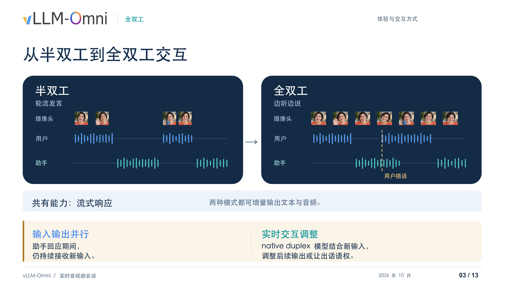
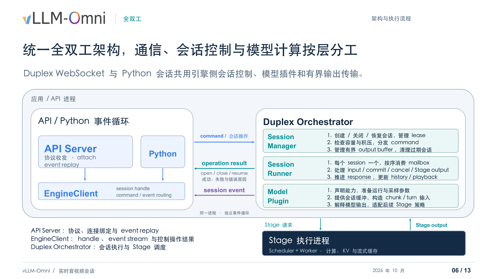
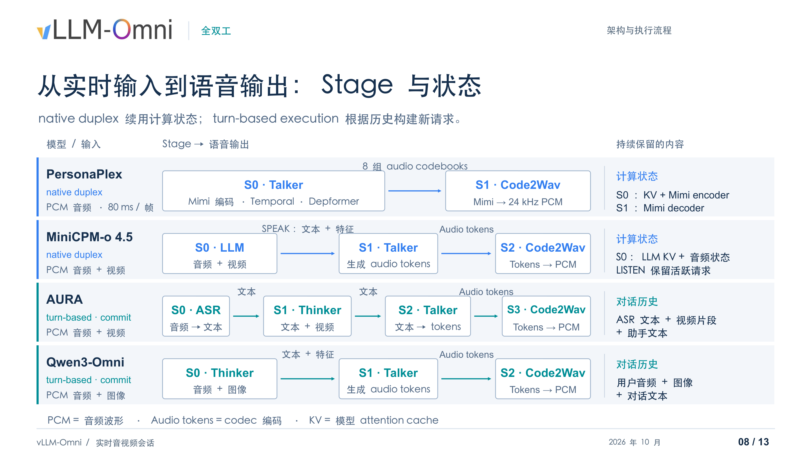
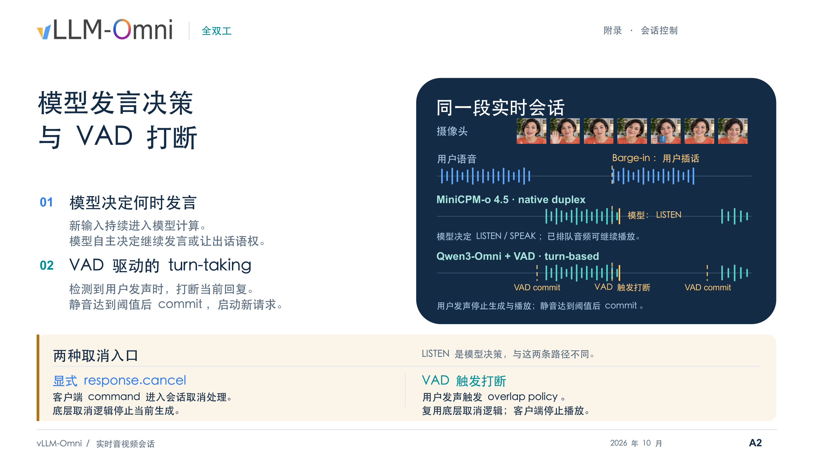
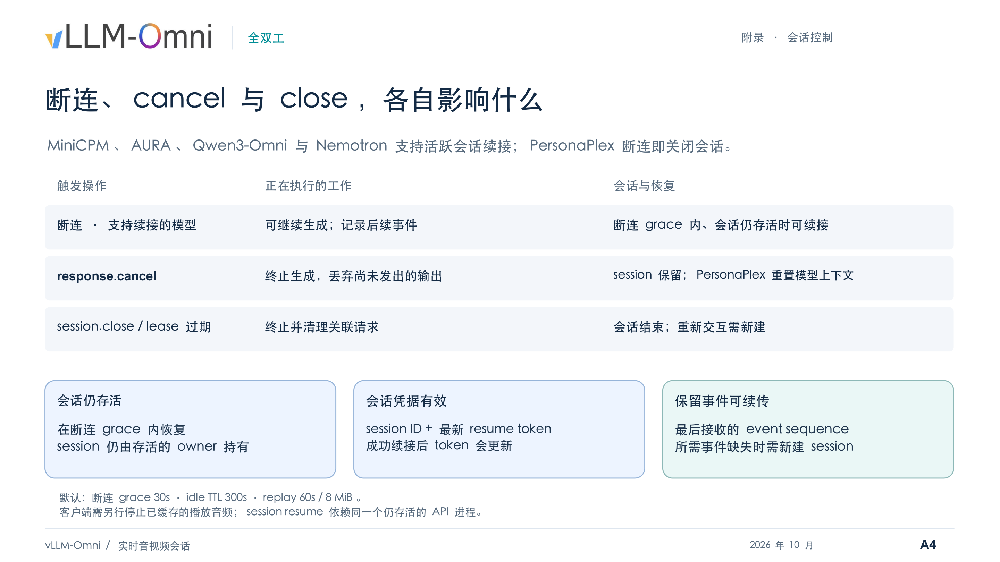
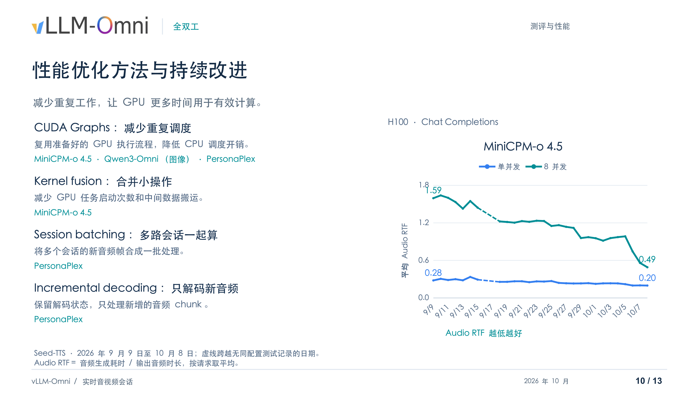
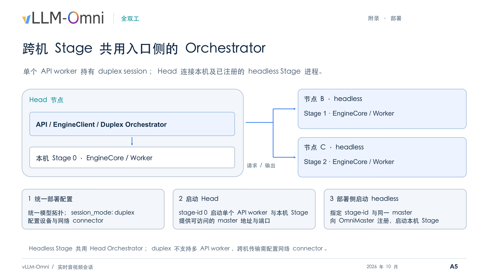
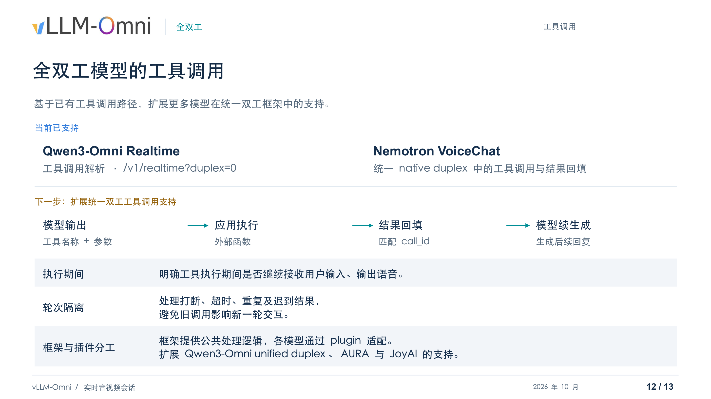

# vLLM-Omni 全双工会话：模型执行、打断控制与性能优化

> 当大模型从"你问我答"走向"边听边说"，推理引擎需要同时承载双向音视频流、毫秒级打断响应与跨机分布式调度。vLLM-Omni 是一个支持实时音视频会话的全双工大模型推理框架，截至 2026 年 10 月 7 日已有 60 余位贡献者参与、合入 160 余个相关 PR。本文沿着数据流与因果关系，逐层拆解其架构分层、模型适配、会话控制、性能优化与跨机部署机制。

**原视频**：[vLLM-Omni 如何让模型边听边说](https://www.bilibili.com/video/BV1zRpg6REeh) · **配套资料**：[vLLM-Omni 全双工交互课件](https://drive.google.com/file/d/1Dh7w6MxO5QQ2HKgsNo8djFoKWIuBBrNw/view)

**适读人群** · AI 基础设施工程师 · 大模型推理优化研究员 · 实时音视频应用开发者

**前置知识**

- 了解大模型推理的基本概念，如 KV Cache、Batching
- 熟悉基本的音视频流媒体传输协议，如 WebSocket、PCM 音频流
- 对并发编程和分布式系统架构有初步认知

**阅读目标**

1. 理解半双工与全双工交互在系统层面的核心差异
2. 掌握 vLLM-Omni 统一全双工架构的分层设计与事件循环机制
3. 理清不同模型（原生全双工 vs 回合制）的执行流与状态保留策略
4. 洞悉全双工场景下的会话控制、打断机制及异常恢复逻辑
5. 获取针对高频实时交互的性能优化方法及跨机部署方案

---

## 一、从轮流发言到边听边说

### 交互需求：输出期间如何处理新输入

直播用半双工与全双工的对比，引出了实时语音系统的核心问题：助手正在回应时，系统如何继续接收用户输入，以及这些输入能否改变后续输出。这里需要区分交互方式、传输通道和模型执行三个层面。

轮次式系统可以持续录音，也可以通过 VAD（Voice Activity Detection，语音活动检测）检测插话、取消当前回答并发起新的请求。因此，能打断或使用双向 WebSocket，并不自动意味着模型具有原生全双工能力。原生双工关注的是：模型在持续执行过程中接收新输入，并据此调整接下来的行为。

### 时间轴上的差异

下图展示直播中的概念性时序对比，用于观察用户与助手发声的重叠关系，不是对所有半双工产品实现的限制。

*图注：半双工（左）与全双工（右）的交互示意；右图展示助手输出期间用户插话。来源：演讲 PPT 第 4 页。*

| 图中元素 | 左侧轮流发言示意 | 右侧边听边说示意 |
|---|---|---|
| 用户与助手的波形 | 按话轮交替 | 存在重叠区间 |
| 用户插话 | 图中未展开处理路径 | 在助手输出期间出现 |
| 摄像头输入 | 是否持续采集取决于实现 | 可与音频输入一起持续接收 |

两种方式都可以流式输出文本与音频。流式输出减少了等待完整回答的时间，但仅凭“输出是增量的”，无法判断新输入如何进入推理过程。

### 并行输入输出带来的系统要求

vLLM-Omni 将实时交互组织为持续存在的会话，而不只是一次请求和一次回答。这带来三个直接要求：

1. **输入输出相互协调**：输出音频时仍需接收输入和控制事件，避免网络收发长期阻塞计算调度。
2. **执行方式由模型适配**：原生双工模型能够持续推进自身状态；轮次式模型则可能由外部检测决定何时构建、取消或重新提交请求。
3. **客户端需要处理播放反馈**：若扬声器与麦克风同时工作，回声可能混入输入。这个问题取决于音频采集与播放方式，也可能出现在支持插话的轮次式系统中，不能只凭模型类别判断。

### 插话例子：两种可行路径

假设用户问北京天气，助手回答过程中，用户改问“上海呢？”。这个例子只说明控制路径，不承诺任何具体模型必然给出某种回答。

- **轮次式执行配合 Server VAD**：检测到用户发声后，系统可取消当前响应，收集新的话轮，再构建新请求。是否打断、何时提交，由框架和客户端策略决定。
- **原生双工执行**：模型在会话持续推进时接收新音频，并按照自身训练与运行时设计，决定继续说话、调整输出或让出话语权。

差别在于新输入如何参与执行，而不是简单比较“能否录音”或“能否停止播放”。后续章节会进一步区分模型自主决策、Server VAD 和客户端的取消事件。

### 能力边界与后续架构

原生双工能力需要模型训练方式、输入输出表示与运行时共同支持，并不等同于使用某一种“注意力方向”。同一个实时接口可以承载原生双工和轮次式执行：本次分享中的 Qwen3-Omni 路径就使用 Server VAD 驱动话轮。

会话中还需要处理音频块、文本事件、取消、断连和恢复。将协议收发、会话控制与 Stage 计算分开，可以让各层明确自己的状态与责任，这也是下一节统一架构的出发点。

---

## 二、架构解耦：通信、控制与计算的分层设计

### 工程矛盾：I/O 与计算的互斥困境

实时音视频会话对系统提出一对天然矛盾的需求。一方面，WebSocket 连接需要在毫秒级完成心跳、音频帧收发和事件回放，一旦阻塞就会导致连接超时或丢帧；另一方面，大模型推理是 GPU 密集型任务，单次前向传播可能耗时数十甚至数百毫秒。若二者运行在同一线程或同一事件循环（Event Loop，单线程内按优先级轮询并执行回调的调度机制）中，网络抖动会饿死推理调度，推理高负载也会卡死协议层。

vLLM-Omni 的解法是：**将通信、会话控制与模型计算在物理和逻辑上彻底分层**，各组件在独立的事件循环中运行，通过异步请求而非同步调用进行交互。

### 统一全双工架构全景

下图是理解整个框架运行机制的基础，它展示了 vLLM-Omni 的分层结构——左侧为应用/API 进程，右侧为 Stage 执行进程，二者以异步的 Stage 请求与 Stage 输出通信。

*图注：统一全双工架构——通信、会话控制与模型计算按层分工。来源：演讲 PPT 第 7 页。*

图中三条关键信息：

1. **左侧方框内的三个组件**（API Server、EngineClient、Duplex Orchestrator）位于同一进程，但各自拥有独立事件循环——图底部文字明确标注了"同一进程 · 独立事件循环"。
2. **组件之间的箭头**（command / 会话操作、operation result、session event）代表进程内异步消息流，而非同步函数调用。
3. **左右之间的双向箭头**（Stage 请求 → Stage 执行进程，Stage output ← Stage 执行进程）标志着计算负载被物理隔离到独立进程，其中包含 Scheduler + Worker 负责实际的 GPU 计算、KV 缓存与流式输出。

### 四层职责拆解

| 层级 | 组件 | 核心职责 | 阻塞敏感度 |
|------|------|----------|------------|
| 协议层 | **API Server** | WebSocket 握手与帧解析、连接绑定、event replay | 极高——必须毫秒级响应 |
| 控制层 | **EngineClient** | session handle 管理、command/event 路由 | 高——转发延迟直接影响会话连续性 |
| 调度层 | **Duplex Orchestrator** | 会话生命周期、Stage 调度、模型适配 | 中——可容忍短暂排队，但不能被 I/O 饿死 |
| 计算层 | **Stage 执行进程** | GPU 推理、KV 缓存管理、流式输出 | 低——按批次调度，与上层异步解耦 |

**API Server** 是系统面向外部的唯一入口，负责 Duplex WebSocket 的帧收发。由于运行在自己的事件循环中，即使 GPU 端正在执行耗时推理，心跳和帧接收也不会中断。

**EngineClient** 持有每个连接的 session handle（会话句柄），将 API Server 的原始事件翻译为结构化 command 路由给 Orchestrator，并将操作结果回送。

**Duplex Orchestrator** 是信息密度最高的组件，包含三个子模块：**Session Manager** 负责创建、关闭、恢复会话并管理租约，检查容量后分发 command，管理有界 output buffer 并清理过期会话；**Session Runner** 每个 session 对应一个实例，按序消费 mailbox 消息，处理 input / commit / cancel 及 Stage output，推进 response 并更新 history；**Model Plugin** 声明模型能力，构造 chunk / turn 粒度的输入，解释模型输出并适配 Stage 策略。三者的协作链为：Manager 决定"是否接受"→ Runner 决定"如何执行"→ Plugin 决定"怎样适配模型"。

### 因果机制：分层如何消除互斥

核心因果可归纳为两条链路：

**链路 A（网络抖动 → 不影响推理）**：客户端网络波动导致 WebSocket 帧延迟到达时，API Server 在自己的事件循环中处理重传与 replay，已提交的 Stage 请求继续在 Stage 执行进程中正常推理。

**链路 B（推理高负载 → 不影响连接）**：GPU 批次饱满、推理延迟上升时，Stage 执行进程的排队仅影响 Orchestrator 的 output buffer 填充速率，API Server 仍能按时回复心跳、接收新帧，连接不会因超时而断开。

### 最小例子：单用户单轮语音输入

1. 客户端通过 WebSocket 发送一段音频帧 → **API Server** 解帧并生成 `audio_input` 事件。
2. **EngineClient** 包装为 command，路由至 Orchestrator。
3. **Duplex Orchestrator** 的 Session Runner 消费 mailbox，Model Plugin 构造模型输入，生成 **Stage 请求**发往 Stage 执行进程。
4. Stage 执行进程完成推理，返回 **Stage output**；Runner 更新 history，Manager 将结果写入 output buffer。
5. EngineClient 将 session event 回送 API Server，API Server 通过 WebSocket 下发音频响应。

步骤 4 的 GPU 计算与步骤 5 的网络发送可以并行——因为它们分属不同事件循环甚至不同进程。

### 边界与小结

进程间通信（IPC，Inter-Process Communication）开销在会话数极大或音频帧率极高时可能成为瓶颈，但演讲材料未给出 IPC 延迟的具体测量数据。三个独立事件循环共享同一进程 CPU 时间片，如果某个循环长期占用 CPU，仍可能间接影响其他循环的响应及时性。有界 output buffer 的容量取舍同样需要根据实际并发量调节。

这套"各层自治、异步协作"的架构为上层支持多种模型提供了统一的非阻塞运行基座。但不同模型——如原生全双工的 PersonaPlex 与回合制的 Qwen3-Omni——在推理时的状态管理和 Stage 编排截然不同，需要在同一架构下走出不同的执行路径。

---

## 三、模型执行流：原生全双工与回合制的差异

### 工程矛盾：状态留还是状态弃？

实时语音会话需要处理一个根本性矛盾——**模型在两次交互之间，应当保留还是丢弃其内部计算状态？** 保留状态意味着后续推理可直接续写，但显存被持续占用；丢弃状态则在每次交互时依赖对话历史重建上下文，显存可按需释放，代价是首包延迟增大。这一选择由模型架构本身决定，而非部署参数的调优问题。

### Stage 划分与状态保留全景

下图对比四种代表性模型的执行模式，是理解框架如何兼容异构模型的关键。横轴区分**原生全双工（native duplex）**与**回合制（turn-based execution）**，纵向展示各自的 Stage 链路及过程中持续保留的内容。

*图注：从实时输入到语音输出的 Stage 与状态保留机制对比。来源：演讲 PPT 第 9 页。*

图中关键元素：

- **左侧两列（PersonaPlex、MiniCPM-o 4.5）** 标记为 native duplex。箭头从输入直接流向各 Stage，无"构建新请求"环节；"持续保留的内容"一栏为**计算状态**——包括 KV Cache（Key-Value Cache，Transformer 推理时保存的历史键值对，又称注意力缓存）、音频编解码器状态等。
- **右侧两列（AURA、Qwen3-Omni）** 标记为 turn-based · commit。"持续保留的内容"为**对话历史**——ASR 文本、视频片段、用户音频、图像及对话文本。
- 各模型 Stage 数量从 2 到 4 不等，反映推理管线复杂度差异。

### 原生全双工：续用计算状态

原生全双工模型在整个会话生命周期内，推理请求持续存活，新输入以追加方式送入。

| 模型 | 输入格式 | Stage 划分 | 保留的计算状态 |
|------|----------|-----------|---------------|
| PersonaPlex | PCM 音频，80 ms/帧 | S0：KV + Mimi encoder → S1：Mimi decoder | KV Cache + Mimi 编码器内部状态 |
| MiniCPM-o 4.5 | PCM 音频 + 视频 | S0：LLM KV + 音频状态 → S1：Talker → S2：Code2Wav | LLM KV Cache + 音频状态 |

**因果机制：** 音频帧（如 PersonaPlex 的 80 ms/帧 PCM）被逐帧追加到已有 KV 序列尾部，模型仅对新增帧做增量前向计算。MiniCPM-o 4.5 还由模型自主决定进入 LISTEN（监听）或 SPEAK（输出）状态——切换时活跃请求不销毁，KV Cache 和音频编码状态原地保留。

**对显存与延迟的影响：** KV Cache 随会话时长线性增长，长对话场景下显存持续累积。但正因状态不断存续，新输入到达后无需重填历史 token，首包延迟仅取决于增量计算量。

### 回合制：依赖历史构建新请求

回合制模型在每次用户话语结束后（由 Server VAD 等机制判定），将对话历史组装为全新推理请求提交给引擎。

| 模型 | 输入格式 | Stage 划分 | 保留的对话历史 |
|------|----------|-----------|---------------|
| AURA | PCM 音频 + 视频 | S0：ASR → S1：Thinker → S2：Talker → S3：Code2Wav | ASR 文本 + 视频片段 + 助手文本 |
| Qwen3-Omni | PCM 音频 + 图像 | S0：Thinker → S1：Talker → S2：Code2Wav | 用户音频 + 图像 + 对话文本 |

**因果机制：** 以 AURA 为例，Stage 链最长（4 个 Stage）。用户语音先经 S0 ASR 转写为文本，再与历史文本、视频片段拼接后送入 S1 Thinker。每次新请求都需从头构建完整 prompt，引擎为其分配新的 KV Cache 并重新计算所有历史 token 的注意力。

**对显存与延迟的影响：** 旧请求结束后 KV Cache 即可释放，显存峰值由单次请求长度决定，不随会话总时长单调增长。但代价是：历史越长，新请求的 prefill（预填充）阶段计算量越大，首包延迟随对话轮次递增。

### 最小例子：一轮对话中的状态流转

用户说了一句话后模型回答完毕，用户紧接着说第二句：

- **PersonaPlex（native duplex）：** 第二句音频帧直接追加到 S0 已有的 KV 序列末尾，Mimi encoder 状态延续，增量计算后立即进入 S1 解码输出。无需重建请求。
- **AURA（turn-based）：** 第二句音频经 ASR 得到文本，与第一轮的 ASR 文本、助手回复文本拼接，组成全新 prompt 提交给 S1 Thinker。引擎从零分配 KV Cache，所有历史 token 重新 prefill。

### 边界与小结

原生全双工的续用状态策略在长会话中面临 KV Cache 膨胀问题（演讲材料未给出具体上限策略）。回合制模型虽首包延迟随轮次增长，但在多并发场景下更容易做请求级调度和显存复用。两类模式并非优劣之分，而是工程约束与模型能力的匹配：模型若原生支持流式追加输入，则走 native duplex；否则框架用 VAD + 历史拼接将其适配为 turn-based 执行。

执行路径和状态管理的差异确立后，紧接着的问题是：当用户在模型持续输出时突然插话，业务逻辑层如何决定继续生成还是立即停止？

---

## 四、会话控制与打断机制：模型决策与 VAD 驱动

### 问题：打断判定的两难

全双工会话中，系统正在输出语音的同时，用户随时可能开口。一边要持续推理并播放回复，一边要实时感知用户意图并决定是否停下来——停得太迟，用户感到系统"不听话"；停得太早或误判，回复被频繁截断。vLLM-Omni 为此提供了两条截然不同的控制路径。

### 两条路径与插话处理

下图呈现了两种路径对"用户插话（Barge-in）"的不同响应流程，是理解打断机制的核心参照。

*图注：会话控制示意。左侧列出模型发言决策和 VAD 驱动 turn-taking 两种机制及取消入口；右侧时序展示 MiniCPM-o 4.5 与 Qwen3-Omni + VAD 在 Barge-in 发生时的差异行为。来源：演讲 PPT 第 16 页。*

图中三组关键元素：

1. **上半部分（原生全双工路径）**：用户语音与视频持续输入模型。Barge-in 发生时，MiniCPM-o 4.5（一种原生支持全双工交互的模型，由模型自主决定 LISTEN 或 SPEAK）自行切换到 LISTEN 状态，已排队的音频片段仍可继续播放——模型并非被外部强制打断，而是自主让出话语权。
2. **下半部分（VAD 驱动路径）**：Qwen3-Omni（一种配合 Server VAD 使用 turn-based 模式的模型）在 VAD 检测到用户发声后立即触发打断，停止当前生成与播放；静音持续达到阈值时执行 commit，将已收集的音频提交并启动新一轮请求。
3. **左侧取消入口区**：图中将 LISTEN 标注为模型决策行为，与两条显式取消路径区分开来。

### 因果机制

**路径一：模型自主决策。** MiniCPM-o 4.5 在推理过程中持续接收语音与视频帧，内部维护发言/倾听状态判断。当它在新输入中感知到用户开始说话，便将输出状态从 SPEAK 切换为 LISTEN。这一决策发生在模型推理内部，不依赖外部 VAD，判断颗粒度可与语义关联。

**路径二：VAD 驱动打断。** Qwen3-Omni 不具备原生双工的发言决策能力，需外挂 Server VAD（如 Silero，一种开源声学 VAD 模型）。VAD 持续监测麦克风输入：检测到语音活动即判定用户插话，触发打断；用户停止说话、静音超过阈值后执行 commit。此机制需显式启用 `interrupt_response` 配置项，否则 VAD 事件仅标记话语边界而不会中止推理。

### 两种取消入口的边界

| 维度 | 显式 `response.cancel` | VAD 触发打断 |
|------|----------------------|-------------|
| 触发方 | 客户端主动发送 command | VAD 模块检测到用户发声 |
| 底层行为 | 进入会话取消处理，停止当前生成 | 复用同一套底层取消逻辑 |
| 客户端侧 | 由客户端自行决定是否停止播放 | 客户端自动停止播放 |
| 典型场景 | 用户点击"停止"按钮 | 用户直接开口说话 |

两者共享底层取消逻辑，但入口语义不同。对 PersonaPlex（一种原生全双工模型）而言，显式 cancel 还会重置对话上下文——副作用更强。

### 不同模型的控制差异总览

| 模型 / Demo | 输入处理 | 回复控制方式 | 打断行为 |
|------------|---------|------------|---------|
| MiniCPM-o 4.5 | 持续接收语音与视频 | 模型自主决定 LISTEN / SPEAK | 模型内部状态切换 |
| Qwen3-Omni + VAD | 持续接收麦克风输入 | 配合 Server VAD | VAD 触发停止播放及服务端取消生成 |
| AURA | 按住说话，松开提交 | 按住时停止本地播放 | 服务端仍可能继续生成 |
| PersonaPlex | 持续接收流式语音 | 模型生成语音或保持静默 | 显式 cancel 重置上下文 |

### 边界与小结

VAD 基于声学特征工作，环境噪声或非语音声响可能造成误触发（演讲材料未给出具体误判率数据）。原生全双工模型切换到 LISTEN 后，已进入播放队列的音频片段仍会播出，用户可能短暂听到"余音"，这与 VAD 路径的立即静音存在体验差异。

两条路径本质上是**智能分布位置**的差异——模型决策将打断判断内化于推理过程，VAD 驱动则将判断外置为独立声学模块。然而，打断属于符合预期的正常会话行为；当遇到移动网络切换等意外断连时，复杂的会话状态该如何保留和恢复，需要另一套机制。

---

## 五、异常处理与状态恢复：断连、取消与关闭的边界

### 问题：全双工会话中"意外退出"不止一种

一次 Wi-Fi 切换、一次用户主动点击"停止"、一次超时关闭，对底层系统的含义截然不同。如果框架对这三类事件一律销毁会话，就会在网络短暂抖动时迫使用户从头开始；如果一律保留，则会在用户已明确退出后仍占用 GPU 资源。vLLM-Omni 对**断连（disconnect）、取消（response.cancel）与关闭（session.close / lease 过期）**三种操作赋予了严格区分的语义。

### 三种操作的语义对照

下图以表格呈现三种操作分别对"正在执行的工作"和"会话恢复可能性"的影响，是理解资源释放阶梯的核心参照。

*图注：三种触发操作对正在执行的工作及会话恢复能力的影响。来源：演讲 PPT 第 18 页。*

将图中信息提取为结构化对比：

| 触发操作 | 对正在执行的工作 | 对会话状态 |
|---|---|---|
| **断连**（支持续接的模型） | 模型可继续生成；后续事件被记录 | 在 grace 期内、会话存活时可续接 |
| **response.cancel** | 终止当前生成，丢弃尚未发出的输出 | session 保留（PersonaPlex 会重置模型上下文） |
| **session.close / lease 过期** | 终止并清理所有关联请求 | 会话结束；重新交互需新建 |

三种操作对应递进的破坏程度：断连最轻——仅连接丢失，会话实体完好；取消居中——打断回答但保留对话历史；关闭最重——释放全部资源。

### 因果机制：断连后模型为何继续生成？

断连发生后，API Server 无法立即判定用户是永久离线还是即将回来。若立刻终止推理，用户重连后将丢失断连期间产生的回答片段或 Tool Calling（工具调用，模型在对话中调用外部函数的能力）结果。因此框架让 Engine session 继续执行，将产出事件写入保留窗口（replay buffer）。用户在 grace 期限内重连后，这些事件通过 event replay（事件续传）补发给客户端，实现无缝衔接。

### 恢复的三项硬性条件

1. **会话仍存活**——session 由存活的 API 进程持有，且处于断连 grace 期内（默认 **30 s**），空闲生存时间（idle TTL）为 **300 s**。
2. **凭据有效**——客户端持有正确的 **session ID** 与**最新 resume token**。成功续接后 token 刷新，旧 token 失效。Python WebSocket SDK 自动管理这两项凭据。
3. **保留事件可续传**——客户端提供最后接收到的 event sequence（事件序号）。replay 窗口默认 **60 s / 8 MiB**，若所需事件已超出窗口则无法续传。

三条件中任一不满足，均回退到新建会话。

### 恢复流程：三个角色的协作

- **User Client 接入**——携带 session ID 与 resume token，发送 `session.resume` 并告知最后接收的 event sequence。
- **API Server 验证与绑定**——校验凭据后将新 WebSocket 连接绑定到原有会话，返回 `session.resumed` 及新 token，从 replay buffer 补齐缺失事件。
- **Engine session 无感延续**——Engine 侧在断连-恢复周期内从未中断，输入输出接回同一上下文。

支持续接的模型包括 MiniCPM-o 4.5、AURA、Qwen3-Omni 与 Nemotron VoiceChat（一种支持全双工及工具调用的模型）。

### 边界情形

**PersonaPlex 不支持活跃会话续接**——断连等价于 session.close，重新交互需新建 session 并重新应用音色与 persona 配置。

**API 进程重启**——session 状态绑定在进程内存中，进程重启意味着所有存活会话丢失，无论 grace 是否到期均需新建。演讲材料未给出进程级容灾方案细节。

### 小结

断连、取消、关闭构成递进式的资源释放阶梯。恢复能力依赖 grace 窗口（30 s）、凭据有效性和 replay buffer（60 s / 8 MiB）三重保障同时成立——在保护用户体验与及时释放 GPU 资源之间做出了可量化的折衷。

复杂的会话控制、状态保留与高频音频流转在实现层面带来的直接后果是：CPU 调度开销和 GPU 碎片化加剧，音频延迟上升。在并发路数增加后，这一矛盾尤为突出。

---

## 六、性能优化：降低音频延迟与提升并发吞吐

### 矛盾本质：高频小任务 vs. GPU 调度代价

全双工会话中，音频以极短 chunk（通常数十至数百毫秒）连续到达，每个 chunk 都需触发一次模型推理。GPU 在极短间隔内被反复启动，每次启动伴随 CPU 端的算子调度、显存分配与内核提交。当并发从 1 扩到 8，这些非计算开销急剧放大，推理延迟很可能超过音频本身时长。

衡量这一矛盾的核心指标是 **Audio RTF（Real-Time Factor，实时因子）**：

$$
\text{Audio RTF} = \frac{\text{音频生成耗时}}{\text{输出音频时长}}
$$

RTF < 1 表示生成速度快于播放速度，具备实时能力；RTF > 1 意味着用户会感知到明显卡顿。

### 四项优化手段与因果链

下图展示了优化手段与 Audio RTF 的下降趋势，是判断各优化实际收益的关键依据。

*图注：左侧列出四种优化手段及适用模型，右侧折线图展示 MiniCPM-o 4.5 在 H100 单卡上的 Audio RTF 随时间变化，测试区间 2026 年 9 月 9 日至 10 月 7 日。来源：演讲 PPT 第 11 页。*

折线分为两组：**单并发**（浅色）与 **8 并发**（深色）。8 并发曲线从左端约 1.59 持续下降至右端约 0.49，单并发从 0.28 降至 0.20。以下逐一拆解四项手段的因果机制：

| 优化手段 | 解决的瓶颈 | 因果机制 | 适用模型（据 P11 标注） |
|---|---|---|---|
| **CUDA Graphs** | CPU 反复向 GPU 提交相同拓扑的算子图 | 首次执行时录制完整 GPU 执行流程并缓存，后续推理直接重放，跳过 CPU 端逐算子调度 | MiniCPM-o 4.5、Qwen3-Omni（图像）、PersonaPlex |
| **Kernel Fusion（算子融合）** | 细碎算子间频繁的内核启动与中间显存读写 | 将多个连续小算子合并为单一 GPU 内核，减少启动次数并消除中间数据搬运 | MiniCPM-o 4.5 |
| **Session Batching（会话批处理）** | 多路会话各自独立推理，GPU 利用率低 | 将同一时刻多个会话的新音频帧合成一个批次统一送入模型，共享一次前向计算的固定开销 | PersonaPlex |
| **Incremental Decoding（增量解码）** | 每次 chunk 到达后从头解码全部音频 | 保留先前解码状态，仅对新增 chunk 解码，避免重复计算 | PersonaPlex |

**层级关系：** CUDA Graphs 与 Kernel Fusion 作用于单次推理的调度效率——前者消除 CPU→GPU 提交延迟，后者压缩 GPU 内部内核切换代价。Session Batching 在此基础上解决并发维度的效率——将 N 路会话的 N 次前向合并为 1 次。Incremental Decoding 沿时间维度剔除冗余。四者叠加后，计算资源中真正用于有效推理的比例显著提升。

### 数据锚点

在 **H100 单卡、MiniCPM-o 4.5 模型**条件下：

- **单并发** Audio RTF：0.28 → 0.20（降幅约 29%）
- **8 并发** Audio RTF：**1.59 → 0.49**（降幅约 69%）

8 并发改善尤为显著，原因在于：并发越高，CPU 调度开销和会话间资源争抢越严重，CUDA Graphs 与 Session Batching 的收益空间越大。优化前 RTF = 1.59 意味着系统根本无法实时服务 8 路会话；优化后 RTF = 0.49，测得的生成耗时约为输出音频时长的一半，留出余量应对网络抖动与打断回退。

### 边界与小结

上述数据严格绑定于 H100 单卡、MiniCPM-o 4.5、特定测试日期区间，不同模型适用的优化子集不同。演讲材料未给出 A100 或更低规格 GPU 的对比数据，也未公开各优化手段单独的增量贡献。图中虚线跨越的日期缺少同配置记录，期间可能存在未被观测到的波动。

核心结论明确：**四项优化协同作用，使 8 路并发的 Audio RTF 从不可用的 1.59 降至具备实时能力的 0.49。** 然而，当模型参数规模进一步增大或并发数超出单卡承载极限时，单机优化终将触顶，必须考虑跨机扩展。

---

## 七、跨机部署：分布式 Stage 的协调与路由

### 问题：计算要分散，控制要集中

当单机 GPU 无法容纳完整的多阶段推理流水线时，不同 Stage 必须分散到多台物理节点。但全双工模式要求一个持续存活的 duplex session 来维护对话状态和打断逻辑——分布式扩展不能简单复制多个独立服务，而必须在分散计算的同时保持控制面的集中。

### Head-Headless 拓扑

下图展示了跨机部署的整体拓扑与启动流程，是理解多节点协作方式的关键。

*图注：跨机 Stage 共用入口侧 Orchestrator 的部署架构与启动流程。来源：演讲 PPT 第 19 页。*

图中核心元素：

| 元素 | 所在位置 | 职责 |
|---|---|---|
| **API / EngineClient / Duplex Orchestrator** | Head 节点 | 接收外部请求，持有唯一 duplex session，统一调度所有 Stage |
| **Stage 0 · EngineCore / Worker** | Head 节点本机 | 执行流水线第一阶段的推理 |
| **Stage 1、Stage 2** | 节点 B、C（headless） | 分别承担后续阶段推理，不运行 API 层或 Orchestrator |

Head 指向节点 B、C 的连线代表请求/输出双向通道，依赖预先配置的**网络 connector**（Network Connector，负责跨节点进程间通信的传输组件）。

### 三步启动的因果依赖

启动顺序存在严格因果约束，图中以编号 ①②③ 标注：

1. **统一部署配置**——所有节点共享同一份模型拓扑定义，将 `session_mode` 设为 `duplex`，为每台机器指定设备映射与网络 connector 参数。
2. **启动 Head 节点**——Head 以 `stage-id 0` 启动，拉起单个 API worker 和本机 Stage 0，对外暴露 **master 地址与端口**。若 Head 尚未就绪，远端节点无法获知注册入口。
3. **启动 headless 节点**——节点 B、C 分别指定各自 `stage-id` 及 Head 的 master 地址，向 **OmniMaster**（Head 内负责多节点注册与发现的管理组件）发起注册，成功后在本机启动 EngineCore / Worker。

依赖链概括为：**配置对齐 → Head 提供入口 → headless 注册并挂载**。任一步缺失，后续环节都无法执行。

### 最小例子：从单机到双机

单机场景下所有 Stage 在同一台机器运行，Orchestrator 通过本地 IPC 调度，无需网络 connector。当模型增长到单机显存不足时，最小扩展动作是将一个 Stage 迁移到第二台机器：

- Head 节点保留 Orchestrator + Stage 0；
- 节点 B 以 headless 模式运行 Stage 1。

新增变量是**网络 connector**：本地通信被替换为跨网络传输，中间结果（隐藏状态张量或音频 token）须经序列化、传输、反序列化，跨机延迟直接叠加到端到端响应时间。进一步扩展到三机时，Orchestrator 需同时管理两条远端连接，调度复杂度线性增长，但控制面仍仅有一个。

### 边界与约束

- **duplex 模式不支持多 API worker。** 全双工会话需要唯一 Orchestrator 持有连续状态，当前仅允许 Head 节点运行单个 API worker，可能成为高并发场景的接入瓶颈。
- **跨机传输强依赖网络 connector 稳定性。** Head 与任一 headless 节点间的连接中断将导致对应 Stage 脱离调度视图。演讲材料未给出 connector 的重连策略或容错机制。
- **Head 节点单点风险。** 所有 headless 节点共用 Head 的 Orchestrator，Head 故障将导致整个集群不可用。

### 小结

跨机扩展围绕"单一控制面 + 分布式计算面"展开：Head 集中持有会话与调度逻辑，headless 节点仅承担推理负载。当前主要约束在于 API worker 的单点性和网络 connector 的可靠性——更大规模或更高可用性要求下仍需进一步演进。

---

## 八、演进方向：语义 VAD 与通用工具调用

### 工程矛盾：声学检测与纯对话的天花板

全双工会话要解决两个核心判断：**用户是否说完**和**模型能否与外部世界交互**。当前框架在这两点上各存在一条明确的能力边界——

1. 声学 VAD 只听"有没有声"，不懂"说没说完"——静音达到阈值即 commit，即使用户只是在思考下一个词。
2. 纯对话模型无法操作外部系统——用户说"帮我查一下明天北京的航班"，模型若不具备工具调用能力，只能给出文字层面的模拟回答。

### 从 Acoustic VAD 到 Semantic VAD

**Acoustic VAD**（声学语音活动检测）以 Silero 为代表，核心逻辑是对每帧音频做语音/非语音二分类，配合可配置的静音时长阈值触发 commit。优势在于 CPU 推理开销低，可直接运行在 CPU 线程池中。

但声学方案存在结构性盲区：**无法区分"思考性停顿"与"话轮结束"**。一句典型请求——"帮我订明天的……*（停顿 800 ms）*……去北京的机票"——若静音阈值设为 600 ms，系统会在停顿处提前 commit，将不完整的半句话送入模型。

**Semantic VAD**（语义级话轮检测）引入上下文语义判断，在检测到停顿后进一步评估话语是否完整。开源领域已有组合实践：**Silero VAD 负责第一级**——区分语音与非语音并检测停顿；**Pipecat Smart Turn v3.2 负责第二级**——判断话轮完整或尚未完整。两级串联可显著减少因中途停顿而误触发的情况。

| 对比维度 | Acoustic VAD | Semantic VAD |
|---------|-------------|-------------|
| **判断依据** | 语音活动 + 配置静音时长 | 语义与上下文 |
| **停顿处理** | 静音达阈值即 commit，句子可能未说完 | 判断话语未完整时继续等待 |
| **系统动作** | 静音后自动 commit | 判断用户说完后 commit 并开始回复 |
| **计算开销** | CPU 线程池，开销低 | 轻量模型可跑 CPU；较重模型计划接入 Omni Stage |

> *基于演讲 PPT 第 17 页内容重构。*

演进方向上，较重的 Semantic VAD 模型计划接入 Omni Stage，与推理引擎共享 GPU 调度，在不增加额外硬件的前提下获得语义级判断能力。需注意，VAD 能减少非语音噪声造成的误触发，但音频降噪与打断意图识别属于独立能力，不应与 VAD 混为一谈。

### 全双工框架中的工具调用

下图将工具调用拆解为串行阶段，并标注了已支持模型与扩展计划，是理解异步交互流程的核心依据。

*图注：全双工工具调用流程与扩展计划。来源：演讲 PPT 第 13 页。*

图中四个串行阶段：

1. **模型输出**——模型在生成过程中识别出需要外部能力，输出工具名称与参数。
2. **应用执行**——框架将调用请求分派至外部函数（如航班查询 API）。
3. **结果回填**——外部函数返回结果后，框架按 `call_id` 匹配回填到对应对话上下文。
4. **模型续生成**——模型基于回填结果继续生成后续回复。

当前已支持 Qwen3-Omni Realtime 和 Nemotron VoiceChat 的工具调用。下一步计划扩展至 Qwen3-Omni unified duplex、AURA 与 JoyAI。

工具调用引入了对话之外的异步等待，由此产生三个必须处理的边界情形：

- **执行期间的输入输出**——外部函数可能耗时数秒，此时是否继续接收用户音频、是否输出等待提示音，需框架层面明确策略。
- **轮次隔离**——用户在等待期间发起打断或新话轮时，旧调用的迟到结果不应污染新上下文。超时与重复调用同样需要隔离。
- **框架与插件分工**——公共逻辑（call_id 匹配、超时管理）由框架统一提供，各模型差异化的解析和回填逻辑通过 plugin 适配。

演讲材料未给出工具调用端到端延迟的具体基准数据。

### 小结

声学 VAD 在低算力场景下仍是实用基线，但其"只听不懂"的局限在复杂对话中会引发误 commit。Semantic VAD 通过语义二次判断补齐缺口，较重变体正规划进入 Omni Stage 共享 GPU 资源。工具调用将全双工模型从"只能对话"推向"能做事情"，核心挑战在于异步执行期间的轮次隔离与输入输出策略。两条演进线共同指向同一目标：让全双工会话框架在真实业务环境中可靠运行。

---

## 结论

1. **vLLM-Omni 通过将 API 通信、会话控制（Orchestrator）与 GPU 计算（Stage）分置于独立事件循环和独立进程**，从根本上消除了全双工并行输入输出时高频 I/O 与重负载推理的互相阻塞。

2. **框架灵活兼容原生全双工与回合制两类模型。** 前者（如 PersonaPlex、MiniCPM-o 4.5）续用 KV Cache 等计算状态实现低首包延迟；后者（如 AURA、Qwen3-Omni）通过对话历史重建请求，换取显存按需释放的灵活性。

3. **打断机制提供了两条差异化路径：** 原生全双工模型自主判断发言与倾听的切换，VAD 驱动路径则以外部声学检测触发强制打断——两者共享底层取消逻辑但入口语义不同。

4. **断连、取消、关闭构成递进式的资源释放阶梯。** 断连在 grace 期内（默认 30 s）可通过 session ID + resume token 恢复，replay buffer（60 s / 8 MiB）保障事件续传；取消仅终止当前生成；关闭彻底回收所有资源。

5. **针对性的底层优化——CUDA Graphs、Kernel Fusion、Session Batching、Incremental Decoding——协同将 8 路并发的 Audio RTF 从 1.59 降至 0.49**（H100 单卡、MiniCPM-o 4.5 模型条件下），使该测试配置下的音频生成耗时低于输出音频时长。

6. **跨机部署采用"单一控制面 + 分布式计算面"架构**，Head 节点集中持有会话与调度逻辑，headless 节点按 Stage 承担推理负载，通过 OmniMaster 实现有序注册与发现。

7. **Semantic VAD 与通用工具调用是两条明确的演进方向。** 前者弥补声学 VAD 无法理解语义停顿的缺陷，后者使模型能够与外部系统实时交互，共同拓宽全双工交互的业务边界。

### 已知局限

- 演讲材料未给出 IPC 延迟、KV Cache 增长上限、VAD 误判率、工具调用端到端延迟等具体测量数据，上述讨论中涉及这些维度的判断基于机制分析而非实测。
- 性能数据（Audio RTF 1.59 → 0.49）严格绑定于 H100 单卡、8 并发、MiniCPM-o 4.5、特定测试日期（2026.9.9–10.7），不可直接外推至其他硬件或模型。
- duplex 模式当前不支持多 API worker，Head 节点存在单点风险；跨机 connector 的容错与重连机制未见详述。
- PersonaPlex 断连即关闭会话，不支持续接；API 进程重启后所有存活会话丢失——进程级容灾方案尚未公开。
